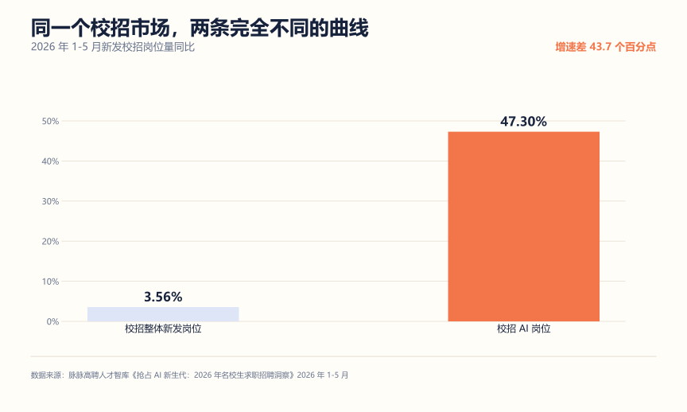
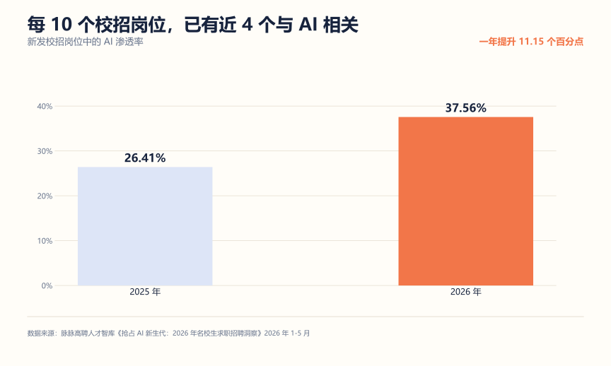
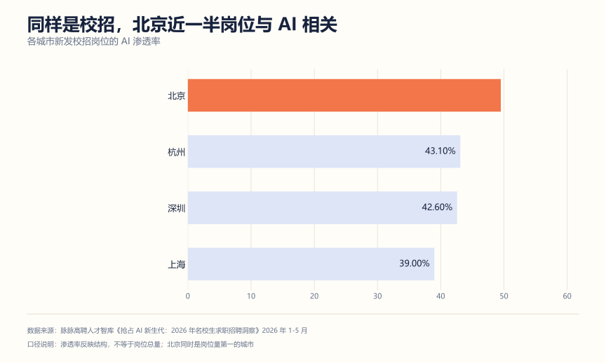
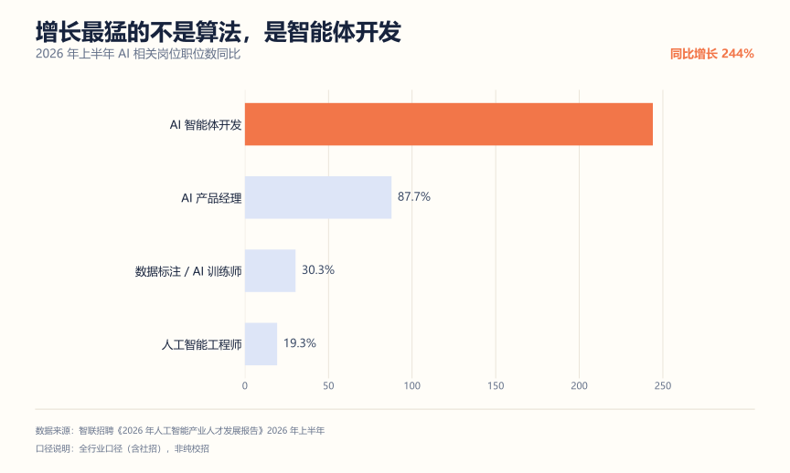
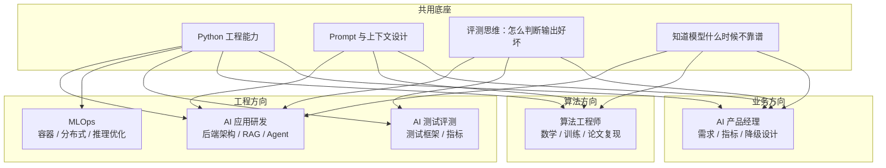
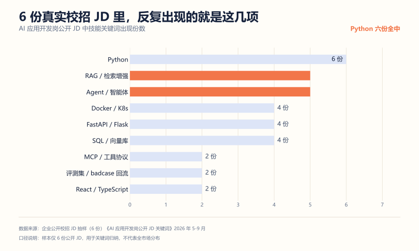
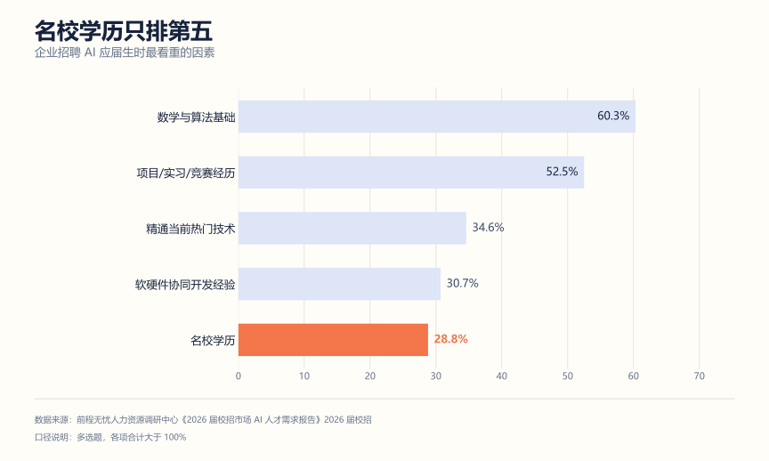
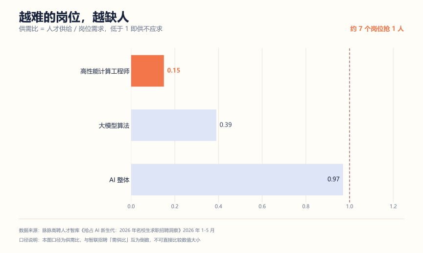

# AI 岗位全景与转型路径：从迷茫到清晰

2026 届校招，每 10 个新发校招岗位里差不多有 4 个跟 AI 有关。

但"AI 岗位"这四个字被用得太宽了。大模型算法工程师月薪中位数两万四，AI 数据训练师八千五，差快三倍，干的活也不是一回事。

所以不用急着问"要不要转 AI"。先问"转到哪个 AI"。

下面按这个顺序讲：市场大概什么样、有哪几类岗、你适合哪一类、从哪开始动手。

---

## 一、市场大概是什么情况

先看一张对比图。



> 校招整体 +3.56%，AI 岗位 +47.30%。来源：脉脉高聘《抢占 AI 新生代》，2026 年 1-5 月。

校招的总盘子基本没动，增量几乎全在 AI 这边。

也就是说，如果你还照 2023 年的岗位表准备，你是在一个不增长的池子里跟人抢。

再看渗透率。



> 2025 年 26.41%，2026 年 37.56%。来源同上。

这个数字的意思是：AI 已经不只是"一个岗位方向"了，它变成了技术岗的通用背景。后端、前端、测试的 JD 里开始出现"熟悉大模型应用""有 RAG 经验优先"。

所以真实的处境不是"要不要转"，而是"要不要给自己加一层 AI"。

第三个是城市。



> 北京 49.50%、杭州 43.10%、深圳 42.60%、上海 39.00%。来源同上。

北京接近一半的岗位跟 AI 相关，这个不意外。意外的是杭州比深圳高。

原因不难猜：杭州有大模型公司和电商 AI 的落地场景，岗位密度高；深圳盘子更大，也更分散。

这里提醒一句，别把渗透率当成机会总量。北京渗透率最高，岗位总数也最大；某个城市渗透率低，如果它盘子很大，绝对数可能更多。看渗透率是看结构，看岗位数才是看饭碗。

---

## 二、六类岗位，分别要什么

各家公司叫法不一样，看职责和技能要求才准。下面这张表，我把"能不能投"和"投了会不会被问穿"分开写了。

| 岗位 | 干什么 | 入门得有什么（没有就先别投） | 面试常问 |
| --- | --- | --- | --- |
| AI 应用研发 | 把模型接进业务系统：RAG、Agent、工具调用、评测 | 一条跑通的完整链路，加一份失败复盘 | 你的召回率多少，怎么测的 |
| 算法工程师 | 选型、微调、训练优化 | 训练过的模型，能复现的实验记录 | 这个 loss 为什么不收敛 |
| AI 产品经理 | 定功能边界、设计评测标准、管模型预期 | 一份 AI 产品需求和评测方案 | 模型做不到的部分怎么降级 |
| AI 测试/评测 | 建评测体系、自动回归、发现模型退化 | 一套测试集，一份回归报告 | 你怎么证明模型没变差 |
| MLOps | 推理服务、GPU 调度、训练 Pipeline | 部署过能扛并发的服务 | 单卡 QPS 多少，卡在哪 |
| 数据标注 | 语料处理、标注规范、质量把控 | 标注规范文档，一致性校验办法 | 标注一致性怎么保证 |

表里最右边那列，是我觉得最有用的一列。因为面试被问穿，通常不是因为不会，而是因为项目里没这些数据。

### 哪类岗在涨



> AI 智能体开发 +244%，AI 产品经理 +87.7%，数据标注 +30.3%，人工智能工程师 +19.3%。来源：智联招聘《2026 年人工智能产业人才发展报告》，上半年，含社招。

涨得最猛的不是算法，是智能体开发。这个结果我第一次看到也有点意外。

但有两个地方要打个折。一是 244% 是从很小的基数起跳，绝对数量上人工智能工程师还是主流。二是这是全行业口径，包含社招。校招里这类岗位一般挂在"AI 应用研发"下面，不会单独写"智能体开发工程师"。

落到你身上，实际意义是这样：简历上能写清楚"做过一个多步工具调用的 Agent，处理了失败重试和状态管理"，你就踩在这条线上。

---

## 三、六类岗的共同点和区别

它们不是六个孤岛。底下有一层共用的东西，上面各自往深处走。



底座上这四件事，随便哪类岗都会被问：

- **Python 工程能力**。不是会写脚本，是能拆模块、处理异常、写测试。证据是别人能把你仓库跑起来。
- **Prompt 和上下文设计**。知道为什么这么写，不是抄模板。证据是两版 Prompt 的对比。
- **评测思维**。说清"好"的标准，并且量化。证据是 20 到 50 条问题集加一个准确率。
- **知道模型什么时候不该用**。这条最容易被忽略。

最后一条我多说两句。面试官问"这个需求你会用大模型做吗"，答"会"的人一大把。让人放心的回答是"这里用规则更稳，模型只负责兜底"。

能说出这种话，说明你踩过坑。

至于各自的纵深，简单列一下缺了就拿不到 offer 的东西：

- AI 应用研发：独立做过一个有架构设计的系统，能画出数据流
- 算法：深度学习项目 + 能复现训练 + 数学推导
- AI 产品：完整推过一个需求落地，有指标结果
- AI 测试评测：测试方法论 + 自动化框架 + 统计
- MLOps：Linux/K8s 实操 + 一次真实的性能排查
- 数据标注：标注规范设计 + 一致性度量

---

## 四、三条转型路径

按"已有东西能复用多少"排序。

### 路径 1：后端转 AI 应用研发（复用最多）

后端已有的系统设计、数据库、API、并发，在 AI 应用里全都用得上。缺的只是"模型这一层"。

| 你已经有 | 要补的 |
| --- | --- |
| Java/Go/Python 工程能力 | Prompt 与上下文工程 |
| 数据库、缓存、消息队列 | RAG：切分、召回、重排、引用 |
| API 设计与中间件 | Agent 编排和状态管理 |
| 高并发与稳定性经验 | 评测、Trace、降级 |
| 代码规范 | 幻觉识别和兜底 |

具体要补到什么程度，可以看真实 JD。

我抽了 6 份 2026 年 5 到 9 月发布的 AI 应用开发岗公开校招 JD，数了一下技能关键词出现在几份里：



> Python 6 份都有；RAG、Agent 各 5 份；Docker/K8s、FastAPI/Flask、SQL 各 4 份；MCP、评测集、React 各 2 份。样本 6 份，只用来归纳，不代表全市场。

这张图的好处是排除了想象。

RAG 和 Agent 已经不算加分项了，是基本项。MCP 只有 2 份提到，它还是前沿加分项，不是门槛。

评测能力（评测集、badcase 回流）也只有 2 份明确写。但这条恰恰是面试时最能拉开差距的——写的人少，说明做到的人更少。

还有一点：一份 JD 里同时要 Python、FastAPI、RAG、Agent、Docker、SQL，不是让你全会，是说这是个全栈型岗位，从接口到检索到部署，一个人得能串起来。

**四周能做出什么**

| 周 | 学什么 | 交出什么 |
| --- | --- | --- |
| 1 | 模型 API、结构化输出、函数调用 | 能调 2-3 个工具的命令行 Agent |
| 2 | Embedding、向量库、切分和召回 | 能回答本地文档的 RAG，加 20 条测试问题 |
| 3 | Agent 编排、状态管理、失败恢复 | 多步任务 Agent，工具挂了能重试 |
| 4 | 评测、Trace、降级 | 一份评测报告：准确率、失败分类、badcase |

第 2 周和第 4 周的东西最关键。没有测试问题的 RAG 不算项目，因为你说不清它到底好不好。

### 路径 2：算法方向（门槛在变，也在变贵）

这条路不是变难了，是评价标准变了。

企业招 AI 应届生时，数学与算法基础占 60.3%，项目/实习/竞赛占 52.5%，名校学历占 28.8%，排第五。



> 多选题，合计大于 100%。来源：前程无忧《2026 届校招市场 AI 人才需求报告》。

"名校只排第五"这句话得正着读。它不是说不重要，是说项目够硬的时候，学历能被盖过去。反过来，只有学历没项目，在 AI 岗上是撑不住的。

算法岗内部也不均匀：



> 供需比 = 供给 ÷ 需求，低于 1 就是缺人。来源：脉脉高聘。

高性能计算 0.15，差不多 7 个岗位抢 1 个人；大模型算法 0.39；AI 整体 0.97，基本平了。

结论有点冷：AI 整体已经不缺人了，缺的是深水区。会调库、跑过 demo 的人，在 0.97 那个池子里挤；有 CUDA 优化、分布式训练、推理加速这类硬东西的人，才进 0.15 那个池子。

顺便说个坑：智联用的是"需供比 2.62"（需求除以供给），脉脉用的是"供需比 0.97"（供给除以需求）。两个数互为倒数，说的都是"稍微缺人"。看到不同机构的供需数字，先看方向，再比大小。

### 路径 3：非技术背景转产品 / 标注（入口最宽）

数据标注是唯一明确欢迎跨专业的入口。智联的数据里，投这个岗的人专业来源有土木、工商管理、会计、电子商务、汉语言文学——因为处理高质量中文语料需要语言能力，不是只有写代码才行。

现实情况：

- 起薪低，月薪中位数 8513，但门槛也低。
- 真正的上升通道是"标注规范设计"和"评测体系"，不是标注本身。
- 干一两年可以往 AI 产品、AI 运营、评测工程转。

零基础又想做 AI，这是唯一能在三个月内进去的路。但别把它当终点，它的价值是让你近距离看到真实数据长什么样。

---

## 五、几个容易想错的地方

**一、以为算法最核心，先转算法。**

数据不支持这个判断。大模型算法供需比 0.39 是缺人，缺的是能推、能训、能优化的人。而 AI 应用这条线的岗位增量大得多。

一个简单的判断办法：你能不能没有 GPU，一周内复现一篇论文的核心实验？不能，就先走应用线。

**二、觉得非名校没机会。**

28.8% 的企业把名校列为筛选因素，排第五。前面是数学基础（60.3%）和项目经历（52.5%）。

与其纠结学历，不如把项目做到"能接住 10 个追问"的程度。这在简历筛那一关的权重，比学校名字高。

**三、以为 AI 岗都高薪。**

这个最危险。同一份报告里，大模型算法 24760，AI 数据训练师 8513，差 2.9 倍。把"AI 岗"当整体看平均薪资，会直接选错路。

具体数字和分位在[数据篇](./02-AI岗位数据图谱.md)。

**四、想先学完再投。**

AI 技术栈每季度都在变，没有"学完"这一天。比较靠谱的节奏是边做边投：第一个项目跑通就开始投，用面试反馈告诉你下一步补什么。

---

## 六、90 天怎么安排

把上面这些压成能执行的版本。

**第 1-2 周：定方向**

- [ ] 对着第二节的表，选 1 个主投 + 1 个备选，别选三个
- [ ] 找 5 个目标岗位的真实 JD，把要求抄成一张表
- [ ] 数一下你的经历能覆盖多少关键词，不到 40% 就换方向
- [ ] 把判断依据记下来，两周后回看

**第 3-6 周：造证据**

- [ ] 跑通一条完整链路：数据 → 检索 → 生成 → 评测，别停在 demo
- [ ] 准备 20 条测试问题，算出准确率，写下失败分类
- [ ] 画一张架构图，标清每个模块进出什么
- [ ] 写 README，第一屏说清解决什么问题、效果如何

**第 7-10 周：练表达**

- [ ] 写 3 分钟讲解稿，练到不看稿
- [ ] 自己列 10 个追问并写答案：为什么不用微调、召回率多少、流量涨 10 倍怎么办
- [ ] 找人做一次模拟面试，记下被问住的地方
- [ ] 把被问住的问题补成笔记

**第 11-13 周：投递和迭代**

- [ ] 建投递表：公司、岗位、渠道、状态、反馈
- [ ] 每周看一次漏斗：投了多少、进面多少、卡在哪
- [ ] 卡简历就改关键词，卡一面就补基础，卡二面就补深度

---

## 用 AI 做这件事：把经历和岗位对一遍

选方向最容易出的问题不是信息不够，是自己看自己不准——把"上过课"记成"做过"，把"跑通 demo"记成"有项目"。

AI 在这里的作用是当一面不带情绪的镜子。

**怎么做**

| 步骤 | 你给它什么 | 它给你什么 | 你还要做什么 |
| --- | --- | --- | --- |
| 1 | 课程、项目、实习、竞赛的流水账（先脱敏） | 三列：可验证事实 / 主观感受 / 不确定信息 | 把"不确定"全删了，不许进简历 |
| 2 | 3-5 份目标岗 JD 原文，注明来源和抓取日期 | 每份的硬性要求、加分项、职责边界 | 回去核对原文，它爱把"优先"读成"必须" |
| 3 | 事实清单 + JD 拆解 | 四列：要求 / 我的证据 / 差距 / 30 天能做什么 | 逐条确认"证据"是不是真的存在 |
| 4 | 上面的结论 | 这份分析最可能错在哪 | 带着疑问去问学长或 HR |

**提示词**

```text
你是求职方向分析师，我是一名准备校招的计算机专业学生。

【我的经历流水账】（已脱敏，无真实姓名和公司内部信息）
[粘贴]

【目标岗位 JD】（来源：公司名 + 岗位名，抓取日期：2026-xx-xx）
[粘贴原文，最多 3 份]

请按顺序做三件事：
1. 事实核对：把我的经历拆成三列——可验证事实、主观感受、不确定信息。
   不要替我美化，不要把"了解""接触过"升级成"掌握""精通"。
2. 匹配分析：输出四列表——岗位要求 / 我的现有证据（引用我的原话）/ 差距 / 30 天内能做的补强动作。
   某条要求我完全没证据时，直接写"无证据"，不要用推测填。
3. 反向质询：列出这份分析最可能错在的三个地方，以及我该向谁核实。

约束：
- 不得新增我没提供过的经历、数据或项目结果。
- 涉及薪资、招聘时间、HC 的信息，一律标注"待核实，以官方公告为准"。
- 输出用表格，不要写鼓励性长文。
```

**要自己盯的三件事**

1. 写进"事实"列的，你得能当场说出时间、角色、具体做了什么。说不出的，退回"不确定"。
2. JD 要求回原文核对。它很容易把"有 RAG 经验者优先"读成"必须具备 RAG 经验"，这会让你误判自己不够格，或者误判某个方向门槛很高。
3. 结论自己下。它能告诉你差距在哪，不能替你判断这个差距值不值得补。

**哪些东西别发出去**

- 流水账里去掉公司内部系统名、未公开的业务数据、同事和面试官姓名。
- JD 可以直接贴，那是公开的。但内部推荐邮件、HR 私聊截图别贴。
- 实习的业务指标涉及真实经营数据的，改成量级，比如写"百万级订单"而不是具体数字。

---

## 延伸阅读

- [用 AI 求职全流程](../用AI求职全流程.md)——七环节主线，本文对应环节 1
- [AI 岗位数据图谱](./02-AI岗位数据图谱.md)——本文引用的数据，分位和口径都在这里
- [AI 应用研发求职专题](../AI应用研发/README.md)——十个专题的技术纵深
- [AI 应用研发作品集项目清单](../项目实战/AI应用研发作品集项目清单.md)——做什么项目
- [岗位路线图：AI 应用研发](../岗位路线图/AI应用研发路线图.md)——十二周能力地图

---

*本文所有数字来自 [docs/_data/ai-job-market.json](../_data/ai-job-market.json)，里面记了发布机构、报告名、统计区间和口径。不同机构的统计方式不一样（校招和全行业、供需比和需供比），比数字之前先看条件。市场每个季度都在变，做决定前最好对一下最新报告。*
