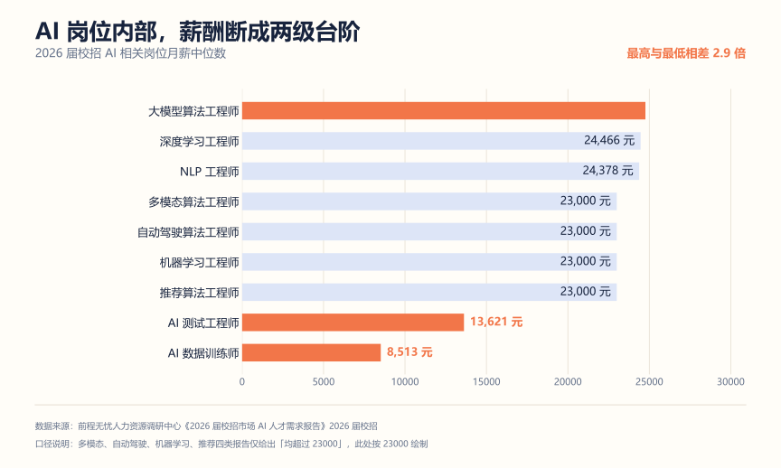
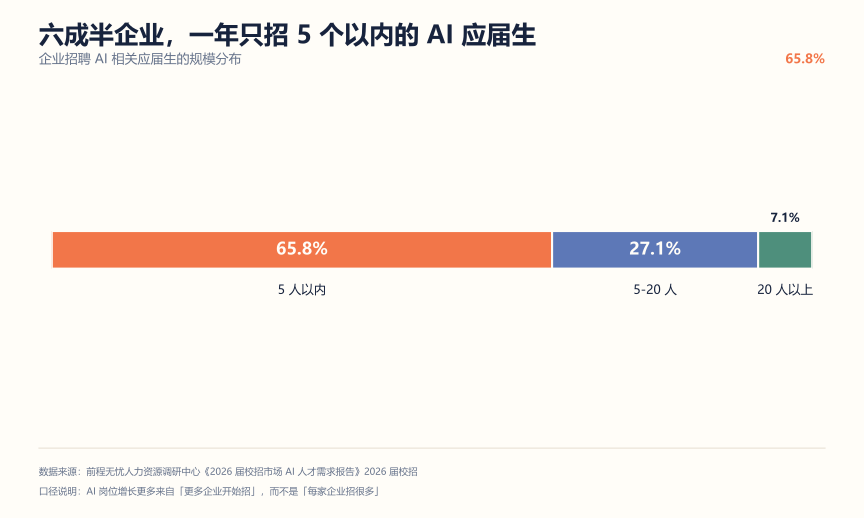
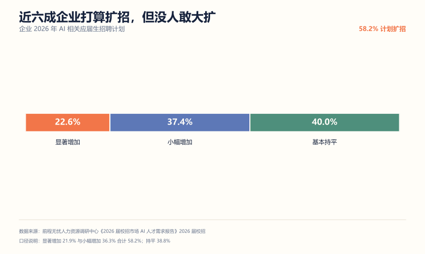
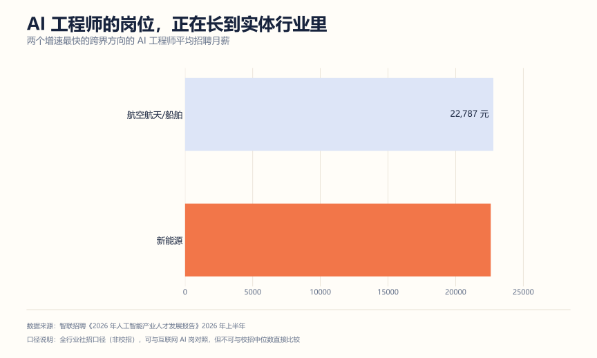
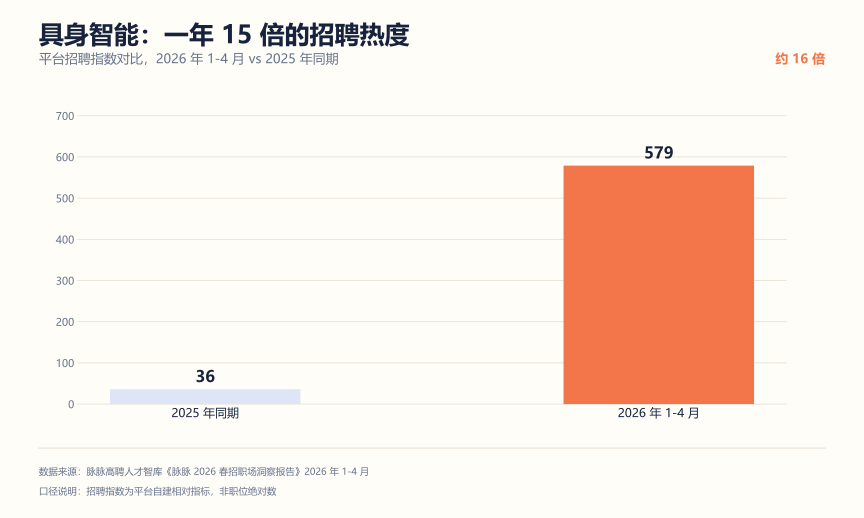

# AI 岗位数据图谱：薪资、供需与真实门槛

招聘报告是很容易被读歪的一类材料。

同一个市场，智联算出"需供比 2.62，缺人"，脉脉算出"供需比 0.97，基本平衡"。两个都对，因为分母放反了。

这篇把能找到的公开数据摊开，一张一张说：数字是多少、怎么算的、对你有什么用。

---

## 一、薪资不是一个档次，是三个

很多人对 AI 岗薪资的印象停在一个模糊的高位。真实的分布是这样。



> 来源：前程无忧《2026 届校招市场 AI 人才需求报告》。

竖着切成三段看。

**第一段，两万四上下。** 大模型算法 24760，深度学习 24466，NLP 24378，多模态、自动驾驶、机器学习、推荐都在 23000 以上。共同点是得能训练、能调参、能解释模型行为。这一档以硕博为主，有论文或竞赛，有真跑过训练。

**第二段，一万三上下。** AI 测试工程师 13621。不需要你训模型，但需要你定义什么叫"好"，还能自动反复验证。这个岗位被低估了，它是 AI 系统上线前最后一道闸门。

**第三段，八千五上下。** AI 数据训练师 8513。跨专业入口，门槛最低，也最容易被替代。

### 这张图怎么用

**校准预期。** "AI 岗平均月薪两万"这种说法没意义，因为分布是三段不是一个正态。先确认自己在哪一段，再谈钱。

**找跳板。** 从第三段到第二段，靠的是从"执行标注"变成"设计标注规范、做一致性校验"；从第二段到第一段，靠的是从"评测别人的模型"变成"能自己训和调"。跨段不靠熬年限，靠能力类型换掉。

**识别改名的岗位。** 有岗位写"AI 工程师"，月薪却明显低于一万三，那多半是标注或数据运营改了名。看薪资能反推它的真实定位。

补一句：这是**月薪中位数**，不是总包，不含股票和签字费。大厂总包一般高于中位数，但中位数更能反映"普通人拿到什么"。

---

## 二、企业在怎么招

求职者视角容易失真，换个方向看企业端。

### 六成半企业，一年只招 5 个以内



> 65.8% 的企业招 AI 应届生在 5 人以内，5-20 人的 27.1%，20 人以上 7.1%。来源：前程无忧。

这个分布解释了一个常见困惑：明明说 AI 岗位涨了 47.3%，为什么我投了还是没回音。

因为增长来自"更多企业开始招"，不是"每家企业招很多"。招聘企业数同比涨了 24.8%（智联口径），但单家招得很少。结果就是岗位散在大量中小企业里，每家 HC 都紧，流程还不一定规范。

对你的影响有三条：

- 别只盯大厂。很多中小企业和传统企业的数字化部门在招第一个 AI 岗，竞争小得多。
- 投递量要够。单家 HC 少，押单点成功率就低。
- 面试流程可能不专业。准备好回答"你们想用 AI 解决什么具体问题"，帮对方理清需求，本身就是加分。

### 近六成想扩招，但没人敢大扩



> 显著增加 21.9%，小幅增加 36.3%，基本持平 38.8%。来源：前程无忧。

58.2% 计划扩招，其中 36.3% 是"小幅"。企业的态度是谨慎乐观：认这个方向，但还在试点，不敢一次压重注。

同一份报告里还有个更细的信号：近六成企业对 AI 技术研发岗需求增长，35.6% 对技术支持岗需求上升，而 20.3% 在缩减基础客服这类标准化岗位的应届生编制。

这条值得停一下。AI 在造岗位的同时也在消岗位，消掉的正是可标准化、可重复的那类。你选的方向如果本身就容易被标准化，AI 越强你越危险。

---

## 三、实体行业的机会

大多数人把 AI 求职等同于互联网大厂。增长最快的地方其实在别处。



> 来源：智联招聘，全行业社招口径，不是校招。

| 行业 | AI 工程师职位数同比 | 平均招聘月薪 | 缺口 |
| --- | --- | --- | --- |
| 新能源 | +38.2% | 22594 元 | 增速在各行业领先 |
| 航空航天/船舶 | +23.5% | 22787 元 | 增速和薪酬双高 |
| 汽车研发/制造 | — | — | 需供比 8.2，缺口居首 |

汽车那个 8.2 的意思是：一个求职者平均对应 8.2 个岗位需求。这是全表最缺人的地方，其中智能驾驶系统工程师最旺。

值得考虑的理由：

- 竞争没那么挤。大部分计算机学生没想过"去车企做 AI"，简历池小。
- 钱不输互联网，两万二上下，实体行业的稳定性通常还好一些。
- 技术栈能迁移。感知、规划、控制、数据闭环，这些在具身智能起来以后更值钱。

代价也说清楚：实体行业的 AI 岗节奏慢、迭代周期长，工程规范不如互联网成熟，你可能一个人干完算法加数据加部署。想快速成长的要自己权衡。

---

## 四、具身智能

只看增速的话，2026 年最猛的不是大模型，是具身智能。



> 招聘指数是平台自建的相对指标，不是职位绝对数。来源：脉脉高聘《2026 春招职场洞察报告》。

配套几个数字：

| 指标 | 数值 | 来源 |
| --- | --- | --- |
| 人形机器人新发职位同比 | +215.8% | 猎聘 |
| 机器人领域新发职位同比 | +75.26% | 猎聘 |
| 人形机器人平均年薪 | 40.61 万 | 猎聘 |
| 具身智能人才缺口 | 约 100 万 | 北理工调研（新华网报道） |

### 但这不全是给校招生的机会

具身智能的岗位是哑铃型：一头是极缺的算法和机电集成人才，要求硕博加软硬结合；另一头是产线调试、装配、测试，要求动手能力。中间那层反而薄。

对校招生来说，现实门槛是三条：

- **要真机经验。** 纯仿真跑通不算，企业要看你在真硬件上处理过噪声、延迟、力学约束。
- **要跨学科。** 算法、控制、机械，单一专业很难全覆盖。
- **培养体系还在追。** 教育部 2026 年本科专业目录刚在 9 所高校增设"具身智能"专业（据媒体报道），人社部也把"具身智能机器人应用技术员"列进了第八批新职业。

判断标准很简单：你实验室有机器人平台，或者能摸到真硬件，这条路可以押；只有一台笔记本，先走 AI 应用线，把具身智能当成三年后的方向。

---

## 五、看数据容易踩的五个坑

这部分可能是全篇最实用的。

### 坑 1：供需比和需供比是反的

| 机构 | 指标 | 算法 | 数值 | 怎么读 |
| --- | --- | --- | --- | --- |
| 脉脉高聘 | 供需比 | 供给 ÷ 需求 | 0.97 | 小于 1 是缺人 |
| 智联招聘 | 需供比 | 需求 ÷ 供给 | 2.62 | 大于 1 是缺人 |

两个数说的是同一件事，方向相反。看到"供需比 0.39"，别以为它比"需供比 2.62"更糟，它们不在一个坐标系里。

### 坑 2：校招口径和全行业口径

脉脉的 47.3%、37.56% 是校招口径。智联的 +10.6%、+244% 是全行业口径，含社招。

全行业的增速往往更夸张，因为社招基数大、变化快。拿社招增速去预测校招机会，会系统性高估。

### 坑 3：增速高不等于岗位多

智能体开发 +244% 看着最猛，但它从很小的基数起跳，绝对岗位数远少于"人工智能工程师"。

正确的读法是：增速告诉你哪里在变热，绝对值告诉你哪里有饭吃。先看绝对值定方向，再看增速挑细分。

### 坑 4：平均薪资会被极值拉高

"人形机器人平均年薪 40.61 万"是平均数，不是中位数。这个赛道里少数资深岗会把均值显著拉起来（有报道称资深算法岗月薪 5-8 万）。你要看的是中位数，和你所在层级的区间。

### 坑 5：渗透率不是机会总量

北京 AI 渗透率 49.50% 全国第一，但这不等于"去北京机会最多"——它的岗位总量也最大，两个因素叠起来才是机会。反过来说，某个城市渗透率低，如果盘子极大，绝对机会可能更多。

渗透率看结构，职位数看总量，两个乘起来才是你的目标市场。

---

## 六、怎么用这些数字做决定

数据不是拿来看的。下面三张表，建议直接填。

### 表 1：我该站哪一段

| 问题 | 你的答案 | 判断 |
| --- | --- | --- |
| 能独立训练并调优一个模型吗 | 能 / 不能 | 能，走算法线；不能，往下看 |
| 能设计一套评测标准并自动验证吗 | 能 / 不能 | 能，走评测线；不能，再往下 |
| 能沉住气处理大量语料并保证一致吗 | 能 / 不能 | 能，走数据线 |

三个都"不能"，说明你还没有能投递的能力证据。这时候该去造证据，不是选岗位。

### 表 2：我的目标市场有多大

| 项 | 怎么填 |
| --- | --- |
| 目标城市 | 北上深杭广，或新一线（长沙 +67.6%、武汉 +38.5%、成都 +16.5% 是增速领跑的） |
| 目标行业 | 互联网 / 汽车 / 新能源 / 航空航天 / 金融 / 政企 |
| 目标岗位 | 从六类里选 1 主 1 备 |
| 岗位量级 | 去招聘平台搜，记下 30 天内的岗位数变化 |

### 表 3：我的缺口在哪

| 企业看重什么 | 权重 | 我现在几分（1-5） | 补什么 |
| --- | --- | --- | --- |
| 数学与算法基础 | 60.3% | | |
| 项目/实习/竞赛 | 52.5% | | |
| 精通热门技术 | 34.6% | | |
| 软硬件协同 | 30.7% | | |
| 名校学历 | 28.8% | | |

按"权重 ×（5 - 我的分数）"排序，先补乘积最大的那项。多数人的答案会是"项目经历"——权重高，提升路径也最明确。

---

## 七、数据总表

| 指标 | 数值 | 口径 | 来源 |
| --- | --- | --- | --- |
| 校招整体岗位量同比 | +3.56% | 校招，2026 年 1-5 月 | 脉脉高聘 |
| 校招 AI 岗位量同比 | +47.30% | 同上 | 脉脉高聘 |
| AI 渗透率 | 26.41% → 37.56% | 校招 | 脉脉高聘 |
| 北京 AI 渗透率 | 49.50% | 校招 | 脉脉高聘 |
| AI 整体供需比 | 0.97 | 校招 | 脉脉高聘 |
| 高性能计算供需比 | 0.15 | 校招 | 脉脉高聘 |
| 大模型算法供需比 | 0.39 | 校招 | 脉脉高聘 |
| 人工智能工程师需供比 | 2.62 | 全行业 | 智联招聘 |
| 汽车研发/制造需供比 | 8.2 | 全行业 | 智联招聘 |
| AI 智能体开发职位数同比 | +244% | 全行业 | 智联招聘 |
| AI 产品经理职位数同比 | +87.7% | 全行业 | 智联招聘 |
| 招 AI 应届生 ≤5 人的企业占比 | 65.8% | 校招问卷 | 前程无忧 |
| 计划扩招的企业占比 | 58.2% | 校招问卷 | 前程无忧 |
| 数学与算法基础权重 | 60.3% | 校招问卷，多选 | 前程无忧 |
| 名校学历权重 | 28.8% | 校招问卷，多选 | 前程无忧 |
| 大模型算法月薪中位数 | 24760 元 | 校招 | 前程无忧 |
| AI 数据训练师月薪中位数 | 8513 元 | 校招 | 前程无忧 |
| 人形机器人新发职位同比 | +215.8% | 机器人赛道 | 猎聘 |
| 具身智能人才缺口 | 约 100 万 | 行业调研 | 北理工/新华网 |

---

## 用 AI 做这件事：让它帮你拆报告的口径

上面五个坑，说到底是信息素养问题。AI 在这里是个很好用的第一道筛子：它擅长快速挑出自相矛盾的表述，也很擅长一脸正经地把两个不可比的数字放在一起。

所以关键不是"让它下结论"，是**让它把矛盾摆出来，你来判断**。

**怎么做**

| 步骤 | 你给它什么 | 它给你什么 | 你还要做什么 |
| --- | --- | --- | --- |
| 1 | 3-5 份报告的核心数字：指标、数值、机构、时间 | 一张统一格式的数据卡 | 回原文核对每个数 |
| 2 | 数据卡 | 结论相反的数字对，并说明为什么不可比 | 判断是口径差异还是真矛盾 |
| 3 | 矛盾项的原文段落 | 每项的统计对象、分母、时段 | 确认校招/全行业、供需比/需供比 |
| 4 | 你的城市、行业、岗位 | 可行动的结论 + 待核实清单 | 去招聘平台实际搜一遍验证 |

**提示词**

```text
你是数据核查助手，不是分析师。下面是我从招聘报告里抄的数字，每行格式：
机构 | 报告名 | 统计区间 | 指标名 | 数值 | 原文表述

[粘贴，3-5 份报告里的 10-20 个数字]

请做三件事：
1. 一致性检查：找出指向相反结论的数字对，逐对说明是不是因为口径不同
   （供需比 vs 需供比、校招 vs 全行业、中位数 vs 平均数）。
2. 口径标注：给每个数字补一列——统计对象是谁、分母是什么、含不含社招。
3. 可比性判断：给一个矩阵，标哪些数字之间能直接比，哪些绝对不能。

约束：
- 只用我给的数据，不得自行补充行业常识里的数字。
- 判断不了的地方写"需回原文核对"，不要猜。
- 不要给"所以你该去 XX 行业"这类结论，只做数据层面的核对。
```

**要自己盯的三件事**

1. 每个数字都要能翻回原文。它复述时常把"超过 23000"写成"23000"，把"1-5 月"写成"上半年"。这种误差在校招决策里很要命。
2. 它对"互为倒数"不敏感。可能同时引用 0.39 和 2.62 却不觉得矛盾。这正是要你盯的地方。
3. 结论自己下。它算得出"这个城市渗透率高"，但"你要不要去"取决于家庭、成本、机会偏好，那些不在数据里。

**哪些东西别发出去**

- 报告原文可以整段贴，那是公开材料。付费报告的截图别贴，涉及版权。
- 想让它判断你个人情况时，先想清楚哪些信息是必要的。多数情况只需要"目标城市 + 目标岗位"。
- 招聘平台账号、内推码、HR 联系方式，不贴。

---

## 延伸阅读

- [用 AI 求职全流程](../用AI求职全流程.md)——七环节主线，这篇的核查方法可以套到任何行业
- [AI 岗位全景与转型路径](./01-AI岗位全景与转型路径.md)——六类岗位、三条路径、90 天清单
- [AI 求职行动手册](./03-AI求职行动手册.md)——把数据换成日程
- [求职规划：校招时间线](../求职规划/校招时间线.md)——什么时候做什么
- [简历证据库](../简历/简历证据库.md)——把能力变成可验证的证据

---

*本文数字都登记在 [docs/_data/ai-job-market.json](../_data/ai-job-market.json)，含机构、报告全名、区间和口径。图表由 `tools/build_charts.py` 从那个文件生成，可以复现。招聘市场按季度变，做决定前对一下最新报告；薪资、HC、政策以企业官方信息为准。*
