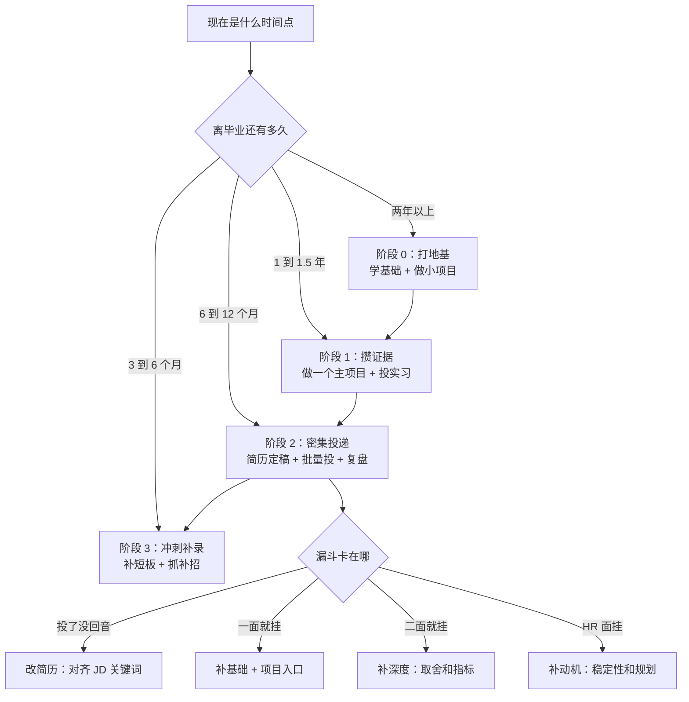
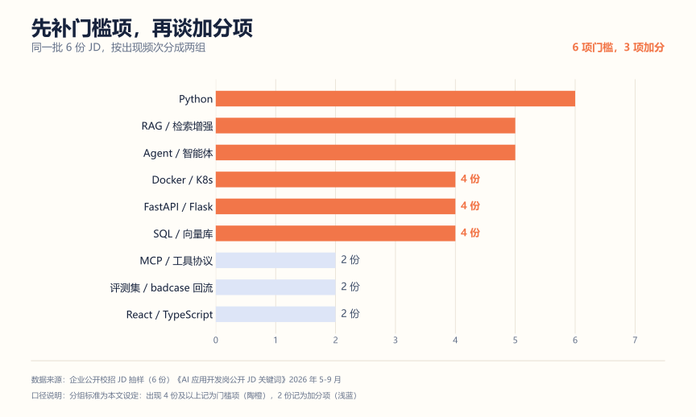

# AI 求职行动手册：从今天到 offer

前两篇讲的是"市场什么样""我该往哪走"。这篇只回答一件事：明天起来先干什么。

按执行顺序排的。不用从头读，找到你现在的位置直接做。

---

## 一、先搞清楚自己在哪



大部分人的问题是**在错误的阶段做正确的事**。离毕业还有两年却在猛背八股，或者只剩三个月还在从零学 RAG。

先对一下位置：

| 问自己 | 答"没有"的话 | 说明你在 |
| --- | --- | --- |
| 有一份能投的简历吗 | 没有 | 阶段 1 之前 |
| 有一个能讲 3 分钟的项目吗 | 没有 | 阶段 1 |
| 投过 20 家以上并记录反馈吗 | 没有 | 阶段 2 之前 |
| 能说清最近三次面试挂在哪一环吗 | 不能 | 阶段 2 里，缺复盘机制 |

---

## 二、阶段 1：造证据（4-6 周）

AI 岗看的是"你做出过什么能验证的东西"，不是你学过什么。这个阶段只有一个目标：**做一个能接住 10 个追问的项目。**

### 项目选题的三条硬标准

| 标准 | 不合格 | 合格 |
| --- | --- | --- |
| 有真实约束 | 调 API 做了个聊天机器人 | 在 8GB 显存下把响应压到 2 秒内 |
| 有量化结果 | 效果不错 | 50 条测试集准确率 82%，主要错在长文档 |
| 有失败复盘 | 没遇到什么问题 | 第一版召回率只有 40%，因为切分粒度太粗 |

第三条最容易被忽略，但它恰恰是面试官判断"这项目是不是你自己做的"的地方。

### 六周怎么排

| 周 | 做什么 | 交出什么 | 怎么算过关 |
| --- | --- | --- | --- |
| 1 | 跑通最小链路 | 能跑的仓库 | 别人 clone 完照 README 能启动 |
| 2 | 换成真实数据 | 100 条以上真实文档或样本 | 数据来自真场景，不是玩具 |
| 3 | 做评测 | 20-50 条测试问题 + 准确率 | 能说清失败样本怎么分类 |
| 4 | 处理失败 | 一份 badcase 分析 | 至少 3 类失败原因和改法 |
| 5 | 优化一处 | 优化前后指标对比 | 说清改了什么、好了多少 |
| 6 | 写表达 | README + 架构图 + 3 分钟稿 | 不看稿能讲完 |

### README 第一屏

```markdown
# 项目名

一句话：解决什么场景下的什么问题

## 效果
- 指标一：xx%（测试集 50 条）
- 指标二：平均响应 1.8s（基线 3.5s）

## 架构
[一张图，标清数据流]

## 关键取舍
- 为什么用 A 不用 B
- 放弃了什么，换来了什么

## 失败与改进
- 第一版问题：xxx
- 怎么定位的：xxx
- 最后的方案：xxx
```

面试官一般只看前 30 秒。"效果"放在"架构"前面，是因为学生项目的架构都差不多，能区分的是你有没有量化。

### 这一阶段的清单

- [ ] 定一个主项目，写在纸上，说清它解决什么问题
- [ ] 跑通最小链路，本地能起
- [ ] 接真实数据，不用示例数据
- [ ] 建 20-50 条测试问题，算出准确率
- [ ] 写 badcase 分析，至少 3 类
- [ ] 做一次优化，记下前后指标
- [ ] 画架构图，标清每个模块进出什么
- [ ] 写 README，第一屏有效果数据
- [ ] 录一个 3 分钟讲解视频，自己看一遍

---

## 三、阶段 2：简历和投递

### 把"技术栈清单"改成"证据链"



> 出现 4 份及以上算门槛项（橙色），2 份算加分项（蓝色）。分组标准是本文自己定的。样本 6 份。

先补门槛项，再点缀加分项。简历里没 RAG 没 Agent，投 AI 应用岗基本过不了；MCP、评测体系、React 只有 2 份提到，属于有了更好——它们适合面试时主动提，不用硬塞进简历。

改写前后对照：

| 原来怎么写 | 改成什么 |
| --- | --- |
| 熟悉 RAG 技术 | 基于混合检索搭文档问答，50 条测试集准确率 82%，主要错在表格类文档 |
| 用 LangChain 开发 Agent | 用状态机管多步工具调用，工具失败重试 2 次后降级到人工，完成率 76% |
| 了解大模型 | 对比 3 个模型在同一批 50 条问题上的准确率和延迟，再选型 |
| 熟悉向量数据库 | 20 万条向量上比 HNSW 和 IVF 的召回率与延迟，最后选 HNSW |
| 参与开发智能客服 | 负责检索模块：切分从固定长度改成语义切分，召回率从 61% 到 79% |

共同点是：**动词 + 具体做法 + 量化结果 + 一个限制条件**。

最后那个限制条件最有用。它证明你真跑过评测，不是编的。

### 简历的 AI 岗版本

```text
姓名 / 学校 / 专业 / 联系方式
─────────────────────────
求职意向：AI 应用研发工程师
─────────────────────────
专业技能（4-5 行，对着 JD 写）
  · 语言：Python（主）、Java、SQL
  · 后端：FastAPI、异步、RESTful API
  · AI：RAG、Agent、Prompt 工程、向量检索
  · 工程：Docker、Git、Linux、基础 K8s
─────────────────────────
项目经历（两个，主项目占六成篇幅）
─────────────────────────
实习 / 竞赛 / 开源（有就写，没有就删，别凑）
─────────────────────────
教育背景（放最后，除非学校是强项）
```

### 投递分三层

别把所有简历投给同一类公司。

| 层级 | 数量 | 目的 | 怎么投 |
| --- | --- | --- | --- |
| 冲刺层 | 10-15 家 | 想去但难 | 早投，用最好的版本，接受挂 |
| 匹配层 | 20-30 家 | 能力对得上 | 主力投入，认真定制 |
| 保底层 | 10-15 家 | 攒面试经验 | 拿来练手，也接受 offer |

保底层不是"看不上但将就"，是**面试训练场**。很多人第一次面试就投最想去的公司，白白浪费了机会。

### 这一阶段的清单

- [ ] 从 5 个目标岗 JD 里提关键词，做成词表
- [ ] 看简历覆盖了多少，低于 60% 就补
- [ ] 用"动词+做法+结果+限制"重写每条项目描述
- [ ] 建三层岗位池，填公司名和投递时间
- [ ] 建投递表：公司、岗位、渠道、投递日、状态、反馈
- [ ] 每周固定一天集中投，别每天零散刷
- [ ] 每次面试后 24 小时内填复盘表

---

## 四、面试：按轮次准备

不同轮次考的东西完全不一样，用一套准备必然失效。

| 轮次 | 真正在考什么 | 怎么准备 |
| --- | --- | --- |
| 一面（基础） | 你是不是真写过代码 | 八股 + 手写 + 项目入口 |
| 二面（项目） | 项目的取舍和边界 | 追问清单自问自答 |
| 三面（设计） | 能不能做工程决策 | 架构题模板 + 指标意识 |
| HR 面 | 稳定性和动机 | 规划叙事 + 反问 |

### 项目追问，这 10 个覆盖八成

建议每题写 150 字，背下来。

1. 为什么用 RAG，不用微调
2. 你的切分策略是什么，为什么这么切
3. 召回率多少，怎么测的，测试集哪来的
4. 检索错了还是生成错了，你怎么分
5. 上下文超长了怎么办
6. 用户问的超出文档范围，系统怎么处理
7. 延迟多少，首字延迟和总耗时分别是多少
8. 成本怎么算，一次问答多少钱
9. 流量涨 10 倍，第一处瓶颈在哪，先改什么
10. 如果重做，你会删掉什么，保留什么

第 10 题是分水岭。答得出来的说明真复盘过；答"没什么要改的"，基本就到此为止了。

### 一个能套的答题结构

> 结论 → 做法 → 数据 → 限制 → 如果重来

举个例子：

> "我们用了混合检索。因为纯向量检索对专有名词不敏感，加了 BM25 做补充，用 RRF 融合排序。50 条测试集上召回率从 61% 到 79%。但表格类文档还是不行，切分把表格结构打散了。如果重来，我会先做表格解析再切。"

一百字，信息密度很高，而且主动暴露了短板。面试官反而更信你。

### 反问别浪费

| 阶段 | 可以问 |
| --- | --- |
| 技术面 | 这个岗位的 AI 应用现在到什么阶段了，探索还是已上线 |
| 技术面 | 团队怎么评估模型效果，有评测集吗 |
| 业务面 | 我入职的话，前三个月最希望我解决什么 |
| HR 面 | 团队成长路径大概是什么样 |

别问工资多少（HR 面会主动说），也别问"加班多吗"。换个说法："团队的项目节奏大概怎样"。

### 这一阶段的清单

- [ ] 10 个追问各写 150 字
- [ ] 用"结论-做法-数据-限制-如果重来"重写答案
- [ ] 准备 2 个系统设计题的答题框架
- [ ] 准备 5 个反问，按轮次分组
- [ ] 找人做一次全真模拟，录音回听

---

## 五、复盘：把面试变成数据

不复盘的面试，只是消耗机会。

### 复盘表（每次填，10 分钟）

```markdown
## 基本信息
公司 / 岗位 / 轮次 / 日期 / 面试官角色

## 被问到的题
1.
2.
3.

## 卡住的地方
| 问题 | 我当时的回答 | 应该怎么答 | 属于哪类短板 |
| --- | --- | --- | --- |
|  |  |  | 基础 / 项目 / 设计 / 表达 |

## 一句话结论
这次最大的问题是：______
下次要改的**一个**动作是：______
```

最后一行只写一个动作。写五个等于没写。

### 漏斗诊断

每两周看一次，一次只调一环。

| 现象 | 可能原因 | 先做什么 |
| --- | --- | --- |
| 投递无回音 | 关键词不匹配 / 岗选错了 | 改简历对齐 JD，换投递层级 |
| 笔试过不了 | 算法或基础薄 | 集中刷两周，别的先停 |
| 一面挂 | 基础不牢或项目讲不清 | 补八股 + 练 3 分钟讲述 |
| 二面挂 | 深度不够，答不出取舍 | 补项目追问，做一次深挖 |
| 三面挂 | 缺系统设计视角 | 练架构题，补指标意识 |
| HR 面挂 | 动机或稳定性存疑 | 重构职业规划叙事 |
| 走完终面没 offer | 就差一点 | 补一个硬指标或一段实习 |

---

## 六、几个常问的

**现在秋招中后期了，还来得及吗？**

看情况。有项目和简历，来得及——补录、春招、日常实习都还有窗口。从零开始的话，调目标：先拿实习，用实习转正，或者准备下一届。

**非科班、双非，AI 岗有戏吗？**

有。企业把名校学历排在筛选因素第五（28.8%），前两位是数学基础（60.3%）和项目经历（52.5%）。非科班的劣势在基础课，优势可能在别的领域的业务理解。补基础加一个带真实业务场景的项目，是最有效的对冲。

**要不要同时准备算法和应用两条线？**

不建议。两条线准备的东西差很多（论文复现 vs 系统工程），一起准备通常两边都不深。先判断你能进哪个池子，再集中投。

**实习和项目哪个更重要？**

有实习先实习，因为实习能给"真实约束"和"团队协作"这两样证据。没实习就用项目补，但项目得过第二节那三条硬标准，否则不如不写。

**被问"为什么不做算法"怎么答？**

别贬低算法，讲匹配："我评估过自己的积累，工程落地和系统设计是我的强项。AI 应用岗要的正好是把模型变成可靠系统，跟我做过的事是对上的。"

---

## 七、总清单

### 每周

- [ ] 周一：看一次目标岗新增 JD，更新关键词表
- [ ] 周三：投 5-8 家，更新投递表
- [ ] 周五：复盘本周面试，填复盘表
- [ ] 周日：补一个短板（只补一个）

### 每月

- [ ] 更新一次简历，哪怕只改一句
- [ ] 回看项目，补新的失败案例
- [ ] 统计漏斗，判断卡在哪一环
- [ ] 找一个行业内的人聊 30 分钟

### 拿到 offer 之后

- [ ] 比薪资结构（base / 奖金 / 股票 / 签字费），别只看总数
- [ ] 确认岗位实际干什么，避免"AI 岗"实为标注岗
- [ ] 看清三方违约金条款
- [ ] 看 [Offer 决策表](../签约/offer决策表.md) 和 [签约避坑指南](../签约/offer三方和劳动合同避坑指南.md)

---

## 用 AI 做这件事：陪练和复盘交给它，判断留给自己

这本手册里有三件事最容易走形式：项目追问练不深、面试复盘写不出、投递漏斗看不出问题。

三件都能让 AI 当陪练。前提是**你先给事实，别让它编。**

**怎么做**

| 场景 | 你给它什么 | 它给你什么 | 你接着做什么 |
| --- | --- | --- | --- |
| 追问陪练 | 项目事实清单（已脱敏） | 20 条分类追问，先不给答案 | 逐条口述回答，让它标出缺证据的地方 |
| 复盘归类 | 本次面试的题 + 你的回答 | 卡点分类：知识缺口 / 表达缺口 / 理解偏差 | 只针对知识缺口回头补 |
| 漏斗诊断 | 投递表数据 | 各环节转化率 + 可能低效的点 | 注意样本量，小样本不下结论 |
| 讲解稿压缩 | 你的 5 分钟讲述稿 | 掐表删减后的 3 分钟版 | 留证据句，删形容词 |

**提示词一：追问陪练**（最值得反复用）

```text
你是压力面试官，我是应届候选人，应聘 AI 应用研发岗。
我的项目事实如下（已脱敏，不含公司内部信息）：
[背景、我的职责、技术选型、量化结果、已知问题]

规则：
1. 先不要给答案，也不要给提示。
2. 生成 20 条追问，分四类各 5 条：架构设计、技术取舍、数据与指标、失败与踩坑。
3. 一次只问一条，等我回答完再问下一条。
4. 我答完 20 条后，输出一张表：问题 / 我的回答里缺证据的点 / 听起来像背诵的点 / 我理解错的问题。

约束：
- 追问按校招二面水平出，不要问需要三年经验才能答的。
- 不要替我编数据。我说"没测过"，你就按"未测过"继续追。
```

**提示词二：复盘归类**

```text
下面是一次面试的题目和我的回答（已脱敏）。请只做归类，不要安慰我。
输出三列：题目 / 卡点类型（知识缺口 / 表达缺口 / 理解偏差）/ 一个具体的补法。
最后指出：如果只能补一项，补哪个最划算，为什么。
```

**要自己盯的四件事**

1. 它出的题不一定是真题。它按教科书逻辑出，真实面试官常从你简历的细节切进去。两边都得练。
2. 它打的分不代表录用概率。评的是表达完整度，不是技术判断力，更不是 HC 匹配。
3. "听起来像背诵"这条最有价值。AI 能认出模板化表达，这恰好是学生面试最常见的失分点。
4. 漏斗诊断要看样本量。投 5 家说"转化率太低"没意义，至少 20 家再看比例。

**哪些东西别发出去**

- 项目事实清单里删掉：公司名（写"某电商平台"就行）、内部系统名、真实业务数据、同事姓名。
- 面经和复盘别原样贴。面试官的提问习惯、公司没公开的流程属于敏感信息，改写成"一类问题"再给 AI。
- 三方协议、offer 邮件、薪资明细别贴，条款的事问 HR 和法务。
- 录音转文字之前，先想清楚有没有得到对方同意。

---

## 延伸阅读

- [用 AI 求职全流程](../用AI求职全流程.md)——七环节主线，本文对应环节 3、5、6
- [AI 岗位全景与转型路径](./01-AI岗位全景与转型路径.md)——选方向
- [AI 岗位数据图谱](./02-AI岗位数据图谱.md)——看市场
- [项目深挖面试准备清单](../面试攻略/项目深挖面试准备清单.md)——追问训练
- [面试复盘方法论](../面试攻略/面试复盘方法论.md)——复盘模板
- [30 天求职训练营](../求职训练营/README.md)——日更版节奏

---

*手册里的策略来自公开数据和招聘实践归纳，不含没验证过的薪资或通过率承诺。市场数据见 [docs/_data/ai-job-market.json](../_data/ai-job-market.json)。结果受学校、城市、行业周期影响，自己判断。*
