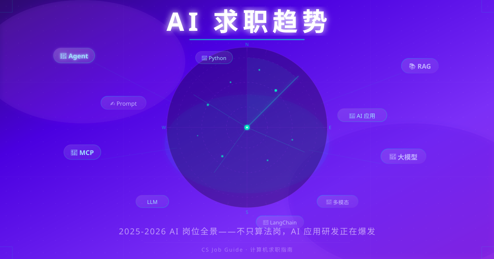
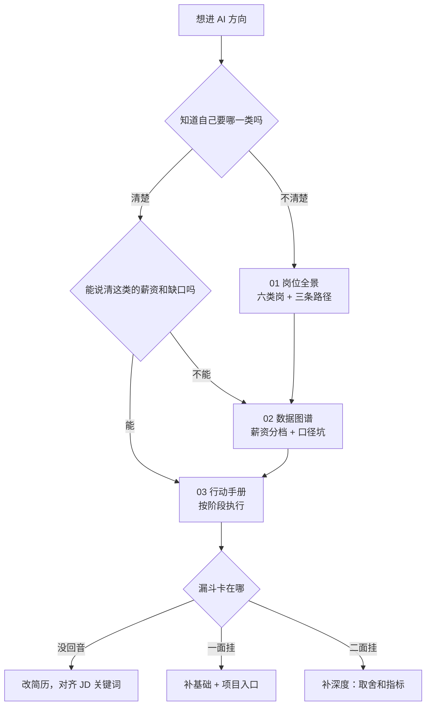

  

# AI 求职趋势与岗位分析

2026 届校招，每 10 个新发校招岗位里差不多有 4 个跟 AI 有关。

但"AI 岗位"内部差得很远：大模型算法月薪中位数两万四，AI 数据训练师八千五。所以先看清是哪一类，再谈转不转。

## 先记住三个数

| 指标 | 数值 | 什么意思 | 来源 |
| --- | --- | --- | --- |
| 校招 AI 岗位量同比 | +47.30% | 校招整体只有 +3.56%，增量几乎全在 AI | 脉脉高聘，2026 年 1-5 月 |
| 校招岗位 AI 渗透率 | 37.56% | 一年从 26.41% 涨上来 | 同上 |
| 大模型算法校招月薪中位数 | 24760 元 | 同一份报告里 AI 数据训练师是 8513 元 | 前程无忧，2026 届 |

其余数字都在 [数据图谱](./02-AI岗位数据图谱.md)，原始登记在 [docs/_data/ai-job-market.json](../_data/ai-job-market.json)。

## 三篇东西

| 序号 | 文章 | 解决什么 | 读完拿到什么 |
| --- | --- | --- | --- |
| 01 | [AI 岗位全景与转型路径](./01-AI岗位全景与转型路径.md) | 选哪条路 | 六类岗位对照表、三条转型路径、90 天清单 |
| 02 | [AI 岗位数据图谱](./02-AI岗位数据图谱.md) | 数字怎么读、值多少钱 | 5 张数据图、五个口径坑、三张决策表 |
| 03 | [AI 求职行动手册](./03-AI求职行动手册.md) | 具体怎么干 | 阶段自测、六周项目表、简历对照、10 个必答追问 |

## 从哪进

## 这个专题的做法

三条，跟一般的求职经验贴不太一样。

**数字都带出处。** 招聘报告最容易被读歪。同一市场，脉脉算出供需比 0.97（基本平衡），智联算出需供比 2.62（缺人）——两个互为倒数。我们没把这种冲突抹平，而是单独写了一节[口径坑](./02-AI岗位数据图谱.md#五看数据容易踩的五个坑)。

**图表是生成的，不是截的。** 所有图由 `tools/build_charts.py` 从 `docs/_data/ai-job-market.json` 渲染。数据更新后重跑脚本就行，图注里的来源、区间、口径跟数据文件严格对应。

**只写能验证的动作。** 不写"提升综合能力"这种话。每个建议都对应一个交付物：能跑的仓库、20 条测试集、一份 badcase 分析、10 个追问的答案。

## 和别的专题的关系

| 想要什么 | 去哪 |
| --- | --- |
| 系统学 AI 应用开发的工程能力 | [AI 应用研发专题](../AI应用研发/README.md) |
| 找一个能做出来的项目 | [AI 应用研发作品集清单](../项目实战/AI应用研发作品集项目清单.md) |
| 先学会用大模型提效 | [大模型使用专题](../大模型使用/README.md) |
| 按岗位看能力地图 | [岗位路线图：AI 应用研发](../岗位路线图/AI应用研发路线图.md) |
| 跟传统后端、银行科技岗比 | [计算机岗位地图](../技能与知识要求.md) |

## 只有 10 分钟

做一件事：打开 [岗位全景](./01-AI岗位全景与转型路径.md) 第二节那张六类岗位表，逐个问自己"这一类的入门证据，我有没有"。

- 有一条：方向基本定了，去 [行动手册](./03-AI求职行动手册.md) 找对应阶段。
- 一条都没有：先去[造证据](./03-AI求职行动手册.md#二阶段-1造证据4-6-周)，别急着投。

---

## 数据与更新

| 项 | 说明 |
| --- | --- |
| 数据文件 | [`docs/_data/ai-job-market.json`](../_data/ai-job-market.json) |
| 绘图脚本 | [`tools/build_charts.py`](../../tools/build_charts.py) |
| 数据时点 | 2026 年 10 月整理，引用报告覆盖 2026 年 1-5 月与上半年 |
| 怎么更新 | 补新报告 → 改 JSON → 重跑脚本 → 检查图注 |

> 市场按季度变，这里的数字用来搭判断框架，不构成薪资承诺。岗位要求、HC、政策的细节，以企业官方招聘信息为准。
