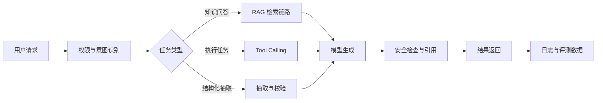

# AI 应用研发作品集项目清单：别只做一个聊天框

AI 应用研发岗位不缺“调用大模型 API”的候选人，缺的是能把模型接入真实业务流程、能评测、能降级、能处理权限和数据边界的人。

## 零、先看 JD 上真正反复出现的词

对 6 份公开的 AI 应用开发岗校招 JD 做了关键词统计（样本含广州、南京、武汉、惠州、合肥，2026 年 5-9 月）：


按出现份数分成两组：

| 分组 | 关键词 | 出现份数 |
| --- | --- | --- |
| 门槛项 | Python、RAG / 检索增强、Agent / 智能体、Docker / K8s、FastAPI / Flask、SQL / 向量库 | 4-6 份 |
| 加分项 | MCP / 工具协议、评测集 / badcase 回流、React / TypeScript | 2 份 |

两个直接结论：

1. **RAG 和 Agent 各出现在 5 份里**，是入场券不是亮点。作品集里没有这两样，简历大概率过不了关键词筛。
2. **评测集和 badcase 回流只出现在 2 份里**——这恰恰是机会。大部分人只做召回和生成，没人做评测闭环。做出这一条，你和"调接口派"就区分开了。

注意样本只有 6 份，用于关键词归纳，不代表全市场分布。但它指出的方向和后面几节的项目分层是一致的。

## 一、作品集项目分层

| 层级 | 项目 | 证明能力 |
| --- | --- | --- |
| 入门 | RAG 知识库问答 | 文档处理、向量检索、引用、低置信度兜底 |
| 进阶 | Agent 工具调用平台 | 工具协议、参数校验、权限确认、任务编排 |
| 工程化 | AI 应用评测平台 | 测试集、自动评测、回归对比、错误归因 |
| 业务型 | 简历/合同/客服审核系统 | 业务规则、结构化抽取、人机协同 |
| 基础设施 | Prompt 与配置管理平台 | 版本管理、灰度、效果对比、审计 |

## 二、推荐项目清单

| 项目 | 核心模块 | 面试亮点 |
| --- | --- | --- |
| RAG 课程资料问答 | 文档解析、切分、Embedding、召回、重排、引用 | 能讲清召回失败、幻觉和评测 |
| 简历智能评估系统 | 简历解析、岗位匹配、证据抽取、修改建议 | 和求职场景结合强 |
| Agent 求职助手 | 工具调用、投递表更新、面试复盘生成 | 能讲工具权限和确认机制 |
| AI 客服质检 | 对话分类、违规检测、评分规则、人工复核 | 能讲业务规则和准确率 |
| Prompt 评测平台 | 测试集、批量运行、指标对比、版本回滚 | 工程化价值高 |
| 合同条款审查 | 条款抽取、风险分类、引用来源、人工确认 | 强调安全和责任边界 |
| 代码 Review 助手 | Diff 解析、规则检查、建议生成、误报反馈 | 适合开发者画像 |

## 三、作品集最低要求

| 能力 | 最低实现 |
| --- | --- |
| 数据输入 | 支持上传文档或接入结构化数据 |
| 检索/工具 | 至少有 RAG 或 Tool Calling |
| 引用来源 | 回答能返回出处或执行记录 |
| 评测 | 至少 30-50 条测试集 |
| 失败兜底 | 低置信度时拒答或转人工 |
| 日志 | 记录输入、检索结果、模型输出、耗时 |
| 权限 | 区分用户可访问数据范围 |

## 四、AI 项目架构模板



## 五、AI 项目简历写法

普通写法：

```text
基于大模型实现智能问答系统。
```

更好的写法：

```text
基于 RAG 构建课程资料问答系统，完成 PDF 解析、文本切分、向量召回、TopK 重排和引用展示，
建立 50 条问答测试集评估可引用率，并对低置信度问题返回“资料中未找到依据”以降低幻觉风险。
```

## 六、面试追问准备

| 问题 | 要点 |
| --- | --- |
| 为什么需要 RAG？ | 私有知识、时效性、可引用、降低幻觉 |
| chunk size 怎么定？ | 文档结构、语义完整性、召回效果、评测对比 |
| 召回不准怎么办？ | Query 改写、重排、多路召回、测试集分析 |
| 怎么评测效果？ | 准确率、可引用率、拒答率、人工标注 |
| 如何处理敏感数据？ | 脱敏、权限过滤、日志保护、最小必要上下文 |
| Agent 调错工具怎么办？ | 参数校验、权限确认、dry-run、审计 |

## 七、五个项目的深度拆解

清单给方向，拆解给细节。下面五篇按「先算账、再设计、再验证」组织，每篇都能直接当面试话术底稿。

| 项目 | 拆解文章 | 重点解决的问题 |
| --- | --- | --- |
| RAG 知识库问答 | [RAG 项目从 0 到 1](./RAG项目从0到1.md) | 延迟与 token 预算怎么分、混合检索、权限条件下推、评测集怎么建 |
| Agent 工具调用平台 | [Agent 工具调用平台拆解](./Agent工具调用平台拆解.md) | 上下文膨胀预算、工具参数校验、权限分级、循环防护 |
| AI 应用评测平台 | [AI 应用评测平台拆解](./AI应用评测平台拆解.md) | 测试集资产化、并发执行、版本回归比对、badcase 回流 |
| 结构化信息抽取 | [结构化信息抽取系统拆解](./结构化信息抽取系统拆解.md) | Schema 约束输出、校验重试、字段级置信度、人工复核阈值 |
| 文档智能解析 | [文档智能解析系统拆解](./文档智能解析系统拆解.md) | 扫描件与电子件分级路由、表格结构、双栏阅读顺序 |

## 用 AI 做这件事

AI 作品集最大的风险是"自认为做完了"。让 AI 当验收者，拿一份陌生视角的清单逐条对照。

| 步骤 | 你做什么 | AI 做什么 |
| --- | --- | --- |
| 1 写材料 | 把项目功能、技术栈、评测结果整理成一页 | 无 |
| 2 盲评 | 把材料贴给它，隐去你的自我评价 | 按"能证明什么工程能力"逐项打分并指出缺失 |
| 3 补短板 | 挑出真会影响面试的缺口 | 给出每个缺口的最小补齐动作 |
| 4 追问演练 | 把补齐后的材料再贴回去 | 只基于材料提问，专挑没证据的部分 |

提示词（可直接复制）：

```text
你是 AI 应用研发方向的面试官。下面是我的作品集项目说明：
<项目功能、技术栈、链路、评测指标、失败案例>
请做三件事：
1. 按「模型接入 / 检索质量 / 工具调用 / 评测闭环 / 失败兜底 / 权限与数据边界 / 可观测」七项，
   逐项给出 强、中、弱 评级，并说明判断依据；
2. 列出这个项目最可能被问穿的 8 个问题，按危险程度排序；
3. 对每个「弱」项，给出一个两周内能完成的最小补齐动作。
不要夸奖，不要给泛化建议。
```

人工校验点：

- 七项评级必须你自己复核。AI 看不到你的代码，"强"可能只是你写得好听。
- "最可能被问穿的问题"里，凡是涉及你没做过的机制，要么补做要么从材料里删掉，不要含糊。
- 项目里的接口密钥、内部 API 地址、真实用户数据不要贴。用占位符。

隐私边界：AI 项目的敏感度高于普通后端项目——你处理的可能就是用户文档。贴给 AI 的内容先脱敏，测试数据自己构造。

## 行动清单

- [ ] 至少完成一个 RAG 项目。
- [ ] 准备 30-50 条测试集。
- [ ] 记录检索结果、模型输出和失败案例。
- [ ] 简历中写清评测指标，不只写“接入大模型”。

延伸阅读（项目拆解）：[Agent 工具调用平台](./Agent工具调用平台拆解.md) · [AI 应用评测平台](./AI应用评测平台拆解.md) · [结构化信息抽取系统](./结构化信息抽取系统拆解.md) · [文档智能解析系统](./文档智能解析系统拆解.md) · [RAG 项目从 0 到 1](./RAG项目从0到1.md)

延伸阅读（岗位与知识）：[AI 岗位数据图谱](../AI求职/02-AI岗位数据图谱.md) · [AI 岗位全景与转型路径](../AI求职/01-AI岗位全景与转型路径.md) · [AI 应用研发工程师求职专题](../AI应用研发/README.md) · [RAG 从检索到评测](../AI应用研发/03-RAG从检索到评测.md)
