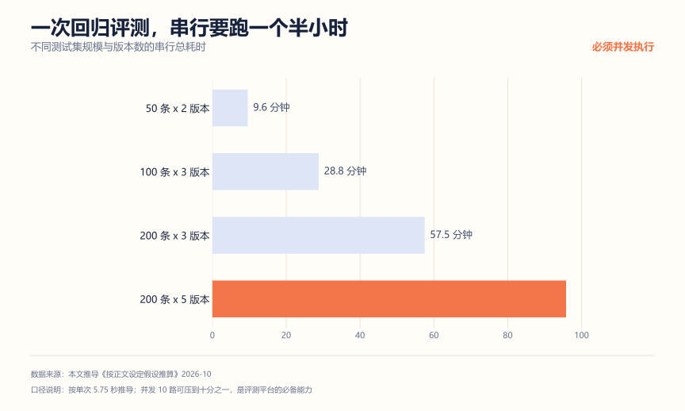
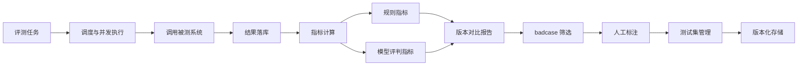
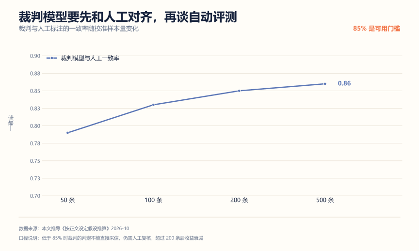
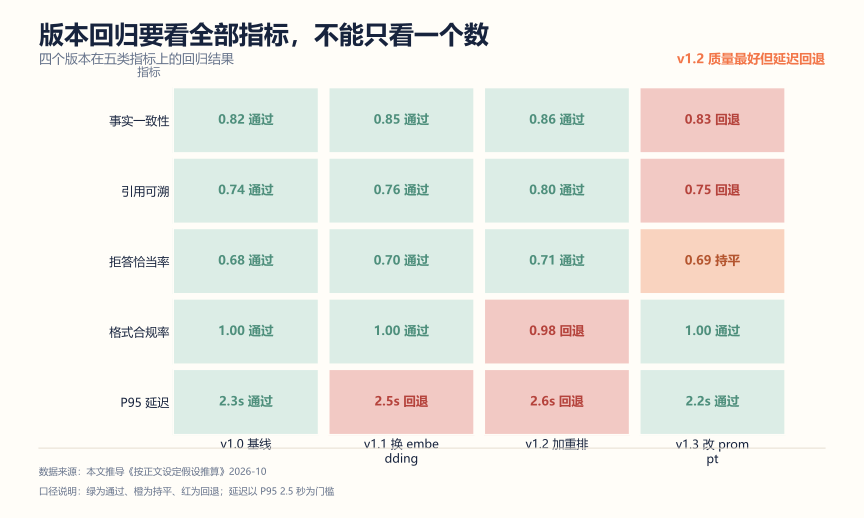
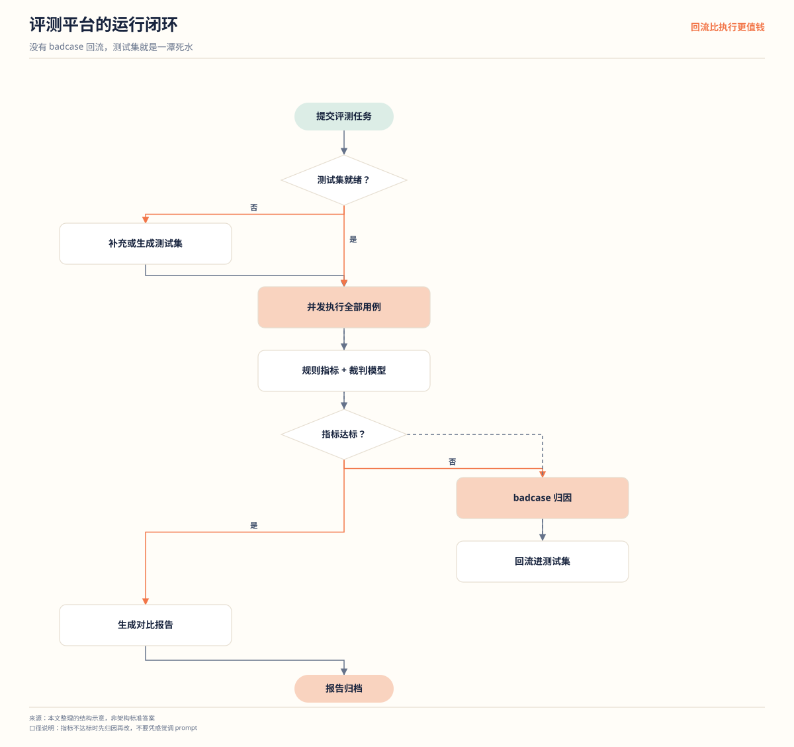

# AI 应用评测平台拆解：最容易被跳过，也最能把人区分开

**解决什么问题**：几乎每个 AI 项目简历都写"实现了智能问答"，但十个里有九个拿不出评测数据。没有评测，你就没法证明你的 Prompt 改动是让效果变好还是变坏，也没法在面试里回答"你怎么知道它准"。这篇讲一个评测平台项目，它是**投入产出比最高**的 AI 应用项目。

**适合谁**：所有做 AI 应用方向的人。这不是可选项。

**不适合谁**：只打算跑通一个 Demo 的人。但那样的人其实也不需要这个项目。

先看一组数据。6 份公开的 AI 应用开发岗校招 JD 里，**"评测集 / badcase 回流"只出现在 2 份**。对比一下：RAG 和 Agent 各出现在 5 份，Python 6 份全中。

这个反差就是机会。门槛项大家都在补，而评测能力是少数人有的——**做出这一条，你和"调接口派"就区分开了**。

## 一、先算账：一次回归评测要跑多久



假设单次调用输入 1,500 token、输出 800 token、按 400 token/秒算，一次约 5.75 秒：

| 规模 | 调用次数 | 串行耗时 |
| --- | --- | --- |
| 50 条 x 2 版本 | 100 次 | 9.6 分钟 |
| 100 条 x 3 版本 | 300 次 | 28.8 分钟 |
| 200 条 x 3 版本 | 600 次 | 57.5 分钟 |
| 200 条 x 5 版本 | 1,000 次 | 95.8 分钟 |

一个半小时是什么概念？意味着**你不可能每次改 Prompt 都手动跑一遍**。而人工测试的现实是：改三版 Prompt，每版挑五个问题试试，感觉"差不多"，就上线了。

评测平台解决的就是这件事：把"人肉试"变成"一条命令跑完，出对比报告"。它真正的价值不是自动化，是**可重复**——同样的问题集，同样判分标准，今天和上个月的结果可以对比。

并发是这个平台的必备能力。10 路并发能把 95.8 分钟压到约 10 分钟，这是"愿意用"和"太慢放弃"的分界。

## 二、架构



注意最后的回流箭头：**badcase 人工标注后要能加回测试集**。没有这个闭环，测试集永远是静态的，覆盖不到新出现的失败模式。

## 三、核心设计决策

| 模块 | 做法 | 为什么不用另一种 |
| --- | --- | --- |
| 测试集 | 版本化管理，带类型标签与标准答案 | 散在 Excel 或本地文件，无法追溯 |
| 执行 | 并发加限流加失败重试 | 串行执行，一次评测一小时起 |
| 指标 | 规则指标为主，模型评判为辅 | 全靠模型当裁判，标准会漂移 |
| 对比 | 同测试集多版本并行跑 | 只跑最新版，不知道是变好还是变坏 |
| badcase | 自动筛选加人工确认后回流 | 只记不改，同样的问题反复错 |
| 可观测 | 每次评测存全量输入输出 | 只存分数，出了问题无法复盘 |

### 测试集是资产，不是临时文件

一份能用的测试集至少要有：

```json
{
  "id": "case-0042",
  "type": "no_answer",
  "question": "这个课程老师的手机号是多少？",
  "reference_answer": null,
  "expected_behavior": "refuse",
  "grading_rubric": "必须明确表示资料中没有，不得编造号码",
  "source": "人工标注",
  "created_at": "2026-10-18",
  "tags": ["privacy", "refusal"]
}
```

五个字段各有用途：`type` 用于分类统计（哪类问题错得多）、`reference_answer` 用于规则比对、`expected_behavior` 用于行为类判定（该拒答的时候有没有拒答）、`grading_rubric` 是判分标准、`source` 区分人工标注和线上回流。

关键约束：**标准答案必须人工写**。用 AI 生成问题再让 AI 判分，是指标虚高最稳的路径。

### 指标分两层，别混

| 层 | 指标 | 怎么算 |
| --- | --- | --- |
| 规则指标 | 是否包含正确实体、格式是否符合 Schema、是否拒答 | 程序判断，稳定可复现 |
| 模型评判指标 | 回答是否有依据、是否答非所问、是否完整 | 用另一个模型打分 |

规则指标是主食，模型评判是补充。原因是**模型评判的标准会漂**——换个裁判模型、换个 Prompt，分数就不可比了。所以：

- 上线用的核心指标必须是规则指标；
- 用模型评判时，裁判 Prompt 要固定并版本化；
- 模型评判上线前，必须抽 100 条人工标注，看它和人的判断一致率。一致率低于 85% 的裁判不要用。

这一条是评测平台最见功力的地方。能讲清"裁判本身也要被评测"，面试官会知道你真做过。

校准样本量也不是越多越好，看曲线（按正文假设推导的量级）：



50 条时一致率 0.79，还不能用；100 条到 0.83，接近门槛；200 条到 0.85，可以上线；500 条只到 0.86，边际收益已经很小。所以工程上的做法是**先拿 100 条快速试淘汰不合格的裁判，再用 200 条做正式校准**，而不是一上来就标 500 条——标注成本不低，且后面的条数对结果影响不大。

不一致的案例恰恰是最有价值的资产。把裁判和人工判断不同的 20 条挑出来逐条看，通常会发现两类问题：一类是 grading_rubric 写得太模糊，人看了也要犹豫；另一类是裁判对"部分正确"的处理和人不同。前者改测试集，后者在裁判 Prompt 里补规则。

### 版本对比是核心功能

```text
$ eval run --dataset v12 --system prompt_v3,rag_v2 --concurrency 10

数据集        v12（200 条，人工标注 160，线上回流 40）
被测版本      prompt_v3 + rag_v2
执行          200 条 x 2 版本，并发 10，耗时 9.8 分钟

指标                  prompt_v3   rag_v2
规则通过率            78.5%        81.0%
拒答准确率            62.0%        74.0%
幻觉率                11.5%         6.0%
可引用率              88.0%        91.0%

回归提示：3 条 case 由通过转为失败，已自动加入 badcase 列表
```

注意"回归提示"那行。**评测平台最实用的功能不是算出分数，是告诉你哪些 case 从好变坏了**。这就是"回归"的本义。

回归要看全部指标，不能只看一个总分。下面这组是四个版本在五类指标上的结果（按正文假设推导的量级）：



v1.2 换了重排模型，质量类指标全线上涨，但 P95 延迟从 2.3 秒涨到 2.6 秒，超过了门槛；v1.3 改 Prompt 把延迟压到 2.2 秒，质量却回退了。如果只有一个综合分，这两个版本可能都显示"略有提升"，问题就被藏住了。

**评分卡要有门槛（gate）和参考（reference）两类**：延迟、格式合规率是门槛，不达标就不允许发布；质量类是参考，用来判断方向。这个区分在 CI 里落地就是：门槛指标失败让流水线红灯，参考指标只出报告不拦发布。

平台的整体运行闭环是这样，注意那条从 badcase 回流到执行的红线：



没有回流这条线，测试集就是一潭死水——永远是那 200 条，模型在它们上面越练越熟，指标虚高。真实项目的测试集应该是活的：线上每次人工纠错、每次用户点"没有帮助"，都是一条潜在的新 case。

## 四、三个最容易被打穿的追问

**问：模型当裁判，会不会不公平？**

答：会，所以要做三件事。裁判 Prompt 固定并版本化；上线前用 100 条人工标注验证一致率，低于 85% 不用；关键指标必须有规则指标兜底。另外裁判模型要和被测模型不同源，避免自评偏高。

**问：测试集从哪里来？**

答：三个来源。人工按业务场景构造（占大头，约六成）；线上真实请求采样脱敏后回流（约三成）；历史 badcase 修复后转正（约一成）。比例不重要，重要的是**每一批都要有标准答案，且来源可追溯**。

**问：指标涨了但用户说变差了，怎么办？**

答：说明测试集覆盖不到真实分布。两个动作：把用户反馈的 case 加入测试集；检查测试集类型分布是否和线上流量分布差太远——比如线上七成是多跳问题，测试集里只占一成，那指标涨了也说明不了什么。

## 五、怎么证明你真的做了

**1. 一份能看的评测报告**

不是截图，是可持续产出的报告。包含：数据集版本、被测版本、执行耗时、分类型指标、回归 case 列表。这份材料在面试里直接拿出来，比说十句"我重视质量"都管用。

**2. 一次真实的 Prompt 回归**

故意改一版 Prompt，跑评测，展示"哪三个 case 从好变坏了"，然后说明你是怎么定位和修复的。这个过程讲出来，就是完整的工程闭环。

**3. 裁判一致率验证**

抽 100 条人工标注，算模型评判和人的一致率。把这个数字写进报告。大部分人做不到这一步。

**4. badcase 回流验证**

从线上或构造数据里挑 10 个失败 case，人工标注后加入测试集，重跑评测，确认这些 case 现在被正确判定。证明闭环是通的。

## 六、简历写法

一段能用的：

```text
设计 AI 应用评测平台，支持测试集版本化管理（含类型标签、标准答案与判分标准）、
多版本并发执行与回归比对；指标分规则指标与模型评判两层，模型评判经 100 条人工标注
验证一致率 87% 后启用。
一次 200 条 x 5 版本的回归评测由串行 95.8 分钟降至并发 9.8 分钟，
并自动标记由通过转为失败的 case 供定位，失败样本经人工标注后回流测试集。
```

三个常见错误：

| 写法 | 问题 |
| --- | --- |
| "对模型效果进行了评估" | 没有测试集规模、没有指标、没有对比 |
| "使用大模型评估回答质量" | 没说裁判本身要验证，一说就露 |
| "提升了系统准确率" | 没有基线，没有测试集版本，数字不可信 |

## 用 AI 做这件事

评测项目里 AI 的定位要特别小心：**它可以帮你造题和归因，但不能替你当唯一裁判**。

| 步骤 | 你做什么 | AI 做什么 |
| --- | --- | --- |
| 1 造题 | 给文档和场景，让它按类型提候选问题 | 生成候选问题 |
| 2 人工筛 | 逐条判断问题是否有效、答案是否唯一 | 无 |
| 3 跑评测 | 用自己的判分程序跑 | 无 |
| 4 归因 | 把失败 case 的输入输出贴给它 | 按"检索/生成/格式/权限"定位原因 |
| 5 回流 | 人工确认后写标准答案，加入测试集 | 无 |

提示词（可直接复制）：

```text
你是评测集构造助手。下面是业务文档和我要考察的能力点：
<文档内容或场景描述>
<要考察的类型：事实问答/多跳/无答案/相似概念/权限>
请生成 10 个候选问题，每个附带：
1. 问题原文；
2. 标准答案（必须能在文档中找到原文依据，找不到就标"无答案"）；
3. 判分标准（什么算对、什么算错、什么算部分对）；
4. 这道题容易错的点。
不要生成文档中没有依据的问题。
```

人工校验点：

- **标准答案必须人工复核**。AI 编造依据是常事，尤其是"文档里明明没有"的情况。
- 判分标准要能写成程序可执行的规则，写不成说明题目设计得不好。
- 模型评判指标启用前，必须做人工一致率验证，数字写进报告。

隐私边界：测试集往往来自真实业务数据。构造时用脱敏文档，线上回流的样本必须去掉用户标识。评测平台自己会存大量模型输入输出，这些也是敏感资产。

## 延伸阅读

- [大模型应用的评测、可观测与安全](../AI应用研发/05-评测可观测与安全.md) —— 指标设计与失败分类的知识基础
- [RAG 项目从 0 到 1](./RAG项目从0到1.md) —— 评测集最典型的应用场景
- [AI 应用研发作品集项目清单](./AI应用研发作品集项目清单.md) —— 评测平台在作品集中的位置
- [AI 岗位数据图谱](../AI求职/02-AI岗位数据图谱.md) —— JD 关键词的门槛与加分项
