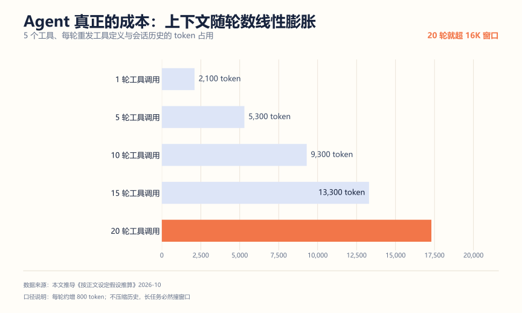
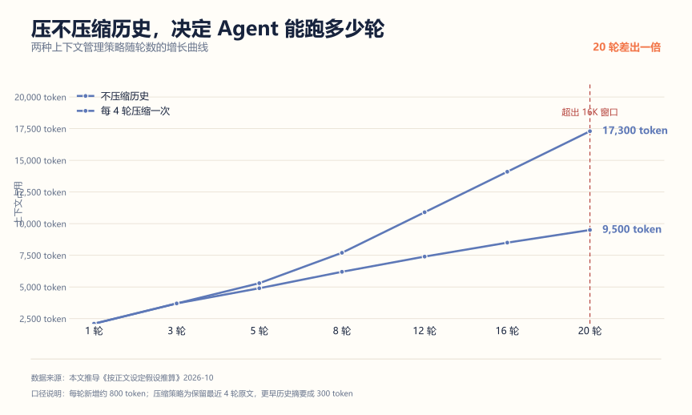
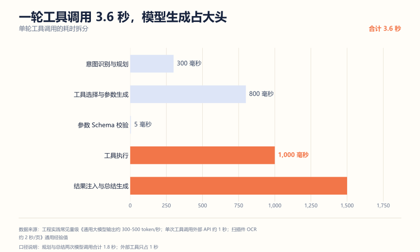
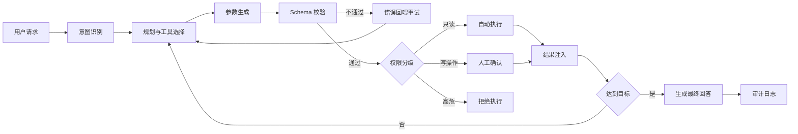
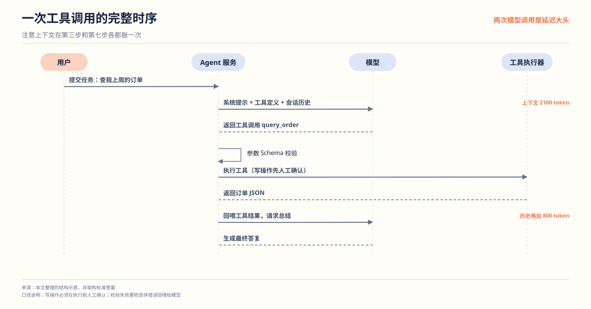

# Agent 工具调用平台拆解：可控比自主更值钱

**解决什么问题**：Agent 是现在简历上出现最多的词，也是水分最大的一个。大部分人的版本是"调了几次 API，模型自己决定调用什么"，面试官一问参数错了怎么办、上下文爆了怎么办、工具调错谁负责，就答不上来。这篇按"先算账、再设计、再验证"讲一个能扛住追问的 Agent 项目。

**适合谁**：目标岗位是 AI 应用研发、大模型应用、智能体开发的人。

**不适合谁**：只想 Demo 一个能跑通的 Agent 的人。那个用框架半小时就能拼出来，不值得写进简历。

先看一组真实数据。对 6 份公开的 AI 应用开发岗校招 JD 做了关键词统计，**Agent / 智能体出现在 5 份里**，和 RAG 并列第一梯队。所以这个方向值得做，但正因为做的人多，你必须做得和别人不一样。

## 一、先算账：Agent 的两个隐性成本

### 上下文随轮数线性膨胀

这是 Agent 项目最大的坑，而且大部分人事前想不到。



假设 5 个工具，每个工具定义（名称、描述、JSON Schema）约 200 token，系统提示 300 token，每轮工具调用产生约 800 token（模型输出的参数加工具返回的结果）：

| 轮数 | 上下文占用 | 说明 |
| --- | --- | --- |
| 1 轮 | 2,100 token | 轻松 |
| 5 轮 | 5,300 token | 还行 |
| 10 轮 | 9,300 token | 开始紧张 |
| 15 轮 | 13,300 token | 接近 16K |
| 20 轮 | 17,300 token | 已经超了 |

问题在于**每一轮都要把全部工具定义和全部历史重新发给模型**。所以上下文不是线性增长一次，而是每轮都在重发。20 轮任务直接把 16K 窗口打满。

这意味着你必须做至少一件事：历史压缩（把旧的工具结果替换成摘要）、工具结果截断（超长的返回只留前 N 字符）、或者限制最大轮数。**能讲清这件事，你的 Agent 项目就超过大多数人了。**

压缩与不压缩的差距有多大，看曲线更直观（同样假设下推导）：



压缩策略是保留最近 4 轮原文，更早的历史摘要成 300 token。20 轮时不压缩要 17,300 token，压缩后 9,500 token，直接省出一半。工程上三件事要一起做，因为它们解决的是不同问题：**截断管单轮过大，压缩管累积，硬上限管失控循环**。只做一件，另外两类的坑还在。

还有一个常被忽略的点：工具定义本身也是成本。5 个工具 1,000 token，20 个工具就 4,000 token，还没开始对话就吃掉四分之一窗口。所以工具多的平台要做**按需加载**——先只注入与当前意图相关的几个工具，不够再扩容。

### 一轮调用 3.6 秒，模型生成占大头



| 环节 | 量级 | 说明 |
| --- | --- | --- |
| 意图识别与规划 | 300 毫秒 | 约 120 token 输出 |
| 工具选择与参数生成 | 800 毫秒 | 约 320 token 输出 |
| 参数 Schema 校验 | 5 毫秒 | 本地校验，微秒级 |
| 工具执行 | 1,000 毫秒 | 外部 API 往返 |
| 结果注入与总结生成 | 1,500 毫秒 | 约 600 token 输出 |

结论：**两次模型调用合计 1.8 秒，占了一半**。外部工具只占 1 秒。所以优化方向是减少模型调用次数（能一次规划完就别分两步），以及流式输出让用户先看到东西。反过来，如果你把精力花在"让工具执行更快"上，收益很有限。

## 二、架构



注意两个岔路：**参数校验失败要能回到规划**（把错误信息喂给模型让它改），以及**权限分级在真正执行前拦截**。

单看一轮，时序是这样：



第三步把工具定义和会话历史一起发给模型，第七步再把工具结果喂回去——上下文就是在这两步之间膨胀的。写操作在第五步前被人确认卡住，这是整个链路里唯一的人工介入点，也是责任边界所在。

## 三、核心设计决策

| 模块 | 做法 | 为什么不用另一种 |
| --- | --- | --- |
| 工具描述 | JSON Schema 描述参数 | 自然语言描述，模型参数格式经常错 |
| 参数校验 | 服务端强校验，失败带错误信息重试 | 信任模型输出，错误直接流到外部系统 |
| 权限分级 | 只读自动、写操作确认、高危禁止 | 全部自动执行，出了事无法定责 |
| 上下文管理 | 历史压缩加工具结果截断 | 无限增长，长任务必爆窗口 |
| 工具执行 | 幂等键加重试上限 | 重试导致外部接口被重复调用 |
| 幻觉工具名 | 注册表白名单校验 | 模型编一个不存在的工具名，直接 500 |
| 审计 | 每次调用记录入参出参会话 ID | 出问题无法复盘 |

### 工具设计首先是 API 设计

一个坏工具：

```json
{
  "name": "query_data",
  "description": "查询数据",
  "parameters": {
    "type": "object",
    "properties": {
      "params": { "type": "string", "description": "查询参数" }
    }
  }
}
```

`params` 是个字符串，模型爱填什么填什么，服务端也没法校验。更合理的设计：

```json
{
  "name": "query_order",
  "description": "按订单号查询订单状态。需要精确的订单号，不确定时先用 search_order。",
  "parameters": {
    "type": "object",
    "properties": {
      "order_id": {
        "type": "string",
        "pattern": "^[A-Z]{2}\\d{10}$",
        "description": "订单号，两位大写字母加十位数字"
      },
      "fields": {
        "type": "array",
        "items": { "enum": ["status", "amount", "created_at"] },
        "description": "需要返回的字段，不传返回全部"
      }
    },
    "required": ["order_id"]
  }
}
```

三点差别：**格式用 pattern 约束**、**必填项明确**、**description 里写清使用前提和不确定时该怎么办**。最后这条最容易被忽略——模型选错工具，往往是因为工具描述没告诉它什么时候该用哪个。

### 权限分级是硬要求

| 级别 | 例子 | 处理 |
| --- | --- | --- |
| 只读 | 查询订单、搜索文档 | 自动执行 |
| 写操作 | 创建工单、发送通知 | 展示参数，人工确认后执行 |
| 高危 | 退款、删除数据、改权限 | 默认禁止，或需二次授权 |

这个分级要在工具注册时就定好，不是在执行时判断。面试时能主动讲出"我把工具分成三级"，比任何技术细节都加分——因为它说明你考虑过责任边界，而不只是让模型跑起来。

### 模型会编工具名，必须防

模型偶尔会调用一个不存在的工具，或者参数名拼错。服务端必须：

1. 校验工具名在注册表里，不在就报错并把可用工具列表回喂。
2. 校验参数符合 Schema，不符合就报错并把具体哪个字段错回喂。
3. 重试上限设为 2 到 3 次，超过就转人工或明确失败。

**错误信息要具体**。返回"参数错误"模型下次还错；返回"order_id 必须是两位大写字母加十位数字，你传的是 ABC"，它下次大概率就对。

把上面几条串起来，核心循环大概这样（省略了流式输出和日志）：

```python
MAX_ROUNDS = 12          # 硬上限，防失控循环
MAX_RETRY = 2            # 同一轮内校验失败的重试次数
seen_calls: set[str] = set()   # 工具名 + 参数哈希，防重复调用

def run_agent(task: str, user_ctx: UserContext) -> str:
    history = [{"role": "user", "content": task}]
    tools = load_tools_for(user_ctx)          # 按需加载，别一次全塞

    for round_no in range(1, MAX_ROUNDS + 1):
        reply = llm.chat(messages=history, tools=tools)
        history.append(reply)

        if not reply.tool_calls:              # 模型认为做完了
            return reply.content

        for call in reply.tool_calls:
            sig = f"{call.name}:{hash(call.arguments)}"
            if sig in seen_calls:
                history.append(tool_msg(call.id, "错误：重复调用，请换思路或直接给出结论"))
                continue
            seen_calls.add(sig)

            tool = REGISTRY.get(call.name)    # 白名单校验，防编造工具名
            if tool is None:
                history.append(tool_msg(call.id, f"错误：工具不存在，可用工具：{list(REGISTRY)}"))
                continue

            err = validate(call.arguments, tool.schema)   # JSON Schema 校验
            if err:
                history.append(tool_msg(call.id, f"参数错误：{err}，请修正后重试"))
                continue

            if tool.level == "readonly":
                result = tool.execute(call.arguments, user_ctx)
            elif tool.level == "write":
                if not ask_user_confirm(call):     # 人工确认点
                    return "已取消"
                result = tool.execute(call.arguments, user_ctx, idem_key=call.id)
            else:
                history.append(tool_msg(call.id, "错误：高危操作已禁止"))
                continue

            history.append(tool_msg(call.id, truncate(result, 2000)))  # 截断防单轮过大

        if round_no % 4 == 0:                  # 每 4 轮压缩一次历史
            history = compress(history, keep_recent=4)
    return "已达最大轮数，以下是目前已确认的信息：……"
```

这段代码的价值不在语法，在于它把前面每一条决策都落成了具体位置：工具白名单在第 23 行，Schema 校验在第 28 行，权限分级在第 33 到 41 行，结果截断在第 43 行，历史压缩在第 45 行，轮数硬上限在第 1 行和第 9 行。面试时讲"我在哪一行做了什么"，比讲"我做了权限分级"可信得多。

## 四、三个最容易被打穿的追问

**问：上下文爆了怎么办？**

答：三层。工具结果超过一定长度就截断，只留关键部分；超过 N 轮后用模型把早期历史压缩成摘要；设置最大轮数硬上限，到顶就带着已有信息收尾。三件事都要做，因为截断只解决单轮过大，压缩解决累积，硬上限防止失控循环。

**问：工具调错了谁负责？**

答：分级负责。只读工具调错，影响是拿到了错数据，靠引用和展示让用户发现；写操作必须人工确认，参数摆出来让人看；高危操作默认禁止。系统设计上不追求"模型永远正确"，追求"错的时候不会造成不可逆后果"。

**问：怎么防止无限循环？**

答：三个机制。最大轮数硬上限；相同工具相同参数连续调用两次就判定为循环，强制换策略或终止；每轮记录 token 消耗，超预算停止。第二条特别重要，因为模型很容易陷入"反复调同一个工具"的死循环。

## 五、怎么证明你真的做了

**1. 参数校验的失败率测试**

构造 100 个"模型容易填错"的请求，统计：校验拦截了多少、重试后成功了多少、最终转人工多少。这三个数字直接证明你的校验和重试是有效的。

**2. 上下文增长实测**

跑一个 20 轮的任务，记录每轮的 token 占用，验证压缩策略生效。把曲线画出来——这就是你文章里那张图的自测版。

**3. 循环注入测试**

故意让一个工具永远返回"需要更多信息"，看系统是否在预期轮数内终止，而不是无限调用。

**4. 权限边界测试**

用一个低权限会话尝试触发写操作和高危操作，确认分别走的是确认和拒绝路径。

**5. 审计完整性**

任取一次会话，能凭会话 ID 还原出完整的调用链：谁、什么时候、调了哪个工具、参数是什么、结果是什么。这个测试做了，"出问题怎么排查"这类问题就再也问不倒你。

## 六、简历写法

一段能用的：

```text
设计工具调用平台，以 JSON Schema 描述工具参数并在服务端强校验，校验失败将具体错误回喂模型重试；
按只读、写操作、高危三级做权限控制，写操作需人工确认；
通过工具结果截断、历史摘要压缩与最大轮数上限控制上下文增长，
20 轮任务上下文由 17,300 token 压至 8,000 token 以内。
经参数校验失败率、上下文增长与循环注入测试验证，全部调用可按会话 ID 完整审计。
```

三个常见错误：

| 写法 | 问题 |
| --- | --- |
| "基于大模型实现了智能体" | 只有名词，没有问题、方案和结果 |
| "实现了 Agent 自主规划能力" | 自主不是目标，可控才是；这么写显得没做过真实系统 |
| "支持多种工具调用" | 没说校验、权限、上下文、审计任何一项 |

## 用 AI 做这件事

Agent 项目里 AI 最好的用途是**当对抗测试者**——专门找你的漏洞，而不是帮你写代码。

| 步骤 | 你做什么 | AI 做什么 |
| --- | --- | --- |
| 1 描述系统 | 把工具清单、权限分级、校验规则写成文档 | 无 |
| 2 对抗演练 | 把文档贴给它 | 列出能突破你设计的攻击路径 |
| 3 筛选补漏 | 挑出真能利用的 | 给出每个漏洞的最小修复 |
| 4 复测 | 按修复后的设计再贴一次 | 继续找新的突破口 |

提示词（可直接复制）：

```text
你是 AI 系统安全测试者。下面是我的 Agent 工具调用平台设计：
<工具清单及权限级别、参数 Schema、校验规则、上下文管理策略、最大轮数>
请找出能突破这个设计的路径，覆盖这些方向：
模型编造工具名或参数、参数格式错误、工具返回超长内容、工具执行超时导致死循环、
低权限会话触发高危操作、上下文窗口被打满、审计日志被绕过。
输出一张表：攻击路径 / 利用条件 / 后果 / 你的设计当前能否防住。
不要给修复方案，只找漏洞。
```

人工校验点：

- AI 列的漏洞要区分"真能利用"和"理论上存在"。选能利用的修，其他的标注为已知限制。
- 修完之后必须自己再走一遍攻击路径，不能只看 AI 说"已修复"。
- 工具的真实入参出参不要贴。用脱敏后的示例，尤其是涉及订单号、手机号这类。

隐私边界：Agent 项目处理的是真实业务操作，审计日志、工具入参往往带敏感信息。贴给 AI 的一律替换成 `order_id = "AB1234567890"` 这类虚构值。

## 延伸阅读

- [Tool Calling 与 MCP](../AI应用研发/04-ToolCalling与MCP.md) —— 工具设计的原理与协议
- [Agent 系统设计与工程化](../AI应用研发/02-Agent系统设计与工程化.md) —— 状态、编排与重试的知识基础
- [AI 应用评测平台拆解](./AI应用评测平台拆解.md) —— Agent 的效果必须靠评测说话
- [AI 岗位全景与转型路径](../AI求职/01-AI岗位全景与转型路径.md)
