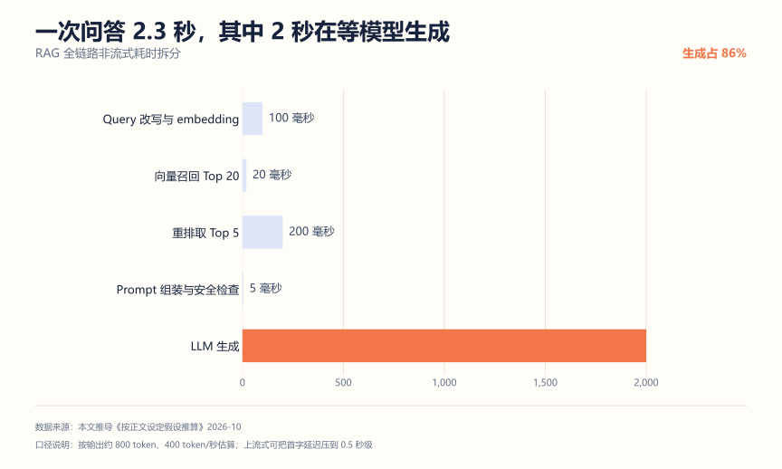
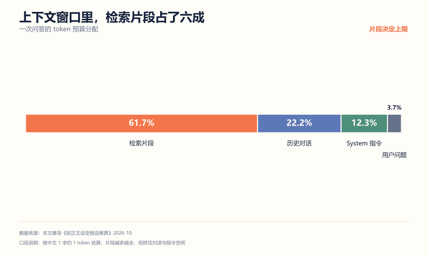
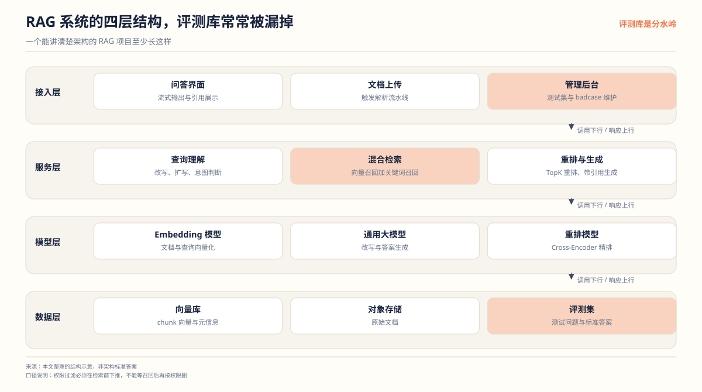
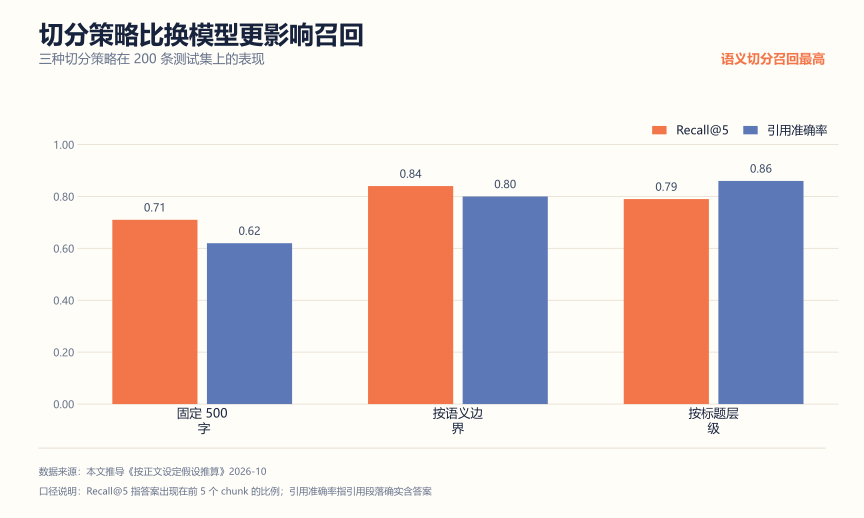

# RAG 项目从 0 到 1：做一个能面试的知识库问答系统

**解决什么问题**：RAG 是 AI 应用研发岗位最常见的项目，但大部分人的版本停留在"上传文档、调接口、显示回答"。面试官真正想知道的是：你怎么切分、怎么召回、怎么做权限、怎么证明效果。这篇按这个顺序讲。

**适合谁**：想做 AI 应用项目、目标岗位是 AI 应用研发或大模型应用的人。

**不适合谁**：只想跑通一个 Demo 的人。跑通 Demo 只要半天，讲清楚要两周。

## 一、先算账：延迟和 token 预算

### 一次问答 2.3 秒，其中 2 秒在等模型



非流式下一次完整问答的耗时拆分：

| 环节 | 量级 | 说明 |
| --- | --- | --- |
| Query 改写与 embedding | 100 毫秒 | 改写一次，再向量化 |
| 向量召回 Top 20 | 20 毫秒 | 10 万级向量库的 ANN 检索 |
| 重排取 Top 5 | 200 毫秒 | Cross Encoder 给 20 个候选打分 |
| Prompt 组装与安全检查 | 5 毫秒 | 字符串拼装加敏感词扫描 |
| LLM 生成 | 2,000 毫秒 | 约 800 token 输出，按 400 token/秒估 |

结论有点反直觉：**生成占了 86%，检索和重排加起来才 13%**。所以"优化 RAG 延迟"最有效的一招是上流式输出，把首字延迟压到 0.5 秒级，而不是死磕向量检索。反过来，如果你面的是"检索精度"相关的岗位，那重点就在重排和切分上，不在延迟。

### 上下文窗口里，检索片段占六成



按中文 1 字约 1 token 估算，5 个 chunk × 500 字就是 2,500 token，占掉上下文的一半以上。这直接决定了两个设计：

1. **chunk 不是越多越好**。塞 20 个 chunk 进去，上下文就爆了，而且模型会被无关信息干扰，答得更差。
2. **对话历史要截断**。多轮对话下历史会不断膨胀，常见的做法是保留最近 N 轮加一个摘要。

这两个数字都是按假设推导的量级，写进面试时要说清"我按什么算的"，别说成实测。

## 二、架构



查询链路是：问题进来先改写，再走混合检索（向量加关键词）拿 Top 20，重排后取 Top 5，过相似度阈值，不够就拒答，够了才组装 Prompt 生成，最后带引用返回。索引链路是：文档上传后解析、按结构切分、向量化入库。

两张图对着看，重点在图里标橙的三处：混合检索、评测集、权限过滤。这三样是大多数教程项目里没有的。

## 三、核心设计决策

| 模块 | 做法 | 为什么不用另一种 |
| --- | --- | --- |
| 切分 | 先按标题段落切，再控长度 | 按固定字数硬切，一句话被切成两半 |
| 检索 | 向量召回加关键词召回混合 | 只用向量，专有名词和编号查不准 |
| 排序 | 粗排 Top 20 加重排 Top 5 | 直接 Top 5，漏掉相关片段 |
| 权限 | 检索前下推 ACL 过滤 | 检索后过滤，结果数量不对且 TopK 失真 |
| 兜底 | 相似度阈值加拒答 | 没有证据也硬答，幻觉率飙升 |
| 评测 | 自建测试集加人工标注 | 靠主观感觉判断效果 |

### 切分：先保语义完整，再控长度

按 500 字硬切是最常见也最糟的做法。一个章节标题切进上一段、一个表格被劈成两半，检索时两边都不完整。

更好的顺序：

1. 先按标题、段落、列表这类结构边界切开，保证每块语义完整。
2. 超过长度上限的块再二次切分，切分点优先选在段落边界。
3. 相邻块保留 10% 到 15% 的 overlap，缓解上下文断裂。
4. 每个 chunk 必须带 `doc_id`、`title`、`section`、`page`、`acl` 这些元信息。

最后一条是面试加分项。没有元信息，你做不了引用展示，也做不了权限过滤。

切分策略的影响比换模型大。同一批文档、同一个 Embedding 模型，只改切分方式，在 200 条问答测试集上的结果是这样（按正文假设推导的量级，不是实测）：



固定 500 字切的 Recall@5 只有 0.71，比语义切分低 13 个百分点，差距主要来自"答案被切断"：答案跨在两个 chunk 里，两个都只算部分命中。但按标题层级切的引用准确率最高（0.86），因为引用要定位到章节，标题切法天然带这个边界。

所以实际做法是两者结合：**按标题层级切出大块，块内超长了再按段落边界细分**，每个 chunk 记录自己归属的标题路径。面试时能讲出"我用引用准确率而不是只用 Recall 来选切分策略"，比只会说"我按语义切分"高一个档次。

### 权限：检索前过滤，不是检索后过滤

这是整个项目最能体现深度的一处。

**错误做法**：先向量召回 Top 5，再在代码里按 `acl` 过滤掉没权限的。问题是：召回了 5 个，过滤掉 3 个，用户只看到 2 个——而且这 2 个未必是最相关的，因为真正相关的那 3 个恰好没权限。TopK 的语义被破坏了。

**正确做法**：把权限条件下推到向量库查询里。

```sql
-- pgvector 示例：把 ACL 作为查询条件一起下发
SELECT content, title, page
FROM chunks
WHERE doc_id = ANY($1)          -- 用户有权限的文档
  AND acl IN ($2, $3)
ORDER BY embedding <=> $4       -- 查询向量
LIMIT 20;
```

Milvus 用表达式过滤，Elasticsearch 用 filter 子句。核心是：**数据库层面就只返回你有权看到的内容，TopK 在合法集合里计算**。

面试时能讲清"检索后过滤为什么不行"，比说"我做了权限控制"高一个档次。

### 拒答：没证据就不答

低置信度场景有三种：召回片段得分都低、来源之间互相矛盾、问题和片段表面相似但实际无关。三种都要拒答，话术要明确：

```text
当前资料中没有找到足够依据回答该问题。
建议补充相关文档，或换一种更具体的问题描述。
```

加一道硬约束：生成的每一句结论都必须能对应到某个 chunk 的编号，对应不上就不输出。这一条能显著压低幻觉率，也是"可引用率"这个指标的来源。

## 四、三个最容易被打穿的追问

**问：chunk size 怎么选？**

答：没有万能值，用测试集比出来。准备 50 条带标准答案的问题，分别用 200、500、800 字跑一遍，比较 Recall@K 和答案完整度。一般结论是：太小丢上下文，太大稀释相似度、还撑爆上下文窗口。500 字上下是常见起点，但你必须能说出"我是怎么测的"。

**问：为什么需要 rerank？**

答：向量召回（bi-encoder）是把问题和文档分别编码后算相似度，快但粗，Top 20 里会混进不相关的。重排模型（cross-encoder）把问题和候选片段拼在一起逐对判断，精度高但慢，所以只对粗排的 20 个候选跑，取 Top 5。本质是用延迟换精度。

**问：如果答案编造怎么办？**

答：四层。检索前过滤保证上下文干净；生成时强制引用，每句结论绑定 chunk 编号；生成后校验，绑定不上的句子删掉；最后用测试集量化幻觉率，持续监控。单靠"把 prompt 写好"是最不可靠的一层。

## 五、怎么证明你真的做了

RAG 项目的说服力全在评测集上。没有评测集的 RAG，等于没有。

**1. 测试集：50 条起步**

| 类型 | 数量 | 示例 | 考察什么 |
| --- | --- | --- | --- |
| 事实问答 | 15 | "作业截止时间是什么？" | 是否找到正确来源 |
| 多跳问题 | 10 | "先修要求和考核方式有什么关系？" | 是否整合多个片段 |
| 无答案问题 | 10 | "老师手机号是多少？" | 是否拒答 |
| 相似概念 | 10 | "召回率和准确率有什么区别？" | 是否混淆 |
| 权限问题 | 5 | 询问无权限文档内容 | 是否被过滤 |

关键：**标准答案和标注必须人工做**。用 AI 生成问题再让 AI 评判，是循环论证，指标再好也没有意义。

**2. 五个指标**

| 指标 | 怎么算 |
| --- | --- |
| Recall@K | 正确片段是否出现在 Top K |
| 可引用率 | 回答中能绑定到 chunk 编号的句子占比 |
| 幻觉率 | 没有依据却给出结论的比例 |
| 拒答准确率 | 无答案问题中被正确拒答的比例 |
| 平均延迟 | 检索加生成的总耗时 |

**3. 失败案例集**

把答错的 10 条单独整理出来，写清失败原因：是切分切断了吗？是召回没中吗？是重排排错了吗？是上下文太长模型忽略了吗？这份材料在面试里比任何指标都值钱——它证明你真在调，不是跑了个 Demo。

## 六、简历写法

一段能用的：

```text
构建课程资料知识库问答系统，完成 PDF 解析、结构化切分与向量化，检索采用向量加关键词混合召回，
Cross Encoder 重排取 Top 5；权限条件下推至向量库查询，避免检索后过滤导致 TopK 失真；
生成阶段强制结论绑定 chunk 编号，低置信度问题拒答。
自建 50 条人工标注测试集，评估 Recall@K、可引用率、幻觉率与拒答准确率，并沉淀 10 条失败案例分析。
```

三个常见错误：

| 写法 | 问题 |
| --- | --- |
| "基于大模型实现了知识库问答" | 没有技术细节，看不出你做了什么 |
| "提升了检索准确率" | 没有基线、没有测试集、没有数字 |
| "解决了大模型幻觉问题" | 空话，换成具体机制：引用绑定加阈值过滤加拒答 |

## 用 AI 做这件事

RAG 项目里 AI 最好的用途是**帮你构造测试集和做失败归因**，不是替你生成测试集然后自己评分。

| 步骤 | 你做什么 | AI 做什么 |
| --- | --- | --- |
| 1 造问题 | 给文档，让它按五类各提候选问题 | 生成候选问题 |
| 2 人工筛 | 逐条判断问题是否有效、答案是否唯一 | 无 |
| 3 跑链路 | 用测试集跑系统，收集答错的 case | 无 |
| 4 归因 | 把失败 case 的输入输出贴给它 | 按"切分/召回/重排/生成/权限"五类定位原因 |

提示词（可直接复制）：

```text
你是 RAG 系统归因分析者。下面是一次失败的问答记录：
用户问题：<问题>
召回的 chunk（含编号与得分）：<片段>
最终回答：<回答>
标准答案：<答案>
请只做一件事：判断失败发生在哪一环，候选为
切分不当 / 召回未命中 / 召回命中但排名靠后 / 重排排错 / 生成未使用证据 / 权限误拦。
输出：环节 + 判断依据（引用具体片段内容）+ 最小修复动作。
不要重写整个系统，不要给出泛化建议。
```

人工校验点：

- 测试集的**标准答案必须人工写**。让 AI 出题再让 AI 判分，指标会虚高。
- 归因结论要自己复核。AI 很容易把"生成没用证据"当成万能解释。
- 贴给 AI 的文档片段先脱敏：去掉人名、电话、内部编号。

隐私边界：企业文档、课程资料里往往带个人信息和内部信息，贴之前先替换。测试集用自己构造的文档，不要用公司真实文档。

## 延伸阅读

- [AI 应用研发作品集项目清单](./AI应用研发作品集项目清单.md) —— RAG 之外还有哪些方向
- [AI 岗位全景与转型路径](../AI求职/01-AI岗位全景与转型路径.md) —— 先确认目标岗位的项目要求
- [项目深挖面试准备清单](../面试攻略/项目深挖面试准备清单.md) —— 把项目讲清楚的通用清单
