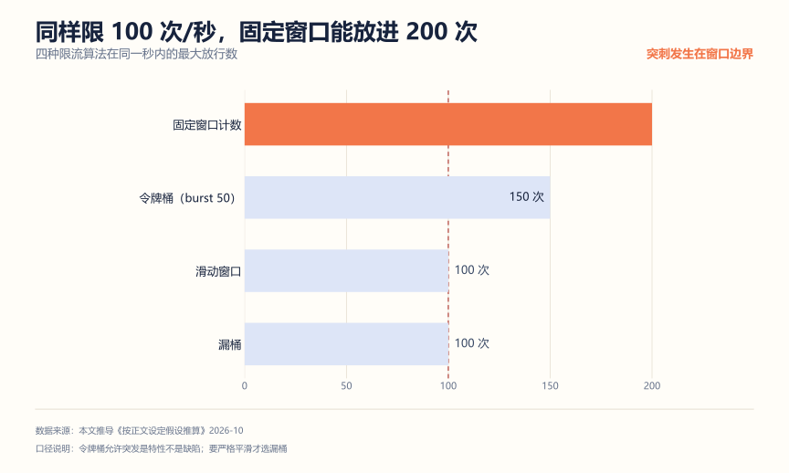
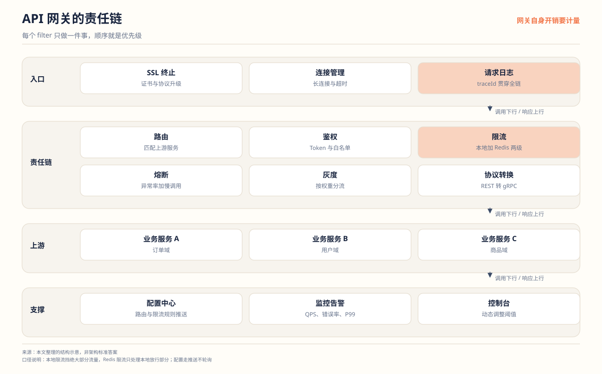
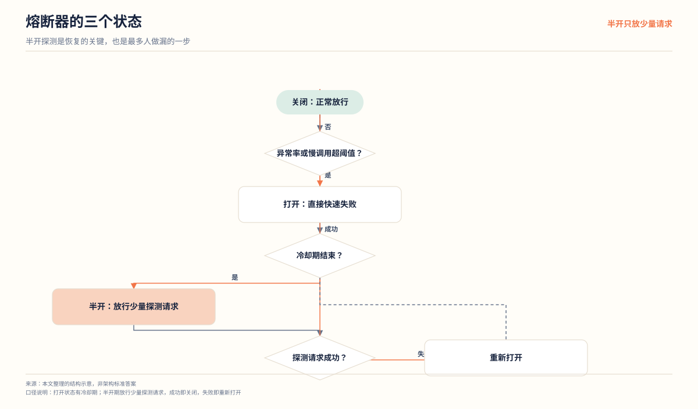

# API 网关项目拆解：别只写成"转发请求"

**解决什么问题**：网关项目很容易做成一个转发代理，然后简历上只剩"我用责任链写了几个过滤器"。这篇文章给你三个能挖深的点：限流算法的边界、网关自身的性能账、以及动态配置怎么做才不算硬编码。

**适合谁**：想体现工程抽象能力、或者目标岗位偏基础架构的人。

**不适合谁**：只想了解网关是什么的人。这篇文章默认你已经知道网关是干什么的。

## 一、先算账：限流算法和网关开销

### 同样限 100 次/秒，固定窗口能放进 200 次

这是固定窗口计数的经典缺陷。窗口是 [0, 1) 秒，限 100 次/秒：

- 第 0.9 秒时放进第 100 个请求，计数满
- 第 1.0 秒窗口重置，计数清零
- 第 1.1 秒又能放进 100 个

从 0.9 秒到 1.1 秒这 0.2 秒里，实际放进了 200 个请求。峰值是限流值的两倍。



选型结论：

| 算法 | 特点 | 什么时候用 |
| --- | --- | --- |
| 固定窗口 | 实现最简单，有边界突刺 | 内部系统，对峰值不敏感 |
| 滑动窗口 | 无突刺，成本高一些 | 对外接口，限流要准 |
| 漏桶 | 强制匀速，不接受突发 | 下游脆弱，必须平滑 |
| 令牌桶 | 允许可控突发 | 默认选择，兼顾突发与保护 |

令牌桶允许突发是**特性不是缺陷**——真实流量本来就有突发。要严格平滑才选漏桶。这一句在面试里能把"背过八股"和"理解场景"区分开。

四种算法在突刺下的放行形状，比上面的表更直观（阈值统一 200 次/秒、令牌桶容量 500）：


看第 5 秒：固定窗口从 200 跳到 400，因为请求跨了两个窗口，每个窗口都放满了 200。滑动窗口始终压在 200。漏桶是一条 100 的直线——它按固定速率流出，多进来的全在桶里排队，所以下游最安全，但延迟会被拉长。令牌桶第一秒放掉 500，是空桶起步时积攒的令牌，之后回到 200。

**这张图是选型答辩的底牌**：被问"为什么用令牌桶不用固定窗口"，直接把第 5 秒那个尖峰指出来。

### 网关自身只花 2 毫秒


一次经过网关的请求，JWT 鉴权 0.5 毫秒、分布式限流 1.2 毫秒、路由匹配 0.1 毫秒、异步日志 0.3 毫秒，合计 2.1 毫秒；下游业务占 20 毫秒。

结论：**网关自身开销占比不到 10%**。所以接口慢了先查下游，别一上来优化网关。这个账算过，你的性能优化方向就不会跑偏。

## 二、架构



请求进网关后依次穿过责任链上的 filter：路由决定去哪个上游，鉴权验身份，限流挡超额流量，熔断在下游挂掉时快速失败，灰度按权重分流，最后做协议转换转发出去。每一步只做一件事，顺序就是优先级——鉴权必须排在路由前面，否则未认证的请求也能探到内部路由。

注意图里两个常被漏掉的节点：**请求日志要在最前面**，因为它要记全链路 trace_id，晚一步就丢上下文；**限流分本地和 Redis 两级**，本地那级挡掉绝大部分，Redis 只处理本地放行的部分，否则限流器自己先成瓶颈。

## 三、核心设计决策

| 模块 | 做法 | 为什么不用另一种 |
| --- | --- | --- |
| 过滤器组织 | 责任链，每个 Filter 单一职责 | 一个大 if-else，加功能就改老代码 |
| 鉴权 | JWT 本地验签 | 每次请求查 Redis 或数据库，网关先成瓶颈 |
| 限流 | 令牌桶，本地加 Redis 两级 | 纯 Redis 分布式限流，每次请求多一次网络往返 |
| 熔断 | 异常率加慢调用双指标 | 只看异常率，慢请求堆积时熔断不了 |
| 动态路由 | 配置中心推送加本地缓存 | 路由写死在代码里，每次改要发版 |
| 可观测 | 统一 trace_id 加异步日志 | 日志同步写，拖慢主链路 |

### 责任链不是摆设

```java
public interface GatewayFilter {
    void doFilter(RequestContext ctx, GatewayFilterChain chain);
}

// 注册顺序即执行顺序
filters.add(new TraceIdFilter());
filters.add(new AuthFilter());
filters.add(new RateLimitFilter());
filters.add(new RoutingFilter());
```

价值在两点：**顺序可控**（trace_id 必须第一个，先有 ID 才能全程串联），以及**可测试**（每个 Filter 单独单测，不用起整个网关）。面试时能讲出"为什么 trace_id 要放第一个"，说明你真设计过顺序，不是抄了个模式。

### 分布式限流要留本地一级

纯 Redis 限流的问题：每次请求一次 Redis 往返，1.2 毫秒，网关自身开销一半在这。流量大的时候，限流器自己先成了瓶颈。

常见做法是两级：**本地限流做粗粒度**（单机配额 = 总阈值 / 实例数），**Redis 做细粒度**（用户级、接口级）。本地这一级挡住绝大部分流量，Redis 只处理本地放行的部分。

### 动态路由：配置推送，不是轮询

```text
配置中心（Nacos / Apollo）
  监听路由配置变更
    更新本地缓存
      路由匹配读本地缓存
```

关键是**监听推送**，不是定时轮询配置。轮询有延迟，变更后要等一个周期才生效，回滚演练时这个延迟很致命。

### 熔断要两个指标

只看异常率不够：下游全部超时但没报错，异常率是 0，熔断永远不会触发，线程池先被打满。要同时看：

- 异常率：5 秒内错误比例超过 50%
- 慢调用比例：5 秒内响应时间超过阈值的比例超过 60%

任一触发就打开断路器，后续请求快速失败；经过冷却期后进入半开状态，放少量请求探测，成功则关闭，失败则重新打开。



半开这一步是分水岭。**没有半开状态，熔断器要么永远打开（下游恢复了也不知道），要么需要人工重启**。放少量探测请求是为了避免下游刚恢复就被全量流量再打垮一次。

实现上最常见的错误是半开期放行比例和正常流量一样，结果探测请求本身又把下游压垮，断路器重新打开，陷入"打开-半开-再打开"的循环。正确做法是半开期只放固定条数（比如 10 个），成功率达到要求才切回关闭。

## 四、三个最容易被打穿的追问

**问：网关和 Nginx 有什么区别？**

答：定位不同。Nginx 是通用反向代理，擅长四层转发、静态资源、TLS 终止，性能极高但业务能力弱。业务网关处理鉴权、限流、灰度、协议转换，这些都需要理解业务语义。生产环境通常两者并存：Nginx 在最前面扛流量和 TLS，业务网关在后面做业务策略。

**问：网关挂了怎么办？**

答：多实例加负载均衡加健康检查，单实例故障自动摘除。更关键的是网关自身不能有状态——连接表、会话这类东西不能放网关上，否则扩容和故障转移都受影响。这也是为什么 IM 项目里连接管理和网关要分开设计。

**问：灰度出问题怎么回滚？**

答：配置开关一键切回稳定版本，不需要发版。所以灰度路由必须是配置驱动的，不能是代码里的 if-else。面试前先确认自己项目里这个开关真的能一键生效，不能就说"可以回滚"。

## 五、怎么证明你真的做了

**1. 限流精度测试**

把阈值设为 100 次/秒，用 JMeter 按 200 次/秒打 10 秒，统计实际放行数。固定窗口应该接近 2000（含突刺），令牌桶应该接近 1000。这个测试直接把算法差异量化了。

**2. 动态路由生效测试**

运行中修改路由配置，验证：不重启是否生效、生效延迟多少、改错了能否快速回滚。把延迟数字记下来。

**3. 熔断演练**

用 Mock 让下游返回异常或延迟 3 秒，观察：断路器多久打开、打开后请求是否快速失败、半开探测是否按预期恢复。恢复后要验证下游已真正恢复，否则会反复打开。

**4. trace_id 贯通测试**

发一次请求，用 trace_id  grep 所有下游服务的日志，确认全链路能串起来。断在哪一环，就说明哪一环没透传。

## 六、简历写法

一段能用的：

```text
设计统一 API 网关，基于责任链模式实现 trace_id、鉴权、限流、路由过滤器，顺序可配置；
限流采用本地令牌桶加 Redis 分布式两级策略，将网关自身开销控制在 2 毫秒内；
熔断按异常率与慢调用比例双指标触发，支持灰度路由配置热更新与一键回滚。
经限流精度、动态路由与熔断演练验证，trace_id 可贯通全部下游服务。
```

三个常见错误：

| 写法 | 问题 |
| --- | --- |
| "使用责任链模式实现网关过滤器" | 只说了模式，没说解决了什么问题 |
| "实现了分布式限流" | 没说算法、没说本地一级、没说精度验证 |
| "提升了系统可观测性" | 空话，换成具体机制：统一 trace_id 加异步日志 |

## 用 AI 做这件事

网关项目适合让 AI **枚举边界 case**。过滤器链的坑大多在边界：配置为空、下游超时、header 缺失，这些自己想容易漏。

| 步骤 | 你做什么 | AI 做什么 |
| --- | --- | --- |
| 1 描述过滤器 | 写出每个 Filter 的职责和顺序 | 无 |
| 2 枚举边界 | 把描述贴给它 | 列出每个 Filter 的异常输入与冲突场景 |
| 3 筛选用例 | 挑出真会发生的 | 转成可执行的测试用例（输入、预期、断言） |
| 4 补实现 | 按用例测 | 无 |

提示词（可直接复制）：

```text
你是网关测试用例设计者。下面是我的过滤器链说明：
<按顺序列出每个 Filter 的职责、依赖的配置、可能读取的请求字段>
请输出一张表，四列：Filter 名称 / 异常或边界输入 / 期望行为 / 如果没处理会怎样。
覆盖这些方向：配置缺失或为空、请求头缺失、下游超时、下游返回异常状态码、
重复执行、并发执行。不要写代码，只列用例。
```

人工校验点：

- 边界用例要挑**你真会遇到的**。AI 倾向于列一堆理论上存在但实际不会发生的，全做会浪费时间。
- "期望行为"必须和你的设计意图一致。如果 AI 说"应该返回 500"而你的设计是降级放行，以你的设计为准，但要想清楚为什么。
- 网关配置里如果涉及内部域名、服务名、密钥，贴之前先替换成示例值。

隐私边界：路由配置、内部服务拓扑、AK/SK 不要贴。用 `service-a`、`service-b` 这类占位符。

## 延伸阅读

- [秒杀系统项目拆解](./秒杀系统项目拆解.md) —— 网关限流在秒杀场景的应用
- [IM 系统项目拆解](./IM系统项目拆解.md) —— 有状态连接为什么不能放网关
- [权限系统项目拆解](./权限系统项目拆解.md) —— 接口级鉴权与网关鉴权的边界
