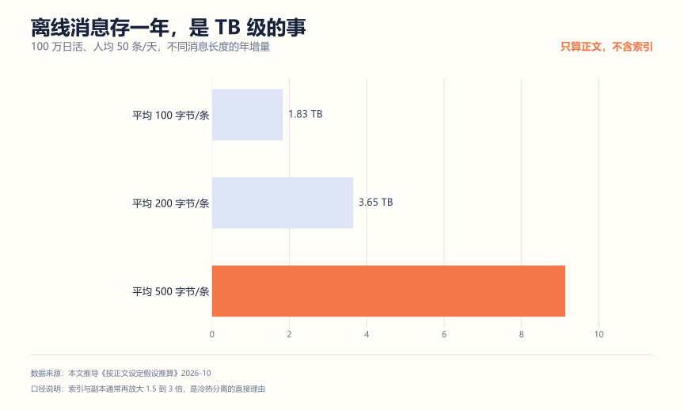
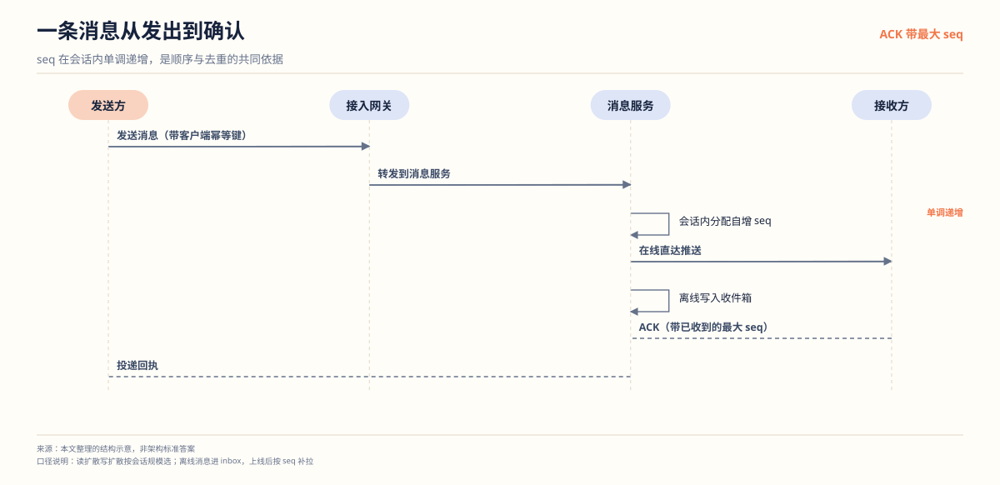

# IM 系统项目拆解：连接、投递和存储，三个真问题

**解决什么问题**：IM 项目好看不好做。大部分人的版本是"WebSocket 收到消息转手发给对方"，面试官一问消息会不会丢、扩容后连接在哪台机器、离线消息怎么补，就答不上来。这篇把这三个真问题拆开讲。

**适合谁**：想做通信类项目、或者想体现分布式理解的人。

**不适合谁**：只想演示实时聊天效果的人。那个用 WebSocket 加一个 Map 就能做到，不值得写进简历。

## 一、先算账：连接数和存储量

### 连接数不是随便涨的

WebSocket 长连接是**有状态**的，它常驻内存，还占用文件描述符。Java NIO 下按每连接约 50 KB 估算（含读写缓冲区和连接对象）：


10 万连接吃掉约 5 GB。这不只是内存问题——默认的 `ulimit -n` 往往是 1024，不调大，服务连 1 万连接都起不来。面试时能说出这两件事（内存和文件描述符），比说"我用了 Netty"更有说服力。

### 离线消息是 TB 级的事

假设 100 万日活，人均 50 条消息/天：



按 200 字节/条算，一年 3.65 TB，而且这只是正文。索引和副本通常再放大 1.5 到 3 倍。

这个数字直接推出两个设计决定：**消息必须分库分表**（按会话 ID 取模），以及**必须做冷热分离**——最近几天的热数据放 MySQL 或 SSD，更老的归档到成本更低的存储。面试官问"消息存不下怎么办"，答案就在这里，不是"加硬盘"。

## 二、架构



发送方的消息经接入网关转到消息服务，服务在会话内分配一个自增 seq——这是顺序和去重共同的依据。在线用户直达推送，离线用户写进收件箱，等上线后按 seq 补拉。接收方的 ACK 带自己已收到的最大 seq，服务端据此判断哪些消息需要重推。

这里有个容易忽略的设计：**seq 由消息服务统一分配，不由客户端生成**。客户端生成的序号在网络重试下会重复或跳号，服务端也校验不了。

## 三、核心设计决策

| 模块 | 做法 | 为什么不用另一种 |
| --- | --- | --- |
| 连接映射 | 本地 Map 加 Redis 全局路由表 | 只用本地 Map，扩容后找不到用户在哪台机器 |
| 在线判定 | 心跳 30 秒，60 秒未收到判掉线 | 只靠 TCP 断开事件，弱网下大量假掉线 |
| 消息序号 | 单会话内递增 seq | 用全局雪花 ID，不保证同一会话内有序 |
| 投递语义 | 至少一次加客户端去重 | 只发一次，弱网下必丢消息 |
| 离线消息 | 按 last_msg_id 增量拉取加分页 | 每次拉全量，流量爆炸 |
| 存储 | 按会话分表加冷热分离 | 单表，一年就撑不住 |

### 消息序号：全局唯一不等于有序

这是个高频误区。雪花 ID 全局唯一，但它在**单个会话内不保证递增**——两个节点并发生成，ID 小的那条可能后到。

正确做法是给每个会话维护一个递增 `seq`：

```text
conversation_id = 1001
seq: 1, 2, 3, 4, 5 ...
```

用 Redis `INCR conversation:seq:1001` 拿号，或者按会话分表后依赖数据库自增。客户端收到消息后按 `seq` 排序，发现断档（比如收到 1、2、5）就按缺失的 seq 主动补拉。

### 投递语义：选"至少一次"，然后客户端去重

三种语义：

| 语义 | 做法 | 后果 |
| --- | --- | --- |
| 至多一次 | 发出去就不管 | 可能丢 |
| 至少一次 | 没收到 ACK 就重发 | 可能重复 |
| 恰好一次 | 至少一次加幂等 | 工程上难以严格做到 |

实际选**至少一次**，重复问题交给客户端按 `(conversation_id, seq)` 去重。严格意义上的恰好一次需要服务端和客户端双向确认加序号协商，成本极高，校招项目没必要，但你要能说清为什么没必要。

ACK 机制：服务端投递后等客户端回一个带 `seq` 的 ACK，超时未收到进重试队列，指数退避重试，超过阈值转离线消息。

### 扩容后连接在哪台机器

这是最能体现分布式理解的一问。连接粘在建立它的那台机器上，不能随意迁移。所以需要一张路由表：

```text
Redis: user_id -> gateway_instance_id
```

用户上线时按 `user_id % 实例数` 选一台机器建立连接，同时写路由表。发消息时先查路由表，拿到实例 ID，再把消息投到那个实例，由它通过本地连接表找到 channel 推送。

实例数变化时路由表要重建，可以在网关层做一致性哈希减少重建范围。面试时能说到这一层就够了。

## 四、三个最容易被打穿的追问

**问：消息会不会丢？**

答：分场景。在线时，服务端先落库或入 MQ 再投递，客户端 ACK 确认，失败重试。离线时，消息已在存储里，上线后按 `last_msg_id` 增量拉取。服务端重启，连接全部断开，但消息不依赖连接存在——它在数据库里。所以答案是"只要落库成功就不会丢，未落库的崩溃瞬间可能丢，可用 WAL 或同步落库降低窗口"。

**问：怎么保证消息顺序？**

答：单会话内用递增 `seq`，客户端按 seq 排序，发现断档主动补拉。跨会话不保证顺序，也不需要。注意别说"用雪花 ID 保证顺序"，那是错的。

**问：多端登录怎么办？**

答：`user_id` 对应多个设备连接，路由表存的是集合而不是单个实例。投递时向该用户的所有在线连接推送。收到任一端 ACK 即视为已投递，其他端的上层同步由拉取接口兜底。

## 五、怎么证明你真的做了

**1. 断网重连测试**

手机飞行模式 10 秒后恢复，检查：离线消息是否补齐、有没有重复、seq 是否连续。这个测试做一次，比讲十句"我做了 ACK 机制"都有用。

**2. 服务端 kill 测试**

启动压测发消息，中途 `kill -9` 服务端进程，重启后检查：已落库的消息是否还在、未 ACK 的消息是否被重投、有没有重复投递。

**3. 乱序测试**

用脚本故意打乱投递顺序，看客户端能否按 seq 重排、能否发现断档并补拉。

**4. 连接规模测试**

逐步加压到 1 万、5 万连接，记录内存和文件描述符占用，验证前面那张估算图。顺便测出你机器的真实拐点。

## 六、简历写法

一段能用的：

```text
实现基于 WebSocket 的单聊消息系统，设计本地连接表加 Redis 路由表支撑网关水平扩容；
以单会话递增序号保证消息有序，客户端按序号去重与补拉；
投递采用至少一次语义加 ACK 重试，离线消息按 last_msg_id 增量同步。
经断网重连、服务端重启与乱序注入测试验证消息不丢、不重、有序。
```

三个常见错误：

| 写法 | 问题 |
| --- | --- |
| "使用 WebSocket 实现实时聊天" | 只有技术词，没有问题 |
| "使用雪花 ID 保证消息顺序" | 概念错误，雪花 ID 不保证会话内有序 |
| "实现了高并发 IM" | 没写连接规模、内存、扩容方案，撑不住追问 |

## 用 AI 做这件事

IM 项目适合让 AI 做**故障注入方案设计**和**语义推演**。投递语义这种东西，自己想想容易漏 case。

| 步骤 | 你做什么 | AI 做什么 |
| --- | --- | --- |
| 1 描述链路 | 把连接、投递、存储流程写成文字 | 无 |
| 2 穷举故障 | 把链路贴给它 | 列出所有可能丢消息、重消息、乱序的节点 |
| 3 设计注入 | 挑选最可能的几个 | 给出每个故障的具体注入步骤和预期现象 |
| 4 对照实现 | 按方案实测 | 无 |

提示词（可直接复制）：

```text
你是分布式系统故障分析者。下面是我 IM 系统的消息投递链路描述：
<贴你的链路：客户端 -> 网关 -> 消息服务 -> MQ -> 存储 -> 投递 -> ACK>
请做三件事：
1. 列出这条链路上所有可能导致消息丢失的节点，按发生概率排序；
2. 列出所有可能导致消息重复的节点；
3. 针对概率最高的三个故障，各给出一个可执行的注入步骤和预期的系统表现。
不要给解决方案，只给故障清单和验证方法。
```

人工校验点：

- 故障清单里挑你真能造的。造不出来的（比如机房光纤被挖断）标为"理论上存在"，别说成"我测过"。
- AI 给的"预期表现"要先在代码里确认逻辑，再去实测。预期错了，测试通过也没有意义。
- 测试用的用户 ID、会话内容自己构造，不要用真实聊天记录。

隐私边界：绝不把真实聊天记录、用户 ID 列表贴给 AI。这是最敏感的数据类型。

## 延伸阅读

- [秒杀系统项目拆解](./秒杀系统项目拆解.md) —— 极端并发场景的对照
- [API 网关项目拆解](./API网关项目拆解.md) —— 网关扩容与长连接的关系
- [项目深挖面试准备清单](../../面试攻略/项目深挖面试准备清单.md)
