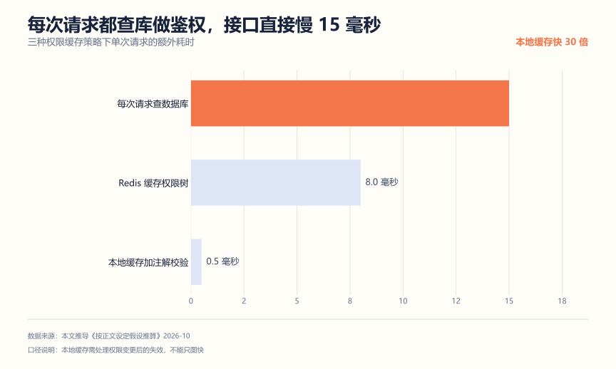
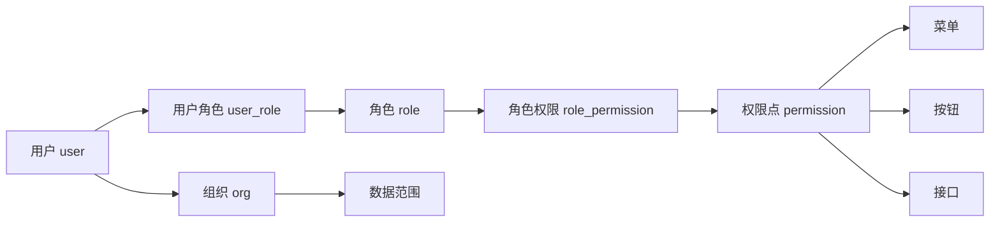
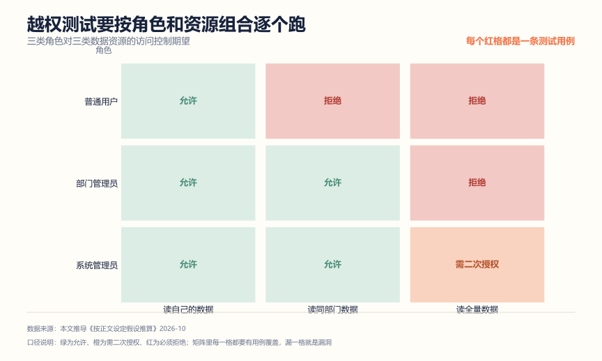

# 权限系统项目拆解：四层权限，最后一层最难讲

**解决什么问题**：权限系统是最容易被写成"登录加角色判断"的项目。真正值得讲的是四层权限的边界，尤其是**数据权限**——十个人里九个说不清怎么实现。这篇把它拆开。

**适合谁**：目标岗位是后台系统、中台、金融或国企方向的人。这类岗位对权限和审计的敏感度远高于互联网 C 端。

**不适合谁**：只想做一个能登录的 Demo 的人。

## 一、先算账：权限校验的三种成本

权限校验要在每次请求时做，所以它的开销会乘以全部流量。



| 策略 | 耗时 | 问题 |
| --- | --- | --- |
| 每次请求查数据库 | 15 毫秒 | 用户-角色-权限三表关联查询，接口直接慢一个量级 |
| Redis 缓存权限树 | 8 毫秒 | 快了，但反序列化权限树仍是大头 |
| 本地缓存加注解校验 | 0.5 毫秒 | 快 30 倍，但权限变更后要处理失效 |

结论：**必须用本地缓存**。但这里有个坑——只图快不管失效，改了权限半天不生效，运维会找你。常见做法是本地缓存 TTL 设 30 到 60 秒，加上配置变更时主动推送失效；对安全要求高的操作（比如改权限本身）不走缓存，直接查库。

## 二、四层权限，缺一层就有洞

| 层次 | 控制什么 | 典型实现 |
| --- | --- | --- |
| 菜单权限 | 能看到哪个菜单 | 登录后返回权限树，前端渲染 |
| 按钮权限 | 能看到哪个按钮 | 权限点控制，`v-if="hasPerm('user:delete')"` |
| 接口权限 | 能调用哪个接口 | 后端拦截器或注解 |
| 数据权限 | 能看到哪几行数据 | SQL 改写，追加范围条件 |

前三层好做，**第四层是分水岭**。只做菜单和按钮，别人拿你的账号配合抓包就能看全部数据；只做接口不做数据，同部门的人能互相看到对方的单子。

前端隐藏按钮**完全不算权限控制**，它只是用户体验。抓包改一个请求参数就绕过了。这句话要在面试里明确说出来。

## 三、RBAC 模型



基础是 RBAC0：用户、角色、权限三张表加两张关系表。往上还有：

- **RBAC1 角色继承**：部门经理继承普通员工的全部权限。用父角色 ID 实现，查询时要递归。
- **RBAC2 责任分离**：会计和出纳互斥，同一个用户不能同时拥有。这是金融场景的硬要求，用互斥角色表在授权时校验。
- **RBAC3**：RBAC1 加 RBAC2。

校招项目做到 RBAC0 加角色继承就够了，但你要知道 RBAC2 的存在——问到"怎么防止一个人既审批又执行"时，这就是答案。

## 四、数据权限：整个项目最难的一块

### 做法：SQL 改写

用户查订单列表，普通员工只能看自己的，部门经理能看本部门的，大区总能看整个大区的。

```sql
-- 原始 SQL
SELECT * FROM orders WHERE status = 1

-- 部门经理执行时，被改写为
SELECT * FROM orders WHERE status = 1 AND dept_id IN (1001, 1002, 1003)
```

范围从哪来：用户登录时带上组织 ID，权限服务根据角色的数据范围规则（本人、本部门、本部门及子部门、本大区、全部）解析成一个 ID 集合。

实现上用 MyBatis 拦截器或 JPA 的 Filter，在 SQL 执行前改写。**注意参数化**，把组织 ID 用占位符传，不要字符串拼接——那是 SQL 注入的经典入口。

### 权限点怎么标

```java
@RequirePermission("order:list")
@RequireDataScope(scope = "dept", deptColumn = "dept_id")
public List<Order> list(OrderQuery query) { ... }
```

拦截器读取注解，先验权限点，再按数据范围改写 SQL。注解方案比在方法里写 if-else 干净，也便于统计"这个接口到底有没有加权限"。

### 水平越权和垂直越权

- **水平越权**：同角色用户 A 看到用户 B 的数据。靠数据权限拦。
- **垂直越权**：低角色用户调用高角色接口。靠接口权限拦。

这两类都要有测试用例，而且用例不是"写几个试试"，是**按角色和资源的组合逐个跑**。一张矩阵就能覆盖：



三行角色、三列资源，九个格子。绿格是允许，橙格要二次授权，红格必须拒绝——每个红格都要有一条自动化用例，构造一个低角色身份去打这个接口，断言返回 403 而不是 200。

这张矩阵的价值在于它把"权限对不对"从主观判断变成了可枚举的清单。漏一格就是一个漏洞，而漏洞往往就漏在没人想到的组合上，比如"部门经理能不能读全量数据"这种看起来显然不能、但代码里数据范围规则写错了真能读到的场景。

矩阵还要能扩展。真实系统里角色不止三个，资源也不止三类，做法是先按数据敏感度分资源等级（公开、内部、机密），再按职责分角色，组合出来一张大表。表大了之后用参数化测试跑，几分钟就能全量回归一遍。

## 五、审计日志：做了没人夸，不做出事背锅

一次关键操作要记全六要素：

| 字段 | 例子 |
| --- | --- |
| 操作人 | user_id = 10086 |
| 时间 | 2026-10-18 21:03:12 |
| 对象 | order_id = 55021 |
| 动作 | 修改收货地址 |
| 请求内容 | 原值、新值、IP、trace_id |
| 结果 | 成功 / 失败及原因 |

三个设计要点：

1. **独立存储**。审计日志不要和业务表放一个库，业务库被删改时日志还在。
2. **只追加不修改**。不提供更新和删除接口，出问题才有据可查。
3. **异步但不丢**。走 MQ 落库，失败重试；对极高敏感操作（转账、改权限）可以同步写，宁可慢一点。

超级管理员也要记。这是审计的核心价值——如果超级管理员不记，出了事无法定责。

## 六、怎么证明你真的做了

**1. 越权测试矩阵**

这是最能体现专业度的一份材料。按"角色 × 接口 × 数据范围"列矩阵：

| 用例 | 操作 | 预期 |
| --- | --- | --- |
| 水平越权 | 员工 A 用员工 B 的 user_id 查订单 | 403 或返回空 |
| 垂直越权 | 普通员工调用 `user:delete` 接口 | 403 |
| 数据范围 | 部门经理查订单，结果是否只含本部门 | 只含本部门及子部门 |
| 权限变更 | 改完角色权限，原权限是否立即失效 | 按缓存策略在预期时间内失效 |
| 审计完整 | 执行一次删除，日志六要素是否齐全 | 齐全且不可改 |

**2. 权限缓存一致性测试**

改一个角色的权限，然后在不同时间点用原账号调接口，记录多久之后才真正失效。这个数字是你缓存策略的实测值，比"我用了缓存"有说服力。

**3. SQL 注入验证**

在数据权限的查询参数里塞 `' OR 1=1 --`，确认被参数化挡住。这个用例必须有，因为数据权限是手工改写 SQL 的高危区。

## 七、简历写法

一段能用的：

```text
设计后台管理系统 RBAC 权限模块，完成用户、角色、权限点与组织架构建型，支持角色继承与互斥校验；
实现菜单、按钮、接口、数据四层权限，数据权限基于 MyBatis 拦截器按组织范围参数化改写 SQL；
权限校验采用本地缓存加注解方式，单次额外耗时约 0.5 毫秒，并通过发布订阅处理权限变更失效。
关键操作记录六要素审计日志，独立存储且只追加，按角色乘接口乘数据范围矩阵完成越权测试。
```

三个常见错误：

| 写法 | 问题 |
| --- | --- |
| "实现了 RBAC 权限管理" | 只有名词，没说四层权限和数据权限 |
| "前端根据角色显示不同菜单" | 把前端隐藏当成了权限控制 |
| "保证了系统安全" | 空话，换成具体机制：接口鉴权加数据过滤加审计 |

## 用 AI 做这件事

权限系统适合让 AI **生成越权测试矩阵**。测试用例最怕漏，而漏一个就是一个洞。

| 步骤 | 你做什么 | AI 做什么 |
| --- | --- | --- |
| 1 描述模型 | 列出角色、权限点、数据范围规则 | 无 |
| 2 生成矩阵 | 把描述贴给它 | 按角色乘接口乘数据范围输出测试用例 |
| 3 补漏 | 标出它没想到的 | 针对盲区补充 |
| 4 执行 | 按矩阵逐条测 | 无 |

提示词（可直接复制）：

```text
你是安全测试工程师。下面是我的权限模型：
<角色列表、每个角色的权限点、数据范围规则、接口清单>
请输出一张越权测试矩阵，四列：用例编号 / 操作步骤 / 预期结果 / 违反的安全属性。
必须覆盖：水平越权、垂直越权、数据范围越界、权限变更未生效、
未登录访问、token 过期后访问。不要写测试代码，只列用例。
```

人工校验点：

- 矩阵里的接口必须是你项目里真实存在的。AI 会编造接口名，别直接拿去执行。
- "违反的安全属性"这一列是给你自己 review 用的，能帮你发现设计里没有对应机制的用例。
- 角色名称、组织 ID、用户 ID 全部用虚构值，不要贴真实的组织架构和人员名单。

隐私边界：组织架构、人员名单、真实权限配置是敏感信息。用 `role-a`、`dept-1001` 这类占位符。

## 延伸阅读

- [API 网关项目拆解](./API网关项目拆解.md) —— 网关鉴权与业务鉴权的分工
- [秒杀系统项目拆解](./秒杀系统项目拆解.md) —— 秒杀资格校验也是权限的一种
- [AI 应用研发作品集项目清单](../AI应用研发作品集项目清单.md) —— AI 方向的项目选择
