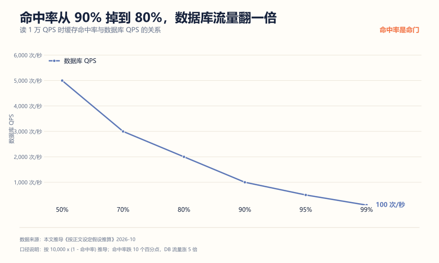
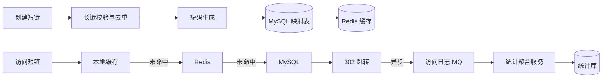

# 短链系统项目拆解：业务简单，但每一层都能讲出取舍

**解决什么问题**：短链是校招里性价比很高的项目——业务一天能讲完，但编码、缓存、一致性、安全每个点都能挖。问题在于大部分人只做到"生成短码、302 跳转"就停了，面试官一问缓存和统计就答不上来。

**适合谁**：想找一个不太大、又能讲出系统设计味道的项目的人。

**不适合谁**：想靠它体现高并发能力的人。短链的读多写少特征明显，但它不是秒杀那种极端场景。

## 一、先算账：短码要多少位，缓存要多少命中率

### 短码长度和容量的关系

Base62 编码（0-9、a-z、A-Z）不同位数的容量：

| 位数 | 容量 | 够不够用 |
| --- | --- | --- |
| 4 位 | 1,477 万 | 不够，几天就耗尽 |
| 5 位 | 9.16 亿 | 中小系统可用 |
| 6 位 | 568 亿 | 主流选择 |
| 7 位 | 3.52 万亿 | 预留冗余 |

按 62^位数 算。结论：**6 位是常见起点**，7 位留给增长。短码不是越短越好，4 位虽然好记但容量太小，扩容时要改长度，历史数据全部受影响。

### 命中率跌一个点，数据库多扛一百次

假设跳转读 10,000 次/秒：


99.9% 命中率时数据库只扛 10 次/秒，90% 时变成 1,000 次/秒，差了 100 倍。这就是为什么"缓存命中率"必须是你压测报告里的一个指标，而不是一句"我加了缓存"。

整条曲线长这样，注意它是**指数型**的，不是直线：



从 90% 到 95%，数据库流量从 1,000 掉到 500，省一半；从 95% 到 99%，再从 500 掉到 100。越往右每提升一个点的收益越大，但难度也越大——最后那几个点通常要靠本地缓存兜最热的那批短码，单靠 Redis 上不去。

所以工程上的排序是：**先保证 90%，再争 95%，最后 99% 靠本地缓存**。面试时能把这个分段策略讲出来，说明你真调过缓存，而不是只会说"我用了 Redis"。

## 二、延迟预算：跳转要快，快在缓存层级

一次跳转的耗时分布：

| 层级 | 量级 | 说明 |
| --- | --- | --- |
| 本地缓存（Caffeine） | 0.1 毫秒 | 进程内，无网络 |
| Redis | 1 毫秒 | 一次往返 |
| MySQL 主键查询 | 5 毫秒 | SSD，单条索引查询 |

所以链路是：本地缓存未命中查 Redis，Redis 未命中查数据库并回写。**不要反过来**，也不要每层都查一遍。

## 三、架构



## 四、核心设计决策

| 模块 | 做法 | 为什么不用另一种 |
| --- | --- | --- |
| 短码生成 | 自增 ID 加 Base62 | 随机字符串要处理冲突，且随数据量增长冲突率上升 |
| 冲突兜底 | 数据库唯一索引 | 只靠生成算法，并发下仍可能撞码 |
| 跳转方式 | 302 临时重定向 | 301 会被浏览器缓存，统计丢失且无法改目标 |
| 缓存 | 本地加 Redis 两级 | 只加 Redis，热点短链仍打满单点 |
| 穿透防护 | 缓存空值加布隆过滤器 | 不存在的短码被刷，会直接压到数据库 |
| 访问统计 | MQ 异步加聚合写 | 同步逐条写，跳转接口被拖慢 |

### 302 还是 301，这是个真问题

- **301** 是永久重定向，浏览器会缓存跳转结果，后续访问根本不请求你的服务。好处是快，坏处是你统计不到、也改不了目标地址。
- **302** 是临时重定向，每次都会来问你。多一次请求，换来统计能力和灵活性。

短链服务必须选 302。这个点面试问到的概率不低，而且答错会显得没真做过。

### 短码生成：自增 ID 比随机字符串靠谱

随机字符串的问题不是"会冲突"，是**冲突率随数据量线性上升**。表里有 9 亿条时，随机一个 6 位码撞上的概率不可忽略，重试几次也未必能避开。

自增 ID 转 Base62 没有这个问题，而且短码有序，便于排查。代价是**暴露业务量**——竞争对手可以把你所有短码遍历一遍，反推出你的增长曲线。对安全性有要求的场景，可以在发号时加一个固定盐做位运算混淆。

分库分表场景下，自增 ID 要换成号段发号器或 Snowflake，再转 Base62。

### 统计千万不能同步写

假设 10,000 次跳转/秒，分散在 1 万个短码上：


逐条同步写是 10,000 行/秒，数据库直接被拖死；按短码加分钟聚合约 167 行/秒；按小时聚合只有 3 行/秒。

做法是：跳转接口只往 MQ 投一条日志，聚合服务消费时按 `(短码, 时间桶)` 累加，批量 UPSERT。粒度越粗写入越少，但实时性越差。分钟粒度是常见平衡点。

## 五、三个缓存问题，答不上来基本就穿

**问：不存在的短码被频繁访问怎么办？**

答：缓存穿透。两种做法——缓存空值，把"不存在"也缓存起来，TTL 设短（比如 30 秒）；或者上布隆过滤器，在缓存前面挡一道。空值方案简单，但如果恶意构造的短码每次都不同，空值缓存也会失效，这时候布隆过滤器更稳。

**问：热点短链缓存过期瞬间怎么办？**

答：缓存击穿。用互斥锁，只放一个线程去查数据库重建缓存，其他线程等结果。或者干脆给热点 key 设逻辑过期，物理不过期，由后台任务异步刷新。

**问：大量缓存同时过期怎么办？**

答：缓存雪崩。TTL 加随机偏移，比如基础 1 小时再加 0 到 10 分钟随机值，把过期时间打散。

这三个问题是缓存专题的标准问法，短链项目正好是最自然的载体。

## 六、怎么证明你真的做了

**1. 冲突测试**

并发调用创建接口 1 万次，检查：生成的短码是否有重复；数据库唯一索引是否真的拦住了冲突。有重复说明你的算法或兜底有问题。

**2. 跳转压测**

JMeter 打跳转接口，分两个场景测：全命中（同一批短码反复访问）和高 miss（随机短码）。记录 P95 和数据库 QPS，验证命中率对数据库压力的影响，也就是前面那张图。

**3. 统计对账**

```sql
-- 跳转总次数
SELECT COUNT(*) FROM access_log WHERE created_at BETWEEN ? AND ?;

-- 聚合表总数
SELECT SUM(pv) FROM stats_minute WHERE bucket BETWEEN ? AND ?;
```

两者应该对得上。对不上说明 MQ 丢消息或者聚合逻辑有漏洞——这个差距本身就是很好的面试素材。

**4. 安全测试**

提交一个恶意域名（比如钓鱼站），看系统是否拦截；用脚本高频访问同一短码，看限流是否生效。

## 七、简历写法

一段能用的：

```text
实现短链生成与跳转系统，采用自增 ID 转 Base62 生成 6 位短码并以唯一索引兜底冲突；
跳转链路设计本地加 Redis 两级缓存，对不存在短码采用空值缓存与布隆过滤器防穿透；
访问统计经 MQ 异步消费并按分钟粒度聚合，将数据库写入从 10,000 行/秒降至约 170 行/秒。
压测验证命中率 99% 时数据库 QPS 由 10,000 降至 100。
```

三个常见错误：

| 写法 | 问题 |
| --- | --- |
| "实现了一个短链系统，用了 Redis 缓存" | 没写缓存层级、命中率、防穿透 |
| "提升了跳转性能" | 没有基线，没有数字 |
| "支持高并发" | 短链是读多写少，说高并发反而暴露没理解场景 |

## 用 AI 做这件事

短链项目适合让 AI 帮你做**容量估算的交叉验证**和**压测脚本起草**。估算最怕的是自己算错一个数量级还没发现。

| 步骤 | 你做什么 | AI 做什么 |
| --- | --- | --- |
| 1 独立估算 | 自己先算一遍容量、命中率、写入量 | 无 |
| 2 交叉验算 | 把假设和算式贴给它 | 独立复算，标出与你不一致的步骤 |
| 3 脚本起草 | 审阅并改写 | 按你的链路生成 JMeter 或压测脚本骨架 |
| 4 追问演练 | 把设计决策贴给它 | 只基于材料提问，专挑你没算过的地方 |

提示词（可直接复制）：

```text
你是容量估算审校者。下面是我对短链系统的估算假设和算式：
<贴你的假设、每一步计算、得到的结论>
请做三件事：
1. 独立复算每一步，只指出算错或量级可疑的步骤，不要重写整篇；
2. 列出我漏算的三个变量（比如缓存命中率、消息丢失、索引膨胀）；
3. 对每个结论给出一个可以反驳它的极端场景。
```

人工校验点：

- 复算结果必须自己再手推一遍。AI 算错乘除法是常事，尤其是数量级。
- "漏算的变量"里挑真正相关的采纳，不要全盘接收——AI 倾向于把不相关的也列上来显得周全。
- 压测脚本里的目标地址、端口、线程数要改成你自己的环境再跑。

隐私边界：不要把线上真实域名的映射关系、真实访问量贴给 AI。用测试数据。

## 延伸阅读

- [秒杀系统项目拆解](./秒杀系统项目拆解.md) —— 读多写少的对照案例
- [IM 系统项目拆解](./IM系统项目拆解.md) —— 长连接场景的存储估算
- [Java 后端校招项目清单](../Java后端校招项目清单.md) —— 先想清楚选哪个项目
