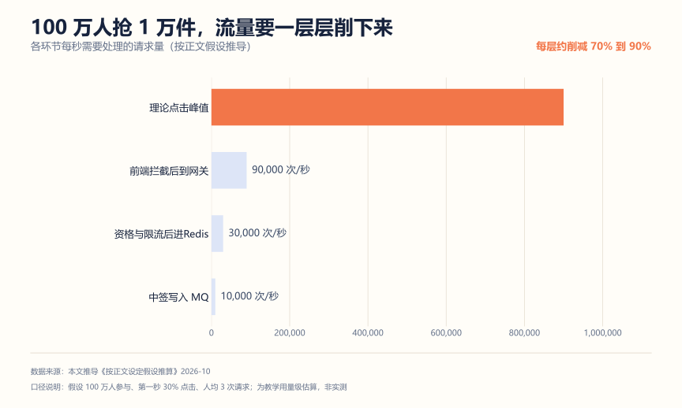
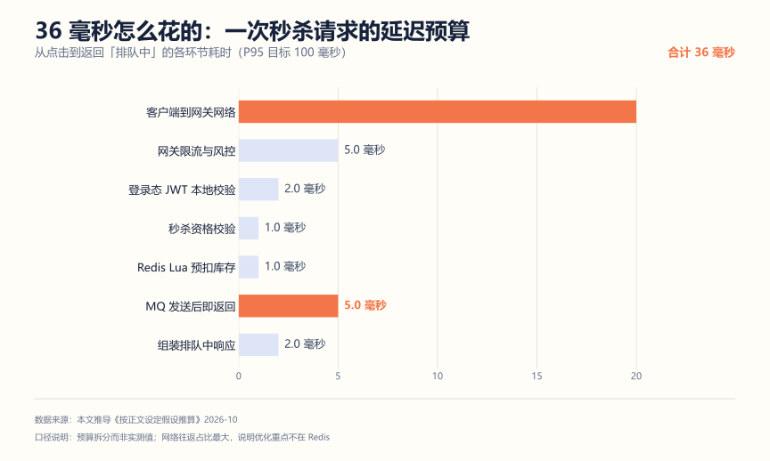
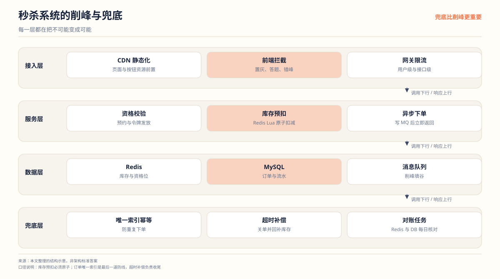
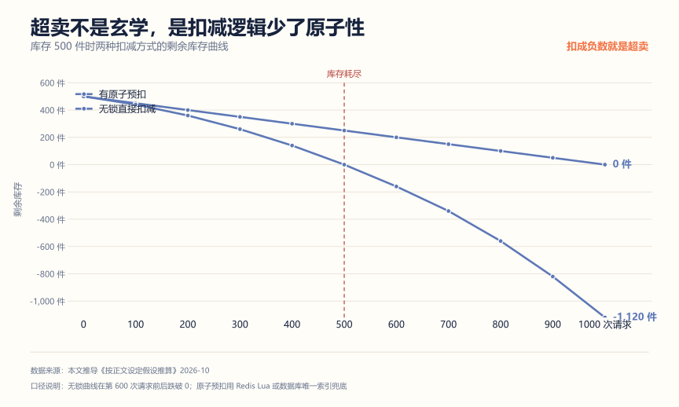
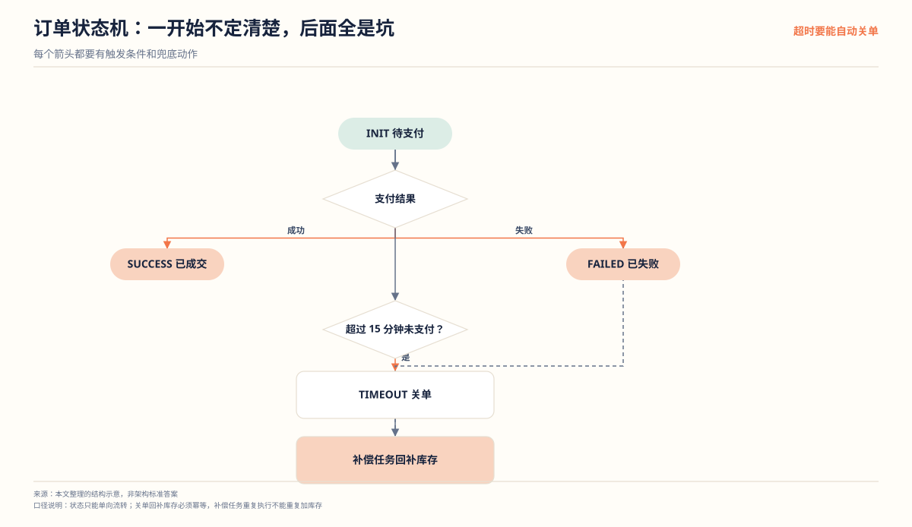

# 秒杀系统项目拆解：先把账算清楚，再谈高并发

**解决什么问题**：秒杀是后端校招出现频率最高的项目，也是被写糊得最多的一个。大部分人的简历上只有"Redis + MQ"两个词，面试官追问三层就穿。这篇按"先算账、再设计、再验证"的顺序，给你一套能扛住追问的讲法。

**适合谁**：正在做或者打算做秒杀项目的同学；也适合已经把项目做完、但不知道怎么讲的人。

**不适合谁**：想找一份能直接抄的代码的人。这里给的是设计判断和验证方法，代码要自己写。

## 一、先算账：100 万人抢 1 万件是什么概念

动手设计之前，先把数量级算出来。不算这个，后面所有"高并发"都是空话。

假设：一场秒杀有 100 万人参与，放出 10,000 件商品，活动开始第一秒有 30% 的人点进来，每人平均发 3 次请求（含重复点击和重试）。

| 环节 | 每秒请求量 | 怎么算的 |
| --- | --- | --- |
| 理论点击峰值 | 900,000 次/秒 | 100 万 × 30% × 3 次 |
| 前端拦截后到网关 | 90,000 次/秒 | 按钮置灰加答题校验，按削减 90% 估 |
| 资格与限流后进 Redis | 30,000 次/秒 | 仅预约用户可参与，且每人限 1 次/秒 |
| 中签写入 MQ | 10,000 次/秒 | 库存只有 1 万件，预扣成功即中签 |



这张图说明两件事。

第一，**最大的流量削减发生在最前面，不是在 Redis**。前端把按钮置灰、加一道答题校验，能削掉九成流量。这不是"用户体验优化"，这是系统能扛住的前提。很多人一上来就研究 Redis 怎么分片，方向就反了。

第二，**库存只有 1 万件，所以 Redis 预扣的上限就是 1 万**。真正落到数据库的写入，是 1 万笔订单，不是 90 万笔。异步队列的作用就是把这个差距拉开。

这里要提醒一句：上面的数字是按假设推导的教学用量级，不是你机器的实测值。真实数字取决于前端策略、用户行为和你自己的压测结果，面试时要说清"我按什么假设算的"，不要说成"我测出来就是 90 万"。

## 二、延迟预算：一次请求 36 毫秒怎么花的

高并发项目不能只说 QPS，还得说清楚一次请求的时间花在哪。用户从点击到看到"排队中"，每一毫秒都应该有去处。



按 P95 目标 100 毫秒倒推，预算是这样拆的：

| 环节 | 预算 | 说明 |
| --- | --- | --- |
| 客户端到网关 | 20 毫秒 | 同城网络往返，占比最大 |
| 网关限流与风控 | 5 毫秒 | 本地规则判定，不依赖外部存储 |
| 登录态 JWT 校验 | 2 毫秒 | 本地验签，不查 Redis |
| 秒杀资格校验 | 1 毫秒 | Redis 单次读 |
| Redis Lua 预扣库存 | 1 毫秒 | Lua 单次执行 |
| MQ 发送后即返回 | 5 毫秒 | 异步发送，不等落库 |
| 组装响应 | 2 毫秒 | 序列化写回 |
| 合计 | 36 毫秒 | 留 64 毫秒余量给抖动 |

结论有点反直觉：**网络往返占了 20 毫秒，是 Redis 那两毫秒的十倍**。所以面试时说"我把 Redis 换成本地缓存能快多少"基本是无效优化。真正该花时间的是：登录态别去查 Redis（用 JWT 本地验签）、资格校验合并成一次 Redis 调用、MQ 发送不等确认。

这个预算法也是你写压测报告时的对照表。压出来 P95 是 80 毫秒，你要能指出是哪一段超了。

## 三、架构



链路是：请求先被前端和网关削掉九成，资格校验放行后进 Redis Lua 预扣，中签的才写 MQ 异步建单，未中签的直接返回已售罄。兜底层负责收拾异常：唯一索引防重复下单，超时补偿关单回补库存，对账任务每天核对 Redis 和 MySQL。

关键点：**未中签的请求不进入后续链路**。90% 的流量在 Redis 预扣这一步就被挡掉了，它们不会去碰消息队列和数据库。

## 四、核心设计决策

| 模块 | 做法 | 为什么不用另一种 |
| --- | --- | --- |
| 流量入口 | 前端置灰加答题，网关按用户令牌桶限流 | 只靠后端限流，90 万请求全打到网关上 |
| 库存扣减 | Redis Lua 原子预扣 | 直接 UPDATE 数据库会全部排队在一行 |
| 一致性兜底 | MySQL 唯一索引加状态机 | 靠代码判断"查过再扣"有竞态 |
| 削峰 | MQ 异步建单 | 同步建单，数据库要扛 90 万写 |
| 结果查询 | 返回"排队中"，前端轮询 | 同步等结果，连接全被占住 |
| 异常兜底 | 重试加死信加补偿任务 | 只靠重试会无限重试同一条消息 |

### 库存为什么必须用 Lua

一个容易丢分的写法是分两步：

```java
// 错误示范
Long stock = redisTemplate.opsForValue().get("seckill:stock:1001");
if (stock != null && stock > 0) {
    redisTemplate.opsForValue().decrement("seckill:stock:1001");
}
```

两步之间，别的线程也可以读到同一个 `stock > 0`，结果就是超卖。改成 Lua 让判断和扣减在一次原子执行里完成：

```lua
-- KEYS[1] 库存 key，ARGV[1] 扣减数量
local stock = tonumber(redis.call('get', KEYS[1]))
if stock == nil or stock <= 0 then
    return 0            -- 售罄
end
redis.call('decrby', KEYS[1], ARGV[1])
return 1                -- 中签
```

Redis 执行 Lua 脚本期间不会插入其他命令，所以判断和扣减不会被切开。Java 侧用 `DefaultRedisScript` 注册，一次 `execute` 调用。

少了原子性会怎样，把库存变化画出来最直接。同样是 500 件库存、同样一批并发请求：



无锁那条线在第 600 次请求前后跌破 0，之后一路往下掉——这就是超卖的完整过程。它不是"偶尔出错"，而是**并发一上来就必然发生**，因为读改写三步之间只要有别的线程插入，更新就丢了。线上表现为库存明明显示 0，后台还能查出几十条已付款订单，然后就是一整天的客诉和补货。

所以这道防线是双层的：Redis Lua 保证扣减原子，数据库唯一索引保证不会重复建单。两层都要有，因为 MQ 重复投递、消费者重试都会让同一请求到达两次。

### 幂等靠数据库，不靠代码

用户连点、客户端重试、MQ 重复投递，都会造成重复下单。靠"先查有没有下单记录"挡不住并发，唯一可靠的是数据库唯一索引：

```sql
UNIQUE KEY uniq_user_item (user_id, activity_id, item_id)
```

重复插入直接抛 `DuplicateKeyException`，业务侧捕获后当作"已下单"处理。订单表再加一个 `request_id` 唯一键，覆盖客户端重试。

### 状态机要一开始就设计

```text
INIT（已创建，待支付）
  - 支付成功，转 SUCCESS
  - 支付失败，转 FAILED（触发库存回补）
  - 超过 15 分钟未支付，转 TIMEOUT（补偿任务扫描后回补）
```

画成图更清楚每个箭头的触发条件：



没有状态机，"这条订单到底成没成"就说不清楚，结果查询接口也无从实现。这是面试里最容易被打穿的地方之一。

真正容易丢分的是**兜底动作没定义**。支付失败要回补库存，超时要关单，这两个动作都由补偿任务触发，而补偿任务自己可能重复执行——所以回补必须幂等。工程上的做法是给每次库存变动记一条流水，回补前先查这笔单有没有已经补过，用唯一键 `(order_id, action)` 拦住重复回补。

## 五、三个最容易被打穿的追问

**问：Redis 扣了库存，订单创建失败怎么办？**

答：消费端按指数退避重试，重试超过阈值进死信队列，人工介入。同时补偿任务每分钟扫描 `INIT` 状态超过 15 分钟的订单，确认未支付后回补 Redis 库存，订单转 `TIMEOUT`。关键是回补也要走 Lua，保证回补本身原子。

**问：MQ 消息重复消费怎么办？**

答：两层。第一层是订单表唯一键，重复插入会被数据库拦住；第二层是消费记录表，按 `message_id` 判重，已处理过直接 ACK。第一层是兜底，第二层是省掉无谓的数据库异常开销。

**问：Redis 挂了怎么办？**

答：降级，不是硬扛。活动开关一键关闭，前端展示"活动已结束"；已中签的用户凭订单号走只读查询，不影响数据库。绝不这时候把请求直接打到 MySQL 上，那等于把库存行锁打满。

## 六、怎么证明你真的做了

这是区分"看过教程"和"真做过"的分界线。至少准备下面四样。

**1. 压测报告**

用 JMeter 或 wrk 打网关接口，记录四个数：QPS、P95 延迟、错误率、Redis 库存终值。重点不是数字多好看，是你能解释每一段曲线为什么长这样。比如限流生效后错误率应该稳定在预期水平，而不是一路飙升。

**2. 库存对账脚本**

```sql
-- 已创建订单数 + 未创建数，应等于放出库存
SELECT status, COUNT(*) FROM orders
WHERE activity_id = 1001 GROUP BY status;

-- 与 Redis 剩余库存核对
GET seckill:stock:1001
```

等式：`Redis 剩余库存 + 订单数（SUCCESS + INIT + TIMEOUT）= 初始库存`。这个脚本跑一次，比说十句"我保证了不超卖"都管用。

**3. 重复下单测试**

同一用户并发发 100 次下单请求，最终数据库里这个用户这个商品只应有 1 条订单。把测试结果截图存着，面试时直接拿出来。

**4. 故障演练**

手动 kill 掉订单消费端，看消息是否堆积、补偿任务是否按时回补库存、恢复后积压是否被消化。这个演练做过一次，"MQ 消息丢了怎么办"这类问题就再也不会问倒你。

## 七、简历写法

一段能用的：

```text
设计秒杀下单链路，通过前端答题校验与网关用户级限流将峰值流量削减约两个数量级；
使用 Redis Lua 脚本原子预扣库存，MQ 异步创建订单削平写入峰值；
以用户加商品唯一索引保证幂等，订单状态机（INIT/SUCCESS/FAILED/TIMEOUT）支撑结果查询，
并实现超时补偿任务回补库存。压测与对账脚本验证高并发下库存无超卖、无重复下单。
```

三个常见错误：

| 写法 | 问题 |
| --- | --- |
| "使用 Redis 和 MQ 实现秒杀系统" | 只有技术词，没有问题、方案和结果 |
| "优化了系统性能，QPS 提升 10 倍" | 没写基线，没写方法，无法验证 |
| "保证了高并发下的数据一致性" | 空话，换成具体机制：唯一索引加状态机加补偿 |

## 用 AI 做这件事

AI 在这个项目里最好的用途是**当压力面试官和压测方案设计者**，不是替你写代码。

| 步骤 | 你做什么 | AI 做什么 |
| --- | --- | --- |
| 1 准备材料 | 把架构图、核心代码片段、压测数据整理成一份事实清单 | 无 |
| 2 追问演练 | 把清单贴给它 | 只根据这份材料提问，不补充外部知识，一轮至少 10 个问题 |
| 3 暴露缺口 | 标记答不上来的问题 | 针对每个缺口给出需要补的最小知识点 |
| 4 复述校验 | 用自己的话重新讲一遍 | 指出逻辑断点和模糊表述 |

提示词（可直接复制）：

```text
你是资深后端面试官，只根据我提供的材料提问，不要引入材料之外的技术。
材料如下：<架构说明、Redis Lua 脚本、订单表 DDL、压测数据>
要求：
1. 先读材料，列出你认为最可能被追问的 10 个问题，按"会不会被打穿"排序；
2. 逐个提问，每次只问一个，等我回答；
3. 我的回答如果出现"应该是""大概"这类模糊表述，直接指出来；
4. 全部问完后，输出一张表：问题 / 我的回答质量（强、中、弱）/ 需要补的最小动作。
```

人工校验点：

- AI 提的问题如果涉及材料里没有的机制（比如它建议你"用分布式锁"），要么补进设计，要么明确拒绝，不能含糊带过。
- 回答质量那列必须你自己判。AI 倾向于把"听起来合理"当成"答对了"。
- 压测数据不要原样贴给在线 AI，脱敏成"峰值 QPS 量级""P95 量级"再贴。

隐私边界：项目里的公司内部数据、真实用户量、线上告警记录不要贴。用自己构造的测试数据。

## 延伸阅读

- [短链系统项目拆解](./短链系统项目拆解.md) —— 另一个适合讲系统设计的入门项目
- [项目深挖面试准备清单](../../面试攻略/项目深挖面试准备清单.md) —— 把项目讲清楚的通用清单
- [AI 岗位全景与转型路径](../../AI求职/01-AI岗位全景与转型路径.md) —— 先确认目标岗位需要什么项目
