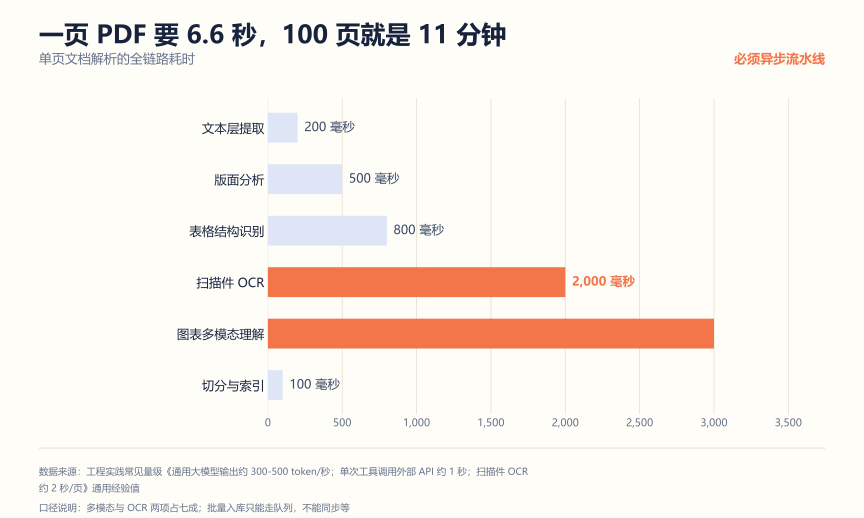
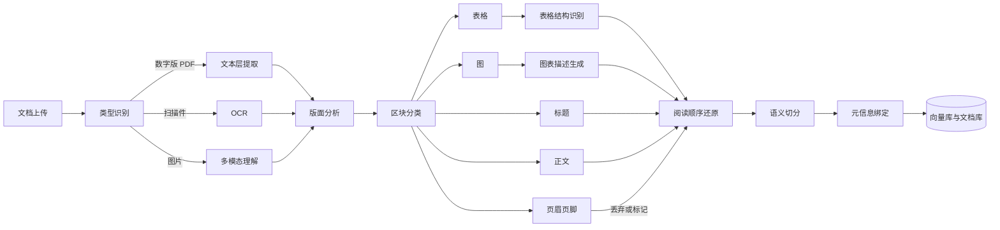
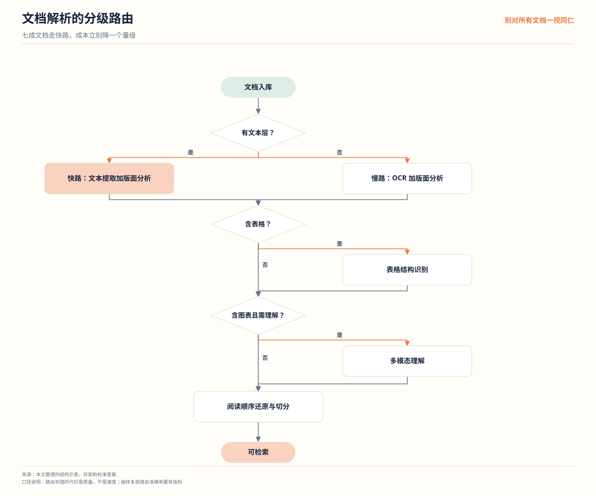
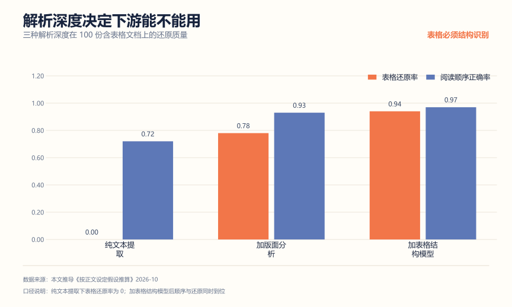

# 文档智能解析系统拆解：RAG 的地基，多数人没打好

**解决什么问题**：所有做 RAG 的人都会遇到同一个困惑——"我 Prompt 也调了，Embedding 也换了，为什么还是答错？"答案 often 在更上游：**文档根本没解析对**。表格被切成两半、页眉页脚混进正文、扫描件一个字都没识别出来。这个项目专门解决这件事。

**适合谁**：做 RAG、知识库、文档问答的人；想体现"能处理脏数据"这个稀缺能力的人。

**不适合谁**：只用干净的 Markdown 或 TXT 做 Demo 的人。那你确实不需要它，但也因此你的 RAG 没经过真实检验。

先说结论：**解析质量决定了检索质量的上限**。召回不准，九成不是检索算法的问题，是切分的时候就把语义切碎了。这个项目是把 RAG 从"能跑"做到"能用"的关键一环。

## 一、先算账：一页 PDF 要 6.6 秒



| 环节 | 量级 | 什么时候需要 |
| --- | --- | --- |
| 文本层提取 | 200 毫秒 | 数字版 PDF 直接取 |
| 版面分析 | 500 毫秒 | 一直需要 |
| 表格结构识别 | 800 毫秒 | 文档含表格 |
| 扫描件 OCR | 2,000 毫秒 | 无文本层的扫描页 |
| 图表多模态理解 | 3,000 毫秒 | 需要理解图的内容 |
| 切分与索引 | 100 毫秒 | 一直需要 |

合计约 6.6 秒/页。**100 页的文档就是 11 分钟。**

这个数字推出两个硬性设计决定：

1. **必须异步流水线**。同步等 11 分钟，用户早就走了。上传后进队列，后台处理，完成通知。
2. **必须分级路由**。不是每页都要走完全部环节。纯文字的数字版 PDF 只需要 300 毫秒；扫描件才需要 OCR；含图表的才需要多模态。**按需调用，别一上来全跑一遍**——这是成本和延迟的双重优化。

## 二、架构



关键在最后两步：**阅读顺序还原**和**元信息绑定**。没有前者，模型读到的是一堆乱序片段；没有后者，你做不了引用展示和权限过滤。

## 三、核心设计决策

| 模块 | 做法 | 为什么不用另一种 |
| --- | --- | --- |
| 路由 | 按文档类型分级处理 | 所有文档全跑 OCR 和多模态，成本翻十倍 |
| 版面分析 | 先分区块再分类 | 直接按坐标切，标题正文混在一起 |
| 表格 | 保留行列与合并单元格结构 | 转成纯文本，表格语义全丢 |
| 图表 | 生成文字描述再入库 | 图片直接跳过，图里的信息全丢 |
| 页眉页脚 | 识别后标记或丢弃 | 混进正文，每页都重复污染上下文 |
| 阅读顺序 | 按版面坐标与字号还原 | 按文本流顺序，双栏文档会串行 |
| 元信息 | 每 chunk 绑 doc_id、页码、章节 | 无元信息，做不了引用和权限 |

### 路由：别对所有文档一视同仁



四岔路的判据和耗时：

```text
文档类型判定
  - 有文本层且无表格无图     快路：文本提取 + 版面分析，约 300 ms/页
  - 有文本层且含表格         中路：加表格结构识别，约 1.5 s/页
  - 无文本层（扫描件）       慢路：OCR + 版面分析，约 2.7 s/页
  - 含图表且需理解内容       慢路：加多模态理解，约 6.6 s/页
```

一本文档库里，纯文字的数字文档通常占七成以上。全走慢路，成本是快路的二十倍。**分级路由是文档解析项目最实用的优化**，比任何单点提速都值。

但路由有个隐藏代价：**判错路的代价是质量，不是速度**。把含表格的文档判成快路，省了 1.2 秒，换来的是表格变乱码，下游检索直接拿不到正确信息。所以路由本身也要评测——抽 100 份文档人工标好类型，看路由判准率，这个指标应该和解析质量指标一起看。

解析深度直接决定下游能不能用。同 100 份含表格文档，三种深度的结果（按正文假设推导的量级）：



纯文本提取下表格还原率是 0，不是"效果差"，是"根本做不了"——表格一旦被拉平成文字，行和列的关系就没了，下游无论用什么检索都拼不回来。而加上表格结构模型之后，还原率和阅读顺序同时上去，说明这两件事是同一个模型解决的，不是两个独立优化。

所以选型时别问"哪个解析器快"，要问"我的文档里表格占比多少、表格信息对业务重要吗"。内部制度文件可能全是表格，那表格结构识别就不是可选项，是必选项。

### 表格：结构比内容更重要

一个表格转成纯文本：

```text
姓名 张三 年龄 30
姓名 李四 年龄 25
```

语义已经丢了——看不出这是两行两列。正确的做法是保留结构：

```json
{
  "type": "table",
  "rows": 3,
  "cols": 3,
  "cells": [
    {"r": 0, "c": 0, "text": "姓名", "is_header": true},
    {"r": 0, "c": 1, "text": "部门", "is_header": true},
    {"r": 0, "c": 2, "text": "入职日期", "is_header": true},
    {"r": 1, "c": 0, "text": "张三"},
    {"r": 1, "c": 1, "text": "研发部"},
    {"r": 1, "c": 2, "text": "2023-04-01"}
  ],
  "merged_cells": [{"r": 2, "c": 0, "colspan": 3, "text": "合计 2 人"}]
}
```

合并单元格必须单独标记——它是表格里最容易解析错、也最影响语义的部分。检索时可以把表格按行转成自然语言描述，比直接塞 JSON 效果更好：

```text
张三，研发部，2023-04-01 入职。
李四，研发部，2023-04-15 入职。
```

### 页眉页脚：不显眼但很致命

每页都有的页眉"XX 公司内部资料"和页脚"第 12 页"，如果不处理，会被切成几十个几乎相同的 chunk。后果是：检索时这些重复片段会占据 Top K 名额，把真正相关的内容挤掉。

处理方式：版面分析时按位置和字号识别（页眉通常在页面顶部、字号小、每页重复），标记后丢弃或转成文档级元信息。**这一条优化在真实文档上效果极其明显**，而且几乎没人做。

### 阅读顺序：双栏文档怎么还原

双栏是论文、期刊、财报的常见版式。直接用 PDF 文本流顺序读，左右栏会逐行交叉："左栏第一行 右栏第一行 左栏第二行……"，读出来完全不通。版面分析存在的核心理由就是解决这个问题。

按坐标还原的顺序判断，粗看这样：

```python
def reading_order(blocks: list[Block], page_width: float) -> list[Block]:
    mid = page_width / 2
    tol = mid * 0.05                     # 容差，防坐标抖动
    left, right, full = [], [], []
    for b in blocks:
        if b.x1 <= mid + tol:
            left.append(b)
        elif b.x0 >= mid - tol:
            right.append(b)
        else:
            full.append(b)               # 跨栏块：大标题、通栏表格

    # 左栏整体在右栏之前，跨栏块按纵向位置与两栏合并
    return merge_by_y(sorted(left, key=lambda b: b.y0),
                      sorted(full, key=lambda b: b.y0),
                      sorted(right, key=lambda b: b.y0))
```

真实实现比这麻烦：要处理三栏、图文环绕、跨栏表格、脚注。但**面试讲清"按坐标分栏、栏内按纵向、跨栏块按位置插入"这个思路就够了**，不需要把实现背出来。

一个验证技巧：拿一份已知的双栏 PDF，抽 10 页人工核对顺序，统计正确率。这个指标比任何"我们用了某开源解析器"都有说服力——因为它证明你知道解析器会错，而且能量化它错多少。

## 四、三个最容易被打穿的追问

**问：怎么知道解析对不对？**

答：抽样人工核对，而且要按类型分层抽。纯文字页抽 20 页看文本完整性，表格页抽 20 页看行列和合并单元格，扫描页抽 20 页看 OCR 错误率。**不要报一个总的"解析准确率"**——那没有意义，不同类型的问题完全不同。

**问：双栏文档怎么处理？**

答：靠版面分析的坐标信息还原阅读顺序。双栏的正文块，左栏块的右边界在页面中线左侧，右栏块的左边界在中线右侧，按坐标和字号排序就能还原。如果直接用 PDF 的文本流顺序，左右栏会逐行交叉，读出来完全不通。这是版面分析存在的核心理由。

**问：OCR 错了怎么办？**

答：三层。先用版面分析约束 OCR 区域，别整页一起识别；对识别结果做语言模型纠错（中文场景下同音字错误很常见）；对关键字段（编号、金额、日期）用规则校验，不匹配的标为低置信度转人工。OCR 不可能百分百对，重点是**错的地方要被发现**，而不是假装没错。

## 五、怎么证明你真的做了

**1. 分层抽样核对表**

```text
文档类型      抽样数   文本完整率   结构正确率   主要问题
纯文字数字页    20      100%        -           无
含表格页        20      98%         91%          合并单元格错位 2 处
扫描件页        20      94%          -            同音字错误 6 处
双栏页          20      100%         -            阅读顺序全部正确
```

**2. 下游指标验证**

这是最有说服力的证据。用解析后的文档跑一遍 RAG，对比解析前后的检索指标：

```text
指标              解析前    解析后
Recall@5          0.61      0.84
可引用率          0.72      0.93
```

**解析质量最终要用下游任务的效果来证明**，这是最能体现工程思维的一点。单独的"解析准确率 95%"说明不了什么。

**3. 成本对比**

统计一次全量入库的耗时和费用，对比分级路由前后的差异。这个数字业务方最关心。

## 六、简历写法

一段能用的：

```text
设计文档智能解析流水线，按文档类型分级路由（数字版/扫描件/含图表），
纯文字页处理耗时由 6.6 秒降至 0.3 秒；
版面分析还原双栏阅读顺序并识别页眉页脚，表格保留行列与合并单元格结构。
全流程异步队列化，100 页文档入库由同步 11 分钟改为后台处理。
经分层抽样核对，表格结构正确率 91%、扫描件文本完整率 94%；
下游 RAG 检索 Recall@5 由 0.61 提升至 0.84。
```

三个常见错误：

| 写法 | 问题 |
| --- | --- |
| "实现了 PDF 文档解析" | 没说分级路由、版面分析、表格结构 |
| "支持 OCR 识别" | 只有名词，没说错误怎么发现、怎么处理 |
| "提升了文档处理效率" | 没有分层抽样数据，没有下游指标 |

## 用 AI 做这件事

文档解析项目里 AI 最好的用途是**帮你构造脏数据测试集**。真实文档的坑无穷多，自己想容易漏。

| 步骤 | 你做什么 | AI 做什么 |
| --- | --- | --- |
| 1 描述场景 | 说明文档类型和常见格式 | 无 |
| 2 造脏数据 | 把场景贴给它 | 列出该类型文档的所有已知"坑" |
| 3 转测试样本 | 挑出能构造的 | 生成带特定缺陷的测试文档 |
| 4 跑流水线 | 用自己的解析逻辑跑 | 无 |
| 5 归因 | 把解析错的贴给它 | 按"路由/版面/表格/OCR/顺序"定位 |

提示词（可直接复制）：

```text
你是文档解析测试工程师。我要处理的文档类型是：
<文档类型，如"扫描版合同""双栏论文 PDF""带合并单元格的报表">
请列出这类文档在解析时所有已知的坑，覆盖：
版面（双栏、跨页表格、旋转页）、元素（页眉页脚、印章、水印、手写批注）、
质量（倾斜、模糊、低分辨率）、格式（日期不统一、金额含单位、全角半角混用）。
输出一张表：坑 / 出现的频率 / 对下游检索的影响 / 是否容易自动检测。
不要给解决方案，只列问题。
```

人工校验点：

- 它列的"坑"要挑**你真的会遇到的**。有些极端情况（比如页面旋转 90 度）现实中很少，标为已知限制即可。
- 测试文档可以自己用脚本生成，但**标准答案必须人工定**——哪块是页眉、哪个单元格和哪个合并，不能靠猜。
- 不要把真实客户文档贴给 AI。用公开样本或自己构造的。

隐私边界：文档是敏感度最高的数据形态之一，扫描合同、身份证、票据都在此列。测试样本全部自己构造或使用公开数据集，真实文档只在本机处理。

## 延伸阅读

- [RAG 项目从 0 到 1](./RAG项目从0到1.md) —— 解析是 RAG 的地基，两项目天然组合
- [结构化信息抽取系统拆解](./结构化信息抽取系统拆解.md) —— 解析之后：从文本到结构化数据
- [向量数据库选型与实战](../AI应用研发/09-向量数据库选型与实战.md) —— 切分结果的落地
- [AI 应用研发作品集项目清单](./AI应用研发作品集项目清单.md)
