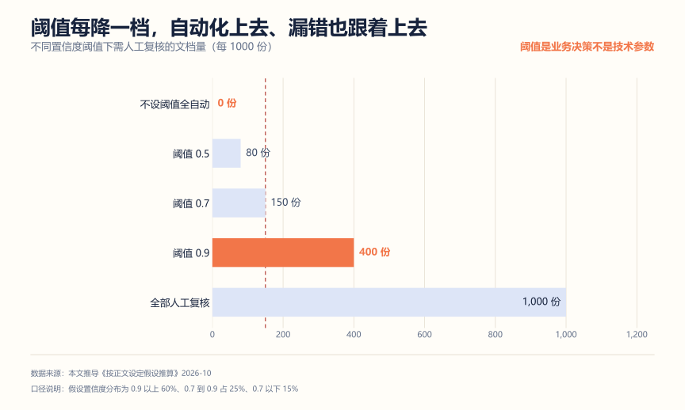
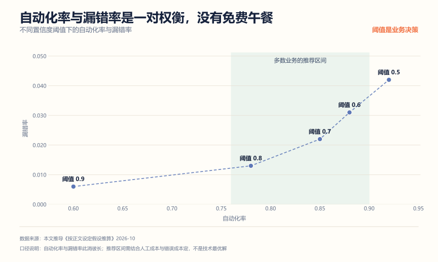
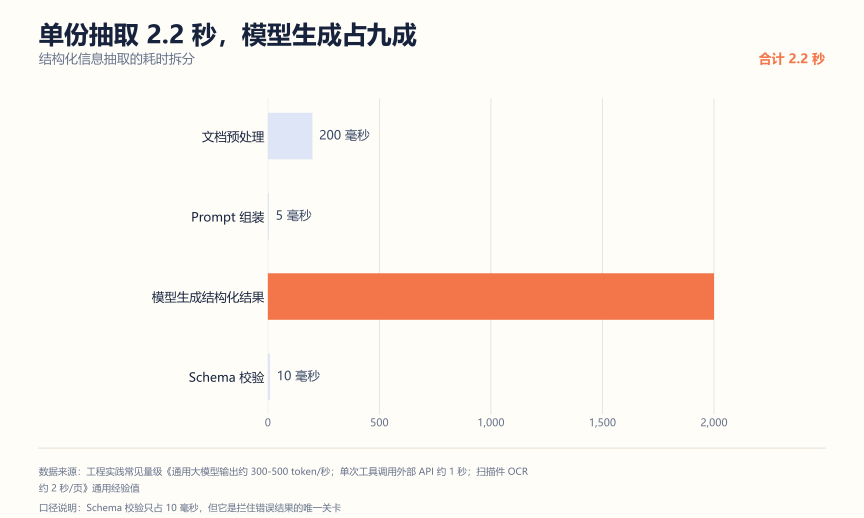
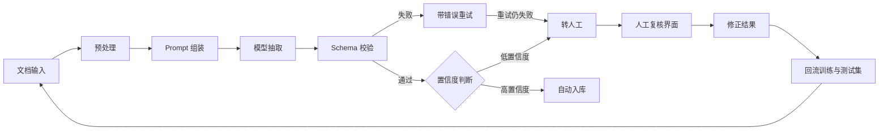

# 结构化信息抽取系统拆解：把文档变成能入库的数据

**解决什么问题**：这是最贴近真实业务的一类 AI 项目，也是金融、国企、银行科技岗最认的方向。简历解析、合同审查、票据录入、公文要素提取，本质都是同一件事：**把非结构化文档变成符合 Schema 的结构化数据，并且知道哪些该信、哪些该人工看**。

**适合谁**：目标岗位涉及文档处理、数据录入自动化、合规审查的人；想做"有业务约束"场景的人。

**不适合谁**：只想演示"把一段话变成 JSON"的人。那个一次调用就完成了，没有工程含量。

这个项目最大的价值在于它天然带**质量闭环**：模型输出有置信度，低置信度的转人工，人工处理完回流。这个闭环讲清楚，比任何技术名词都值钱。

## 一、先算账：阈值是业务决策，延迟是硬约束

### 阈值每降一档，自动化上去、漏错也跟着上去



假设处理 1,000 份文档，模型置信度分布为：0.9 以上占 60%、0.7 到 0.9 占 25%、0.7 以下 15%。

| 策略 | 需人工复核 | 代价 |
| --- | --- | --- |
| 不设阈值全自动 | 0 份 | 错误直接流出，无人发现 |
| 阈值 0.5 | 80 份 | 少量人工，但低置信度的错漏会漏过 |
| 阈值 0.7 | 150 份 | 常见平衡点 |
| 阈值 0.9 | 400 份 | 很稳，但人工成本高 |
| 全部人工复核 | 1,000 份 | 不用模型，回到原点 |

关键在于：**低置信度区间的错误率显著更高**。这不是"阈值调高更保险"这么简单——阈值每降一档，自动通过的量上去，同时漏过错误的风险也上去。所以阈值不是技术参数，是**业务决策**：漏一个错误的代价，和人工复核一份的成本，哪个高？

这个判断题在面试里特别有用。它能证明你理解"AI 系统是要为人服务的"，而不是"把模型准确率刷高"。

把两个维度画到一起，权衡关系更直观（按同一假设推导的量级）：



横轴是自动化率，纵轴是漏错率，虚线是同一个阈值在两个维度上的位置。注意曲线是弯的：从阈值 0.9 降到 0.8，自动化率从 60% 升到 78%，漏错率才从 0.6% 升到 1.3%；但从 0.7 降到 0.5，自动化率只多 7 个百分点，漏错率翻了一倍。**越往左越不划算**，这是选阈值的实操依据。

多数业务落在 76% 到 90% 自动化率这个区间，也就是阈值 0.7 到 0.85。但这不是通用答案——金融、医疗这种漏错代价高的场景，会把阈值推到 0.9 以上；而内部资料整理这种错了也无所谓的场景，0.5 都嫌高。面试时能问一句"咱们这个场景漏一个错的代价是什么"，比直接报一个阈值更专业。

漏错长什么样，决定你要不要加第二道关卡。下面三类是最常见的：

| 漏错形态 | 例子 | 为什么模型会错 | 怎么拦 |
| --- | --- | --- | --- |
| 静默错值 | 把 125,000 读成 12,500 | 数字识别错但不影响语法合法性 | 数值范围校验、单位和文档内交叉核对 |
| 张冠李戴 | 把甲方义务填进乙方字段 | 表格无边框或双语对照时指代混乱 | 字段级证据回链，抽出来的每个值都要能指回原文 |
| 该空不空 | 没有的字段编一个 | Prompt 里写了"必须填写全部字段" | 明确允许 null，并把"资料中未提及"作为合法输出 |

第三类是抽取系统最常见的幻觉来源。Schema 里把每个字段都设成必填，等于在逼模型编造。正确做法是允许 null，再单独统计各字段的填充率——填充率突然掉下来的字段，往往就是上游解析或 Prompt 出了问题。

### 单份抽取 2.2 秒，模型生成占九成



| 环节 | 量级 | 说明 |
| --- | --- | --- |
| 文档预处理 | 200 毫秒 | 格式转换与文本提取 |
| Prompt 组装 | 5 毫秒 | 模板渲染加 Schema 注入 |
| 模型生成结构化结果 | 2,000 毫秒 | 约 800 token 输出 |
| Schema 校验 | 10 毫秒 | 本地 JSON Schema 校验 |

Schema 校验只占 10 毫秒，但它是**拦住错误结果的唯一关卡**。很多人把精力全花在 Prompt 调优上，却不肯写那 10 毫秒的校验——这是本末倒置。

## 二、架构



核心是三个岔路：**校验失败要带具体错误重试**（不是原样重发）、**低置信度必须转人工**（不能自动入库）、**人工修正要回流**（否则同样的错误永远在犯）。

## 三、核心设计决策

| 模块 | 做法 | 为什么不用另一种 |
| --- | --- | --- |
| 输出约束 | JSON Schema 注入 Prompt 加 JSON mode | 自然语言描述结构，格式错误率高 |
| 校验 | 服务端 Schema 强校验 | 信任模型输出，脏数据直接入库 |
| 重试 | 带具体校验错误回喂，上限 2 次 | 原样重发，错的方式每次都一样 |
| 置信度 | 让模型输出字段级置信度 | 只有一个总分，无法定位到具体字段 |
| 路由 | 按置信度分流自动与人工 | 全自动或全人工，两个极端都贵 |
| 回流 | 人工修正样本进测试集与 few-shot | 修完就扔，同样的错反复出现 |

### Schema 驱动：把目标结构变成约束

不要用"请提取合同金额"这种 Prompt。要把结构显式给出来：

```json
{
  "type": "object",
  "properties": {
    "contract_no": {
      "type": "string",
      "pattern": "^[A-Z]{2}-\\d{4}-\\d{6}$",
      "description": "合同编号，格式为两位大写字母-四位年份-六位序号"
    },
    "amount": {
      "type": "number",
      "minimum": 0,
      "description": "合同金额，单位元，只填数字不要单位"
    },
    "sign_date": {
      "type": "string",
      "format": "date",
      "description": "签订日期，YYYY-MM-DD"
    },
    "parties": {
      "type": "array",
      "items": {
        "type": "object",
        "properties": {
          "role": { "enum": ["甲方", "乙方", "丙方"] },
          "name": { "type": "string", "minLength": 2 }
        },
        "required": ["role", "name"]
      }
    }
  },
  "required": ["contract_no", "amount", "sign_date", "parties"]
}
```

三个要点：**格式用 pattern 约束**（合同编号、日期格式）、**必填项明确**、**enum 限定取值范围**（角色只能是甲乙方丙方）。

同时开 JSON mode 或函数调用，让模型在结构化通道里输出。双保险：模型侧约束格式，服务侧校验格式。

### 校验失败，重试要带错误信息

```java
// 第一次失败：{"contract_no": "HT2024001", "amount": "50万元"}
// Schema 报错：contract_no 不匹配 pattern；amount 应为 number

String retryPrompt = buildPrompt(doc, schema)
    + "\n上一次输出未通过校验，错误如下：\n"
    + "- contract_no: 期望匹配 ^[A-Z]{2}-\\d{4}-\\d{6}$，实际值 HT2024001\n"
    + "- amount: 期望 number，实际值 string「50万元」，请只填数字 500000\n"
    + "请只修正这些字段，其他字段保持原样。";
```

关键在最后一句：**只修正错误字段**。不加这句，模型经常把本来对的字段也改错。重试上限设 2 次，超过就转人工——继续重试只是浪费 token。

### 字段级置信度，不是文档级

让模型对每个字段输出置信度：

```json
{
  "contract_no": { "value": "HT-2024-001234", "confidence": 0.95 },
  "amount": { "value": 500000, "confidence": 0.62 },
  "sign_date": { "value": "2024-03-15", "confidence": 0.88 }
}
```

这样做的好处是**路由粒度细**：只有 `amount` 置信度低，那人工只需要核对金额这一个字段，不用重看整份合同。人工成本直接降到十分之一。

这也是面试里的高分点——大部分人只会说"我用置信度做过滤"，说不出字段级。

## 四、三个最容易被打穿的追问

**问：模型抽错了怎么办？**

答：四层。Schema 校验拦格式错误；重试带具体错误信息修；字段级置信度把可疑字段路由给人工；人工修正回流成测试样本和 few-shot 示例。单靠 Prompt 调优是最不可靠的一层，但很多人只做了这一层。

**问：置信度准吗？**

答：不完全准，所以要做校准。抽 200 条人工标注样本，按置信度分档统计实际错误率，看模型自称 0.9 的是不是真的只错 5%。如果偏离大，就要么重调 Prompt 让模型输出更保守，要么按实测错误率重新划阈值。**置信度是模型自评，必须用人工数据校准过才能当路由依据。**

**问：为什么不用专门的信息抽取模型？**

答：可以，而且大 volume 场景应该用。通用大模型灵活但慢且贵；专门的抽取模型（基于 BERT 或 LayoutLM 一类）快且便宜，但需要标注数据训练，且换模板就要重训。常见做法是混合：先用通用模型冷启动跑一批，人工标注后训练专用模型承接高频模板，长尾模板继续用通用模型。能讲出这个演进路径，说明你想过规模化。

## 五、怎么证明你真的做了

**1. 字段级准确率报告**

按字段统计准确率，不要只报一个总准确率：

```text
字段          样本数   准确率   主要错误类型
contract_no    500     97.2%   格式不符（手写体编号）
amount         500     91.4%   含税与未含税混淆、单位错误
sign_date      500     95.8%   日期格式不一
parties        500     88.6%   丙方遗漏、角色判错
```

这张表比"准确率 93%"有用得多——它直接告诉你该优化哪个字段，也证明你真在跑数据。

**2. 阈值校准曲线**

抽 200 条人工标注，按置信度分档统计实际错误率，画出"模型自评 vs 实际错误率"的对比。这条曲线是你敢把阈值设成 0.7 的依据。

**3. 重试有效性对比**

统计：第一次成功率、带错误信息重试后的成功率、两次都失败转人工的比例。如果重试几乎没提升，说明你的错误信息写得不够具体。

**4. 人工复核成本测算**

统计一份文档平均需要人工核对几个字段、花多少秒。这个数字是"AI 到底省了多少人力"的直接证据，也是业务方最关心的。

## 六、简历写法

一段能用的：

```text
设计结构化信息抽取系统，以 JSON Schema 约束输出并在服务端强校验，校验失败将具体字段错误
回喂模型重试（上限 2 次），超出转人工；输出字段级置信度，按置信度分流自动入库与人工复核，
使单份文档人工核对字段数由 8 个降至 1.6 个。
经 500 份样本测试，核心字段准确率 88.6% 至 97.2%，并用 200 条人工标注校准置信度分档错误率。
人工修正样本回流为测试集与 few-shot 示例，同类错误复现率下降约四成。
```

三个常见错误：

| 写法 | 问题 |
| --- | --- |
| "使用大模型实现文档信息抽取" | 没有 Schema、校验、置信度、人工闭环任何一项 |
| "提升了信息抽取准确率" | 没有分字段统计，没有基线 |
| "实现了智能化文档处理" | 空话，换成具体机制：Schema 约束加校验加重试加路由 |

## 用 AI 做这件事

抽取项目里 AI 最好的用途是**帮你构造测试样本和定位错误模式**。

| 步骤 | 你做什么 | AI 做什么 |
| --- | --- | --- |
| 1 造样本 | 给它文档类型和 Schema | 生成边界样本（缺字段、格式异常、干扰信息） |
| 2 人工核 | 确认样本真实合理、标准答案正确 | 无 |
| 3 跑系统 | 用自己的校验和路由逻辑跑 | 无 |
| 4 归因 | 把失败样本的输入输出贴给它 | 按"Prompt/Schema/校验/置信度/路由"定位 |

提示词（可直接复制）：

```text
你是信息抽取测试样本构造者。这是我要抽取的文档类型和目标 Schema：
<Schema JSON>
<2-3 个真实样本示例（已脱敏）>
请构造 10 个边界测试样本，覆盖：
字段缺失、格式异常（日期不统一、金额含单位）、干扰信息（页眉页脚印章文字）、
多值冲突（两个金额）、空值但必填。
每个样本给出：原文、期望抽取结果、这道题考察什么。
不要构造现实中不可能出现的文档。
```

人工校验点：

- 边界样本必须**真实可信**。AI 爱构造极端到不真实的文档，那样的测试没有意义。
- 标准答案要人工逐条确认，尤其是"期望拒答"和"期望转人工"的样本。
- 构造用的文档先脱敏：合同里的真实甲乙方、金额、签章日期全部替换。

隐私边界：这是所有 AI 项目里敏感度最高的一类——你处理的就是合同、票据、简历。测试样本必须用脱敏或虚构数据，人工复核界面上的真实数据不要截图贴给 AI。

## 延伸阅读

- [RAG 项目从 0 到 1](./RAG项目从0到1.md) —— 文档解析是 RAG 的前置，两项目可组合
- [文档智能解析系统拆解](./文档智能解析系统拆解.md) —— 上游：怎么把 PDF 变成干净文本
- [AI 应用评测平台拆解](./AI应用评测平台拆解.md) —— 准确率报告和阈值校准都靠它
- [AI 应用研发作品集项目清单](./AI应用研发作品集项目清单.md)
