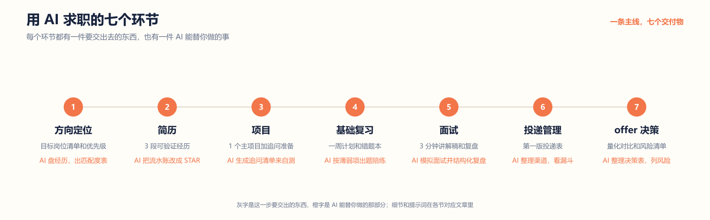
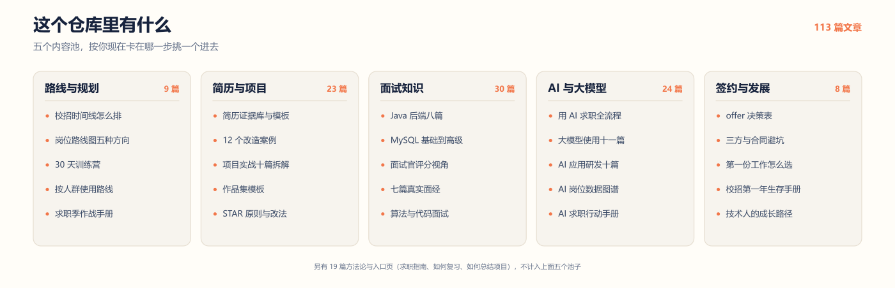
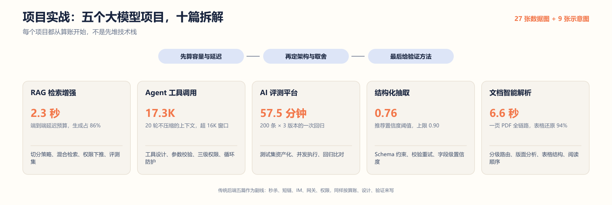

<!--
  ╔══════════════════════════════════════════════════════════╗
  ║             CS Job Guide · 用 AI 求职开源手册             ║
  ║   选择方向 → 准备简历 → 复习基础 → 冲刺面试 → 完成签约（全程 AI 辅助）  ║
  ╚══════════════════════════════════════════════════════════╝
-->

# CS Job Guide · 用 AI 求职开源手册

**从选方向、写简历、刷基础、过面试，到 offer 决策和签约避坑的一站式求职资料库，全程用 AI 提效**

适合计算机专业同学准备实习、春招、秋招、银行/国企科技岗和 AI 应用研发岗位，也适合想把 AI 变成求职搭子的同学

  
  
  
  
  

  <a href="./docs/用AI求职全流程.md">🤖 用 AI 求职</a>　
  <a href="#-先选一条路进去">🧭 先选一条路</a>　
  <a href="#-从这里开始">🚀 快速开始</a>　
  <a href="#-适合谁--不适合谁">🧭 适合人群</a>　
  <a href="#-7-天使用路线">🗓️ 7 天路线</a>　
  <a href="#-产品化入口">🧩 产品化入口</a>　
  <a href="#-热门文章-top-10">🔥 Top 10</a>　
  <a href="#-面试知识体系">📚 知识体系</a>　
  <a href="#-项目实战专题">🧱 项目实战</a>　
  <a href="#-面试攻略及真实面经">💬 面经</a>　
  <a href="#-模板工具箱">🧰 模板工具</a>　
  <a href="#-大模型使用专题">🤖 大模型</a>　
  <a href="#-ai-应用研发求职">🔬 AI 研发</a>　
  <a href="#-ai-求职趋势">📈 AI 求职</a>　
  <a href="#-求职信息及渠道">📡 求职渠道</a>　
  <a href="#-offer--签约">📝 签约</a>

 

  

> 💡 **求职没有标准答案，但充分准备会让每一次选择更有底气。**

## 🧭 先选一条路进去

  

七个环节，七个交付物。灰字是这一步要交出的东西，橙字是 AI 能替你做的部分。

<table>
  <tr>
    <td width="33%" valign="top">
      <strong>🌱 我还在起步</strong> 
      离校招还有三个月以上，想先把方向定下来
        
      
        1. <a href="./docs/计算机求职指南.md">计算机求职指南</a> 
        2. <a href="./docs/求职规划/校招时间线.md">校招时间线</a> 
        3. <a href="./docs/求职训练营/README.md">30 天求职训练营</a>
      
        
      <strong>一周后你会拿到：</strong>目标岗位清单和第一版简历
    </td>
    <td width="33%" valign="top">
      <strong>🧱 我有项目，但讲不清</strong> 
      简历能写，一被追问细节就露怯
        
      
        1. <a href="./docs/面试攻略/项目深挖面试准备清单.md">项目深挖清单</a> 
        2. <a href="./docs/项目实战/README.md">项目实战专题</a> 
        3. <a href="./docs/面试攻略/面试官视角：技术面试的评估维度.md">面试官怎么打分</a>
      
        
      <strong>一周后你会拿到：</strong>3 分钟讲解稿和 20 个追问的答案
    </td>
    <td width="34%" valign="top">
      <strong>⏰ 我两周内就要面</strong> 
      时间不多，只补最容易丢分的那几块
        
      
        1. <a href="./docs/面试攻略/面试官视角：技术面试的评估维度.md">评分维度与扣分项</a> 
        2. <a href="./docs/大模型使用/03-用大模型模拟技术面试.md">用大模型模拟面试</a> 
        3. <a href="./docs/面试攻略/反问面试官问题清单.md">反问清单</a>
      
        
      <strong>一周后你会拿到：</strong>一本错题本和一份反问清单
    </td>
  </tr>
</table>

## 🤖 用 AI 求职：七个环节，一条主线

> 全库正围绕「用 AI 求职」重组：每个环节都给出 AI 工作流、可复制的提示词和人工校验点。总纲：[用 AI 求职全流程](./docs/用AI求职全流程.md)

| 环节 | 你要产出什么 | AI 怎么帮 | 直接读这篇 |
| --- | --- | --- | --- |
| 1 方向定位 | 目标岗位清单和优先级 | 盘点经历、分析岗位匹配度 | [计算机求职指南](./docs/计算机求职指南.md) · [AI 岗位全景](./docs/AI求职/01-AI岗位全景与转型路径.md) |
| 2 简历 | 3 段可验证经历 | 把流水账改写成 STAR 证据 | [如何写好一份简历](./docs/简历/如何写好一份简历.md) · [简历证据库](./docs/简历/简历证据库.md) |
| 3 项目 | 1 个主项目加追问准备 | 复盘项目、模拟压力追问 | [项目实战专题](./docs/项目实战/README.md) · [项目深挖清单](./docs/面试攻略/项目深挖面试准备清单.md) |
| 4 基础复习 | 一周计划和错题本 | 制定计划、每日提问陪练 | [Java 后端学习路线](./docs/基础知识/Java后端校招学习路线.md) · [用大模型制定复习计划](./docs/大模型使用/02-用大模型制定高效复习计划.md) |
| 5 面试 | 3 分钟讲解稿加复盘 | 模拟面试、结构化复盘 | [用大模型模拟技术面试](./docs/大模型使用/03-用大模型模拟技术面试.md) · [面试复盘模板](./templates/面试复盘模板.md) |
| 6 投递管理 | 第一版投递表 | 整理渠道、分析投递漏斗 | [如何投递与管理求职进度](./docs/求职规划/如何投递与管理求职进度.md) |
| 7 offer 决策 | 量化对比和风险清单 | 整理决策表、生成风险提问 | [Offer 决策表](./docs/签约/offer决策表.md) · [避坑指南](./docs/签约/offer三方和劳动合同避坑指南.md) |

## 👥 适合谁 / 不适合谁

| 适合谁 | 你能怎么用 |
| --- | --- |
| 计算机相关专业在校生 | 按校招时间线准备简历、项目、笔试和面试 |
| 准备后端、AI 应用研发、测试开发、前端等技术岗的同学 | 从岗位地图、项目专题和面试题中选择主线 |
| 简历投递反馈弱、项目讲不深的求职者 | 用证据库、项目深挖和复盘模板补强表达 |
| 想投银行科技、国企科技岗的同学 | 对照稳定性、笔试、面试和签约风险做准备 |
| 已拿 offer、正在纠结选择的人 | 用 offer 决策表比较成长、薪资、城市和风险 |
| 想把 AI 用进求职各个环节的同学 | 从七环节主线入手，每个环节都有工作流、提示词和校验点 |

| 不适合谁 | 原因 |
| --- | --- |
| 想找“包过面试”“保 offer”捷径的人 | 本项目强调真实能力、表达训练和长期积累 |
| 只想背标准答案、不愿复盘项目的人 | 技术面试会持续追问背景、取舍、指标和失败案例 |
| 不愿核实招聘信息来源的人 | 校招时间、岗位 JD 和薪资规则必须以官方信息为准 |

## 📍 3 分钟找到你需要的资料

  

| 当前状态 | 直接看这里 |
| --- | --- |
| 我刚开始准备校招 | [计算机专业求职全流程](./docs/计算机求职指南.md) · [校招时间线](./docs/求职规划/校招时间线.md) |
| 我不知道自己该按什么顺序用 | [按人群使用路线](./docs/使用路线/README.md) · [30 天求职训练营](./docs/求职训练营/README.md) |
| 我想按岗位系统准备 | [岗位路线图](./docs/岗位路线图/README.md) · [Java 后端路线图](./docs/岗位路线图/Java后端校招路线图.md) |
| 我想直接开始执行 | [求职工具模板](./templates/README.md) · [Markdown 版求职周计划](./templates/求职周计划模板.md) |
| 我简历没有反馈 | [简历证据库](./docs/简历/简历证据库.md) · [如何写好一份简历](./docs/简历/如何写好一份简历.md) |
| 我缺一个能讲的项目 | [项目实战专题](./docs/项目实战/README.md) · [Java 后端项目清单](./docs/项目实战/Java后端校招项目清单.md) |
| 我面试总被项目追问卡住 | [项目深挖面试准备清单](./docs/面试攻略/项目深挖面试准备清单.md) · [项目实战专题](./docs/项目实战/README.md) |
| 我想系统复习 Java 后端 | [Java 后端校招学习路线](./docs/基础知识/Java后端校招学习路线.md) · [Spring 高频题](./docs/基础知识/Spring与SpringBoot高频面试题.md) |
| 我想准备 AI 应用研发 | [AI 应用研发专题](./docs/AI应用研发/README.md) · [岗位能力地图与十二周路线](./docs/AI应用研发/01-岗位能力地图与十二周路线.md) |
| 我想投银行/国企科技岗 | [银行与国企科技岗求职指南](./docs/求职规划/银行与国企科技岗求职指南.md) |
| 我拿到 offer 了 | [Offer 决策表](./docs/签约/offer决策表.md) · [offer、三方和劳动合同避坑指南](./docs/签约/offer三方和劳动合同避坑指南.md) |
| 我想用 AI 辅助整个求职流程 | [用 AI 求职全流程](./docs/用AI求职全流程.md) · [大模型使用专题](./docs/大模型使用/README.md) |

---

## 🗓️ 7 天使用路线

> 如果你刚发现这个仓库，建议先用 7 天跑完一轮最小闭环。目标不是看完所有文章，而是产出自己的求职资料。

| 天数 | 主题 | 阅读材料 | 当天交付物 | 用 AI 做什么 |
| --- | --- | --- | --- | --- |
| Day 1 | 明确方向 | [计算机专业求职全流程](./docs/计算机求职指南.md) · [计算机岗位地图](./docs/技能与知识要求.md) | 目标岗位清单和优先级 | 用 AI 把经历拆成可验证事实，输出岗位匹配度表 |
| Day 2 | 重建简历 | [简历证据库](./docs/简历/简历证据库.md) · [简历证据库模板](./templates/简历证据库模板.md) | 3 段可验证经历 | 用 AI 把流水账改写成 STAR 证据 |
| Day 3 | 选择项目 | [项目实战专题](./docs/项目实战/README.md) · [Java 后端项目清单](./docs/项目实战/Java后端校招项目清单.md) | 1 个主项目和 1 个备选项目 | 用 AI 对主项目生成追问清单并自测 |
| Day 4 | 补基础 | [Java 后端校招学习路线](./docs/基础知识/Java后端校招学习路线.md) · [数据结构与算法刷题计划](./docs/基础知识/数据结构与算法刷题计划.md) | 一周基础复习计划 | 用 AI 按薄弱项生成计划，每天提问陪练 |
| Day 5 | 练面试 | [项目深挖面试准备清单](./docs/面试攻略/项目深挖面试准备清单.md) · [面试复盘模板](./templates/面试复盘模板.md) | 项目 3 分钟讲解稿 | 用 AI 模拟面试并输出复盘记录 |
| Day 6 | 开始投递 | [如何投递与管理求职进度](./docs/求职规划/如何投递与管理求职进度.md) · [投递管理表模板](./templates/投递管理表模板.md) | 第一版投递表 | 用 AI 整理渠道清单，按三层岗位池分类 |
| Day 7 | 固定节奏 | [求职季作战手册](./docs/求职规划/求职季作战手册.md) · [Markdown 版求职周计划](./templates/求职周计划模板.md) | 下周行动计划 | 用 AI 汇总本周数据，生成复盘和计划 |

---

## 🧩 产品化入口

> 这部分把资料库拆成更像“求职操作系统”的几个入口：路线、训练、案例、作品集和模板。

| 模块 | 适合解决的问题 | 入口 |
| --- | --- | --- |
| 按人群使用路线 | 不同阶段不知道先看什么 | [使用路线](./docs/使用路线/README.md) |
| 岗位路线图 | 想按岗位准备能力、项目和面试 | [岗位路线图](./docs/岗位路线图/README.md) |
| 30 天求职训练营 | 想把资料转成连续行动 | [训练营](./docs/求职训练营/README.md) |
| 简历改造案例库 | 简历表达空泛，缺少案例参考 | [案例库](./docs/简历/简历改造案例库.md) |
| 项目作品集模板 | 想把项目包装成 GitHub 作品集 | [作品集模板](./docs/项目作品集/README.md) |
| 投稿与内容规范 | 想投稿面经、项目或纠错 | [投稿说明](./docs/投稿说明.md) |

---

## 🔥 热门文章 Top 10

| 排名 | 文章 | 适合解决的问题 |
| --- | --- | --- |
| 1 | [计算机专业求职全流程](./docs/计算机求职指南.md) | 不知道从哪里开始准备 |
| 2 | [30 天求职训练营](./docs/求职训练营/README.md) | 想把资料转成每天可执行任务 |
| 3 | [岗位路线图](./docs/岗位路线图/README.md) | 想按岗位准备能力、项目和面试 |
| 4 | [求职季作战手册](./docs/求职规划/求职季作战手册.md) | 投递、复盘和面试节奏混乱 |
| 5 | [简历证据库](./docs/简历/简历证据库.md) | 简历经历空泛、缺少可信证据 |
| 6 | [简历改造案例库](./docs/简历/简历改造案例库.md) | 不知道普通经历怎么改写 |
| 7 | [项目实战专题](./docs/项目实战/README.md) | 缺少能讲的项目 |
| 8 | [RAG 项目从 0 到 1](./docs/项目实战/RAG项目从0到1.md) | 想做 AI 应用项目但不知道如何落地 |
| 9 | [项目深挖面试准备清单](./docs/面试攻略/项目深挖面试准备清单.md) | 项目一被追问就露怯 |
| 10 | [Offer 决策表](./docs/签约/offer决策表.md) | 多个 offer 不知道怎么选 |

---

## 🚀 从这里开始

CS Job Guide 是一份面向计算机专业学生的求职资料库，适合正在准备**实习、春招、秋招和职业选择**的同学。这里不追求资料越多越好，更希望帮你在正确的阶段找到真正需要的内容。

如果你愿意系统准备，可以按下面这条路线走；如果你时间紧，就直接从上面的“3 分钟导航”切入。

<table align="center">
  <tr align="center">
    <td width="20%">
      <h4>🔍 了解节奏</h4>
      
        <a href="./docs/计算机求职指南.md">求职全流程</a> 
        <a href="./docs/求职规划/校招时间线.md">校招时间线</a>
      
    </td>
    <td width="20%">
      <h4>📋 准备材料</h4>
      
        <a href="./docs/技能与知识要求.md">岗位地图</a> 
        <a href="#-简历制作">简历制作</a>
      
    </td>
    <td width="20%">
      <h4>📖 集中复习</h4>
      
        <a href="./docs/基础知识/Java后端校招学习路线.md">Java 后端路线</a> 
        <a href="./docs/基础知识/数据结构与算法刷题计划.md">算法刷题计划</a>
      
    </td>
    <td width="20%">
      <h4>🎯 面试冲刺</h4>
      
        <a href="#-面试攻略及真实面经">真实面经</a> 
        <a href="./docs/面试攻略/HR面试常见问题.md">HR 面试</a>
      
    </td>
    <td width="20%">
      <h4>✅ 做出选择</h4>
      
        <a href="#-offer--签约">offer 与签约</a> 
        <a href="#-职业发展">职业发展</a>
      
    </td>
  </tr>
</table>

### 🗺️ 一条可执行的求职路线

路线就是首屏那张图：了解节奏、准备材料、集中复习、面试冲刺、做出选择。每个阶段对应上面的三张卡片之一，缺哪块补哪块。

---

## 📋 最近更新

<table>
  <tr>
    <td width="33%">
      <strong>🧭 路线与训练营</strong> 🆕 
      <a href="./docs/使用路线/README.md">按人群使用路线</a> · <a href="./docs/求职训练营/README.md">30 天训练营</a> 
      把资料库转成按阶段、按岗位、按天执行的求职系统
    </td>
    <td width="33%">
      <strong>🧱 项目实战专题</strong> 🆕 
      <a href="./docs/项目实战/README.md">项目实战首页</a> · <a href="./docs/项目实战/RAG项目从0到1.md">RAG 从 0 到 1</a> · <a href="./docs/项目实战/Agent工具调用平台拆解.md">Agent 平台</a> 
      大模型项目主线：RAG、Agent、评测平台、信息抽取、文档解析
    </td>
    <td width="34%">
      <strong>🧩 面试项目与反问</strong> 🆕 
      <a href="./docs/面试攻略/项目深挖面试准备清单.md">项目深挖</a> · <a href="./docs/面试攻略/反问面试官问题清单.md">反问清单</a> 
      二面/终面高频卡点，帮你把项目讲深
    </td>
  </tr>
  <tr>
    <td width="33%">
      <strong>🧰 求职工具模板</strong> 🆕 
      <a href="./templates/README.md">模板工具箱</a> · <a href="./docs/项目作品集/README.md">作品集模板</a> 
      简历证据库、投递管理、项目作品集、面试复盘和周计划
    </td>
    <td width="33%">
      <strong>🔧 框架与工程</strong> 
      <a href="./docs/基础知识/Spring与SpringBoot高频面试题.md">Spring 与 Spring Boot</a> · <a href="./docs/基础知识/Linux与Git校招实用指南.md">Linux 与 Git</a> 
      事务失效排查、Git 工作流等校招实用基本功
    </td>
    <td width="33%">
      <strong>🔬 AI 应用研发</strong> 
      <a href="./docs/AI应用研发/01-岗位能力地图与十二周路线.md">岗位能力地图与十二周路线</a> · <a href="./docs/AI应用研发/09-向量数据库选型与实战.md">向量数据库实战</a> 
      对标阿里岗位，新增向量数据库、LangChain vs LlamaIndex
    </td>
  </tr>
  <tr>
    <td width="33%">
      <strong>🧭 岗位路线图</strong> 🆕 
      <a href="./docs/岗位路线图/README.md">路线图总览</a> · <a href="./docs/岗位路线图/Java后端校招路线图.md">Java 后端</a> 
      覆盖 Java、AI 应用研发、银行国企、测试开发和前端
    </td>
    <td width="33%">
      <strong>📝 简历改造案例</strong> 🆕 
      <a href="./docs/简历/简历改造案例库.md">案例库</a> · <a href="./docs/简历/简历证据库.md">证据库</a> 
      把 CRUD、课程设计、AI Demo 和实习杂活改成可信表达
    </td>
    <td width="34%">
      <strong>🤖 大模型与 AI 面试</strong> 
      <a href="./docs/大模型使用/README.md">大模型使用专题</a> · <a href="./docs/基础知识/大模型与AI面试高频题.md">AI 面试高频题</a> 
      11 篇图文实战文章，覆盖 RAG、Agent、Prompt Engineering
    </td>
  </tr>
</table>

> 🤖 **2026-10 进展**：项目实战专题已按「先算账、再设计、再验证」重写完毕，五个大模型项目加五个传统后端项目，每篇都配数据图和结构示意图。用 AI 求职主线正在往各专题铺「AI 工作流 + 提示词 + 校验点」，已完成 AI 求职、项目实战、大模型使用三个专题，其余陆续补。

> 部分栏目仍在持续补充中。欢迎 **Star** ⭐、分享和参与完善。

---

## 🧰 模板工具箱

> 求职资料要能落到行动上。这里提供可直接复制的 Markdown 模板，适合放进自己的笔记软件、GitHub 仓库或 Notion 中持续更新。

| 模板 | 适合场景 | 入口 |
| --- | --- | --- |
| 简历证据库模板 | 写简历前，把项目、实习、竞赛经历拆成证据 | [打开模板](./templates/简历证据库模板.md) |
| 投递管理表模板 | 管理公司、岗位、渠道、简历版本和流程状态 | [打开模板](./templates/投递管理表模板.md) |
| 面试复盘模板 | 每次面试后还原问题、卡点和改进行动 | [打开模板](./templates/面试复盘模板.md) |
| Offer 对比表模板 | 比较薪资、成长、城市、稳定性和签约风险 | [打开模板](./templates/Offer对比表模板.md) |
| Markdown 版求职周计划 | 以周为单位安排学习、投递、面试和复盘 | [打开模板](./templates/求职周计划模板.md) |
| 项目作品集模板 | 把项目整理成 GitHub 可展示作品集 | [打开模板](./docs/项目作品集/README.md) |

---

## 📚 面试知识体系

先建立知识框架，再通过模拟问答检查薄弱点。复习的目标不是"看过"，而是**能够用自己的语言讲清楚**。

### 🧠 学习方法

| 内容                                                                               | 一句话说明                           |
| ---------------------------------------------------------------------------------- | ------------------------------------ |
| [如何复习基础知识](./docs/如何复习基础知识.md)                                     | 建立适合自己的复习节奏               |
| [如何总结项目](./docs/如何总结项目.md)                                             | 把项目经验转化为面试表达             |
| [聊聊如何找实习写简历为秋招做准备](./docs/聊聊如何找实习，写简历，为秋招做准备.md) | 从实习到秋招的整体建议               |
| [如何调整心态](./docs/如何调整心态.md)                                             | 在求职过程中保持稳定状态             |
| [计算机岗位地图](./docs/技能与知识要求.md)                                         | 后端、前端、测开、算法等方向如何选择 |

<strong>☕ Java 后端</strong> — 校招最热门方向，点击展开

 

| 模块      | 文章                                                                                                                                                | 核心内容                 |
| --------- | --------------------------------------------------------------------------------------------------------------------------------------------------- | ------------------------ |
| 学习路线  | [Java 后端校招学习路线](./docs/基础知识/Java后端校招学习路线.md)                                                                                    | 八周训练计划             |
| Java 基础 | [Java 基础与集合](./docs/基础知识/Java基础与集合高频面试题.md)                                                                                      | 集合、泛型、异常、IO     |
| JVM       | [JVM 高频面试题](./docs/基础知识/JVM高频面试题.md)                                                                                                  | 内存模型、GC、类加载     |
| MySQL     | [基础](./docs/基础知识/MySQL基础高频面试题.md) · [进阶](./docs/基础知识/MySQL进阶高频面试题.md) · [高级](./docs/基础知识/MySQL高级高频面试题.md) | 索引、锁、事务、优化     |
| Redis     | [Redis 高频面试题](./docs/基础知识/Redis高频面试题.md)                                                                                              | 数据结构、缓存、分布式   |
| Spring    | [Spring 与 Spring Boot](./docs/基础知识/Spring与SpringBoot高频面试题.md)                                                                            | IoC、AOP、事务、自动配置 |
| 工程      | [Linux 与 Git 校招实用指南](./docs/基础知识/Linux与Git校招实用指南.md)                                                                              | 常用命令、排查思路       |

<strong>🔬 AI 应用研发</strong> — 对标阿里校招岗位，点击展开

 

| 模块   | 文章                                                                                                     |
| ------ | -------------------------------------------------------------------------------------------------------- |
| 总览   | [专题首页](./docs/AI应用研发/README.md) · [十二周路线](./docs/AI应用研发/01-岗位能力地图与十二周路线.md) |
| Agent  | [Agent 系统设计与工程化](./docs/AI应用研发/02-Agent系统设计与工程化.md)                                  |
| RAG    | [RAG 从检索到评测](./docs/AI应用研发/03-RAG从检索到评测.md)                                              |
| MCP    | [Tool Calling 与 MCP](./docs/AI应用研发/04-ToolCalling与MCP.md)                                          |
| 评测   | [评测、可观测与安全](./docs/AI应用研发/05-评测可观测与安全.md)                                           |
| 面试   | [作品集与面试准备](./docs/AI应用研发/06-作品集与面试准备.md)                                             |
| 性能   | [推理性能基础](./docs/AI应用研发/07-推理性能基础.md)                                                     |
| 工程   | [AI Coding 工程实践](./docs/AI应用研发/08-AICoding工程实践.md)                                           |
| 向量库 | [向量数据库选型与实战](./docs/AI应用研发/09-向量数据库选型与实战.md)                                     |
| 框架   | [LangChain 与 LlamaIndex 框架对比](./docs/AI应用研发/10-LangChain与LlamaIndex框架对比.md)                |

<strong>🐍 Python</strong> · <strong>🌐 计算机网络</strong> · <strong>💻 操作系统</strong> · <strong>⚡ 算法</strong> · <strong>🎨 前端</strong> — 点击展开

 

| 方向       | 文章                                                                                                                                                                              |
| ---------- | --------------------------------------------------------------------------------------------------------------------------------------------------------------------------------- |
| AI 面试题  | [大模型与 AI 面试高频题](./docs/基础知识/大模型与AI面试高频题.md)                                                                                                                 |
| Python     | [上篇](./docs/基础知识/Python常见知识点和面试题总结上.md) · [中篇](./docs/基础知识/Python常见知识点和面试题总结中.md) · [下篇](./docs/基础知识/Python常见知识点和面试题总结下.md) |
| 计算机网络 | [常见知识点和面试题总结](./docs/基础知识/计算机网络常见知识点和面试题总结上.md)                                                                                                |
| 操作系统   | [高频面试题](./docs/基础知识/操作系统高频面试题.md)                                                                                                                               |
| 算法       | [数据结构与算法刷题计划](./docs/基础知识/数据结构与算法刷题计划.md)                                                                                                               |
| 前端       | [前端工程师学习路线](./docs/基础知识/前端工程师.md)                                                                                                                               |

---

## 🧱 项目实战专题

> 求职最缺的不是“学过技术”，而是“有一个能讲清楚、经得住追问、能写进简历的项目”。

  

| 方向 | 内容 | 你能拿到什么 |
| --- | --- | --- |
| 总览 | [项目实战专题首页](./docs/项目实战/README.md) | 项目选择标准、面试评分维度、项目材料模板 |
| 项目清单 | [Java 后端校招项目清单](./docs/项目实战/Java后端校招项目清单.md) | 按岗位选项目、功能改亮点、三种组合 |
| AI 作品集 | [AI 应用研发作品集项目清单](./docs/项目实战/AI应用研发作品集项目清单.md) | RAG、Agent、评测平台、Prompt 管理等方向 |
| RAG 实战 | [RAG 项目从 0 到 1](./docs/项目实战/RAG项目从0到1.md) | 延迟与 token 预算、混合检索、权限下推、评测集 |
| Agent | [Agent 工具调用平台](./docs/项目实战/Agent工具调用平台拆解.md) | 上下文膨胀预算、参数校验、权限分级、循环防护 |
| 评测平台 | [AI 应用评测平台](./docs/项目实战/AI应用评测平台拆解.md) | 测试集资产化、并发执行、回归比对、badcase 回流 |
| 信息抽取 | [结构化信息抽取系统](./docs/项目实战/结构化信息抽取系统拆解.md) | Schema 约束、校验重试、字段级置信度、人工闭环 |
| 文档解析 | [文档智能解析系统](./docs/项目实战/文档智能解析系统拆解.md) | 分级路由、版面分析、表格结构、阅读顺序 |
| 后端副线 | [传统后端项目](./docs/项目实战/传统后端项目/README.md)（秒杀、短链、IM、网关、权限） | 容量估算、架构图、设计取舍、验证方法、追问准备 |

> 十篇系统拆解都按「先算账、再设计、再验证」组织：动手前先算容量和延迟预算，讲方案必须给替代选项，最后给出能自己跑的验证方法（压测、对账、故障注入）。除数据图外每篇还配结构示意图（架构图、流程图、时序图）：数据图说明数字之间的关系，示意图说明模块之间的关系。共 27 张数据图与 9 张示意图，假设与算式分别登记在 [`docs/_data/llm-project-metrics.json`](./docs/_data/llm-project-metrics.json) 和 [`docs/_data/project-metrics.json`](./docs/_data/project-metrics.json)，由 `tools/build_llm_project_charts.py`、`tools/build_project_charts.py`、`tools/build_project_diagrams.py` 生成，可复现。

---

## 🤖 大模型使用专题

  

大模型可以成为学习和求职过程中的**助教、面试官与讨论伙伴**。专题强调实战方法，也强调事实核验、隐私保护和独立思考。这是全库的 AI 引擎，建议配合[用 AI 求职全流程](./docs/用AI求职全流程.md)一起使用。

> 📖 **快速入门**：[如何使用大模型提升学习和求职效率](./docs/如何使用大模型提升学习和求职效率.md)　|　**完整专题**：[11 篇图文实战文章](./docs/大模型使用/README.md)

📑 点击预览全部 11 篇文章

 

1. [从提问到交付：写出高质量提示词](./docs/大模型使用/01-从提问到交付：写出高质量提示词.md)
2. [用大模型制定高效复习计划](./docs/大模型使用/02-用大模型制定高效复习计划.md)
3. [用大模型模拟技术面试](./docs/大模型使用/03-用大模型模拟技术面试.md)
4. [用大模型打磨求职简历](./docs/大模型使用/04-用大模型打磨求职简历.md)
5. [用大模型复盘项目经历](./docs/大模型使用/05-用大模型复盘项目经历.md)
6. [用大模型辅助编程与调试](./docs/大模型使用/06-用大模型辅助编程与调试.md)
7. [用大模型阅读论文和技术文档](./docs/大模型使用/07-用大模型阅读论文和技术文档.md)
8. [用大模型检索信息与核验事实](./docs/大模型使用/08-用大模型检索信息与核验事实.md)
9. [大模型使用中的隐私安全与边界](./docs/大模型使用/09-大模型使用中的隐私安全与边界.md)
10. [用大模型构建个人知识库](./docs/大模型使用/10-用大模型构建个人知识库.md)
11. [用大模型做系统设计练习](./docs/大模型使用/11-用大模型做系统设计练习.md)

---

## 🔬 AI 应用研发求职

> 根据阿里巴巴校园招聘 [AI 应用研发工程师](https://campus-talent.alibaba.com/campus/position/199903220038?deptCodes=) 岗位要求整理。重点不在"会不会调用模型"，而在于**能否交付一个可评测、可观测、能降级、有安全边界的 AI 系统**。

| 模块     | 文章                                                                                      | 你学到什么                                  |
| -------- | ----------------------------------------------------------------------------------------- | ------------------------------------------- |
| 🗺️ 路线   | [岗位能力地图与十二周路线](./docs/AI应用研发/01-岗位能力地图与十二周路线.md)              | 从岗位描述反推学习顺序和验收产物            |
| 🤖 Agent  | [Agent 系统设计](./docs/AI应用研发/02-Agent系统设计与工程化.md)                           | 状态、编排、重试、降级与多 Agent 边界       |
| 📚 RAG    | [RAG 从检索到评测](./docs/AI应用研发/03-RAG从检索到评测.md)                               | 分块、召回、重排、引用和错误归因            |
| 🔌 MCP    | [Tool Calling 与 MCP](./docs/AI应用研发/04-ToolCalling与MCP.md)                           | 工具协议、权限、确认和审计                  |
| 🛡️ 评测   | [评测、可观测与安全](./docs/AI应用研发/05-评测可观测与安全.md)                            | 回归测试、Trace、性能、降级与提示词注入     |
| 💼 面试   | [作品集与面试准备](./docs/AI应用研发/06-作品集与面试准备.md)                              | 把聊天 Demo 改造成可验证的求职项目          |
| ⚡ 性能   | [推理性能基础](./docs/AI应用研发/07-推理性能基础.md)                                      | 延迟、Streaming、KV Cache 与推理框架        |
| 🧪 工程   | [AI Coding 工程实践](./docs/AI应用研发/08-AICoding工程实践.md)                            | 用模型辅助编码，保留审查、测试和数据边界    |
| 🗄️ 向量库 | [向量数据库选型与实战](./docs/AI应用研发/09-向量数据库选型与实战.md)                      | Milvus、Chroma、Pinecone 对比与 Chroma 实战 |
| ⚖️ 框架   | [LangChain 与 LlamaIndex 框架对比](./docs/AI应用研发/10-LangChain与LlamaIndex框架对比.md) | LangChain 管流程，LlamaIndex 管数据         |

---

## 📈 AI 求职趋势

> 2026 届校招，每 10 个新发校招岗位里已有近 4 个与 AI 相关（脉脉高聘，2026 年 1-5 月）。不只招算法研究员，AI 应用研发、AI 产品、AI 测试等岗位大量出现。

| 内容                                                              | 说明                                                     |
| ----------------------------------------------------------------- | -------------------------------------------------------- |
| [AI 求职专题首页](./docs/AI求职/README.md)                        | 三个关键数字、阅读地图、方法论说明                       |
| [AI 岗位全景与转型路径](./docs/AI求职/01-AI岗位全景与转型路径.md) | 六类岗位地图、三条转型路径、90 天行动清单、AI 匹配提示词 |
| [AI 岗位数据图谱](./docs/AI求职/02-AI岗位数据图谱.md)             | 5 张数据图、薪资三级台阶、五个口径陷阱                  |
| [AI 求职行动手册](./docs/AI求职/03-AI求职行动手册.md)             | 阶段自测、简历改写对照、10 个必答追问、复盘表            |

> 📊 所有数据登记在 [`docs/_data/ai-job-market.json`](./docs/_data/ai-job-market.json)，图表由 [`tools/build_charts.py`](./tools/build_charts.py) 生成，可复现、可校验。

---

## 📝 简历制作

> 一份好简历的核心不是堆叠技术名词，而是清楚地说明：**你做过什么、解决了什么问题、产生了什么结果**。

| 内容                                                                | 适合谁                     |
| ------------------------------------------------------------------- | -------------------------- |
| [即刻简历：简历评估工具](./docs/简历/即刻简历.md)                   | 🔥 想快速检查简历表达的同学 |
| [简历证据库](./docs/简历/简历证据库.md)                             | 🆕 想让项目经历更可信、更抗追问 |
| [如何写好一份简历](./docs/简历/如何写好一份简历.md)                 | 📝 从零开始梳理简历结构     |
| [一份真实的互联网大厂简历](./docs/简历/一份真实的互联网大厂简历.md) | 👀 想看真实案例参考         |
| [常见项目的 STAR 原则描述](./docs/简历/STAR原则.md)                 | 💡 想优化项目经历表达       |
| [好用的简历模板](./docs/简历/好用的简历模板.md)                     | 🎨 想找合适版式             |
| [简历的重要性](./docs/简历/简历的重要性.md)                         | 🤔 想理解简历在求职中的作用 |
| [简历修改服务](./docs/简历/简历修改服务.md)                         | 📮 想获取人工反馈           |
| [人手一份的求职表](./docs/求职表.md)                                | 📊 想跟踪投递和面试进度     |

---

## 🗓️ 校招时间表

> 不同公司和岗位的招聘节奏可能变化，请以企业招聘官网和官方公告为准。

  

👉 建议先阅读 [求职季作战手册：从海投到有节奏地拿反馈](./docs/求职规划/求职季作战手册.md)，再结合 [校招时间线：实习、秋招和春招分别做什么](./docs/求职规划/校招时间线.md)

---

## 💬 面试攻略及真实面经

面试不是背诵比赛。阅读面经时，重点关注**问题脉络、项目追问和自己的表达薄弱点**。

### 🎤 面试准备

| 内容                                                                       | 覆盖范围                             |
| -------------------------------------------------------------------------- | ------------------------------------ |
| [面试官视角：技术面试的评估维度](./docs/面试攻略/面试官视角：技术面试的评估维度.md) | 🆕 打分表、3分vs5分回答、扣分项、加分提问 |
| [面试复盘方法论](./docs/面试攻略/面试复盘方法论.md)                         | 🆕 复盘模板、错题本、追问还原、卡点诊断     |
| [算法与代码面试准备指南](./docs/面试攻略/算法与代码面试准备指南.md)         | 🆕 刷题策略、沟通技巧、面试模板、卡住自救   |
| [项目深挖面试准备清单](./docs/面试攻略/项目深挖面试准备清单.md)             | 🆕 项目追问、失败案例、技术取舍和速查表     |
| [反问面试官问题清单](./docs/面试攻略/反问面试官问题清单.md)                 | 🆕 技术面、HR 面、offer 前各阶段反问模板     |
| [面试中如何进行自我介绍](./docs/自我介绍.md)                               | 前端、后端、算法、测试、客户端、硬件 |
| [如何总结项目](./docs/如何总结项目.md)                                     | 提炼项目亮点和回答思路               |
| [HR 面试常见问题](./docs/面试攻略/HR面试常见问题.md)                       | 求职动机、薪资沟通、反问技巧         |
| [面试阿里 4 次全过经验分享](./docs/面试阿里4次，全过！大厂面试经验分享.md) | 面试准备与流程复盘                   |

### 📋 真实面经

| 公司       | 方向           | 结果       | 文章                                                           |
| ---------- | -------------- | ---------- | -------------------------------------------------------------- |
| 🟠 阿里菜鸟 | 后端暑期实习   | ✅ 已 OC    | [阅读](./docs/面经/阿里菜鸟网络后端暑期实习（已OC）.md)        |
| 🟡 美团     | 后端开发       | ✅ 已 offer | [阅读](./docs/面经/美团面试经验分享（已offer）.md)             |
| 🟡 美团     | 成长与求职复盘 | ✅ 已 offer | [阅读](./docs/面经/双非拿了美团offer.md)                       |
| 🟥 快手     | Java 后端春招  | ✅ 已 offer | [阅读](./docs/面经/快手春招Java后端面试经验分享（已offer）.md) |
| 🟥 快手     | Java 后端实习  | ✅ 已 OC    | [阅读](./docs/面经/快手实习Java后端面试经验分享（已OC）.md)    |
| 🔵 百度     | C++ 提前批     | 📋 面经     | [阅读](./docs/面经/百度C++提前批面经.md)                       |
| 🟢 招商银行 | 信用卡暑期实习 | 📋 面经     | [阅读](./docs/面经/招商银行信用卡暑期实习面经.md)              |
| 🟦 字节     | 大模型算法     | 📋 26 届秋招 | [阅读](./docs/面经/字节大模型算法岗面经（26届秋招）.md)        |
| 🟦 字节     | 飞书前端一二三面 | ✅ 已 OC    | [阅读](./docs/面经/字节飞书前端一二三面面经（已OC）.md)        |
| ⚪ 商汤     | 大模型算法应用实习 | ✅ 已 offer | [阅读](./docs/面经/商汤大模型算法应用实习面经（已offer）.md)   |
| 🟫 Momenta | 大模型算法提前批 | 📋 一面凉经  | [阅读](./docs/面经/Momenta大模型算法秋招提前批一面面经.md)    |
| 🔵 携程     | 前端秋招一二面+HR | ✅ 已 offer | [阅读](./docs/面经/携程前端秋招一二面及HR面经（已offer）.md)   |
| 🟧 顺丰     | 测开一二三面   | ✅ 已拿 SP   | [阅读](./docs/面经/顺丰测开一二三面面经（已拿SP）.md)          |
| 🟨 BIGO    | 测开一面（AI 测开） | ✅ 一面通过   | [阅读](./docs/面经/BIGO测试开发一面面经（AI测开方向）.md)      |
| 🟥 拼多多   | Go 后端提前批   | 📋 二面实录   | [阅读](./docs/面经/拼多多Go后端二面面经（秋招提前批）.md)      |
| 🟩 上海银行 | 金融科技应用开发 | ✅ 已 offer  | [阅读](./docs/面经/上海银行金融科技应用开发面经（2026秋招）.md) |
| 🟪 上海农商 | 金融科技软件开发 | ✅ 已 offer  | [阅读](./docs/面经/上海农商银行金融科技软件开发面经（2026秋招）.md) |
| 🟤 多家汇总 | 后端秋招凉经合集 | 📋 凉经      | [阅读](./docs/面经/后端秋招凉经汇总（B站百度字节美团）.md)     |

> 新增面经均为牛客网公开分享整理，已按[面经脱敏规范](./docs/面经脱敏规范.md)隐去作者个人信息，每篇头部附原文链接。欢迎通过 [投稿面经](https://github.com/wuyoueeee/CS-Job-Guide/issues/new?template=experience_submission.md) 补充。

---

## 📡 求职信息及渠道

| 内容                                                                | 备注                       |
| ------------------------------------------------------------------- | -------------------------- |
| [如何投递与管理求职进度](./docs/求职规划/如何投递与管理求职进度.md) | 投递渠道、求职表和漏斗复盘 |
| [求职季作战手册](./docs/求职规划/求职季作战手册.md) | 三层岗位池、投递漏斗、周复盘和面试前节奏 |
| [银行与国企科技岗求职指南](./docs/求职规划/银行与国企科技岗求职指南.md) | 银行科技岗、央国企数字化岗位、笔试面试和签约风险 |
| [国家大学生就业服务平台](https://job.ncss.cn/)                      | 官方就业服务平台           |
| [八百家国企名单目录](https://t.zsxq.com/0dhNKXNU8)                  | 已发布                     |
| [三百家互联网求职名单](https://t.zsxq.com/0dPXh5iHm)                | 已发布                     |
| [专栏更新计划](./docs/todo.md)                                      | 查看后续内容安排           |

---

## 📝 offer 与签约

| 阶段         | 关键问题             | 参考文章                                                                    |
| ------------ | -------------------- | --------------------------------------------------------------------------- |
| ⚖️ offer 比较 | 哪个选择更适合我？   | [如何明智地选择 offer](./docs/多个offer如何进行选择.md)                     |
| 📊 决策表 | 如何量化比较风险和成长？ | [Offer 决策表](./docs/签约/offer决策表.md) |
| 💰 谈薪与签约 | offer/三方有哪些坑？ | [offer、三方和劳动合同避坑指南](./docs/签约/offer三方和劳动合同避坑指南.md) |

---

## 🌱 职业发展

> 拿到 offer 只是起点，更长远的职业道路值得提前思考。

| 内容                                                                                | 说明                                 |
| ----------------------------------------------------------------------------------- | ------------------------------------ |
| [第一份工作怎么选](./docs/职业发展/第一份工作怎么选.md)                             | 🆕 大厂/中厂/创业/国企/外企决策框架  |
| [技术人的职业成长路径](./docs/职业发展/技术人的职业成长路径.md)                     | 🆕 从新人到骨干，IC vs 管理路线      |
| [校招生第一年生存手册](./docs/职业发展/校招生第一年生存手册.md)                     | 🆕 试用期过关、踩坑清单、建立信任    |
| [一人公司方法论](./docs/职业发展/一人公司方法论.md)                                 | 🆕 程序员如何构建独立商业系统        |
| [常见互联网黑话](./docs/职业发展/互联网黑话.md)                                     | 理解互联网职场常用表达               |
| [面试中被问"为什么不去互联网"](./docs/职业发展/面试中提问为什么不去互联网.md)       | 梳理岗位选择思路                     |
| [银行科技岗 / 金融科技岗到底怎么样？](https://www.bilibili.com/video/BV12e411V7KM/) | 📺 视频分享                          |

---

## 🤝 参与贡献

欢迎补充真实面经、岗位资料、项目拆解和纠错建议。提交前建议先阅读 [CONTRIBUTING.md](./CONTRIBUTING.md)，也可以直接通过 Issue 模板提交：

- [投稿面经](https://github.com/wuyoueeee/CS-Job-Guide/issues/new?template=experience_submission.md)
- [补充资料](https://github.com/wuyoueeee/CS-Job-Guide/issues/new?template=resource_suggestion.md)
- [纠错建议](https://github.com/wuyoueeee/CS-Job-Guide/issues/new?template=correction.md)

---

## 🌟 社区与支持

希望作为寒气中的一股暖风，为大家提供有价值的求职面试服务。

  
  
加入知识星球：校招信息汇总 · 简历修改 · 资源分享 · 个性化求职建议 · 学习交流

---

## ✨ 为什么值得 Star

| 你可能遇到的问题 | 这个仓库能帮你做什么 |
| --- | --- |
| 不知道该投后端、前端、AI、测试还是银行国企 | 用岗位地图和专题路线帮你判断方向 |
| 简历写得像技术栈清单，投出去没反馈 | 用简历证据库、STAR 和真实案例重写经历 |
| 面试题看过很多，但一被追问就乱 | 用项目深挖、复盘方法论和错题本建立表达闭环 |
| 想转 AI 应用研发，但不知道学到什么程度 | 用对标岗位的十二周路线和作品集指南拆解能力 |
| 拿到多个 offer，不知道怎么选 | 用 offer 决策表、签约避坑和职业发展内容降低风险 |
| 想用 AI 提升求职效率，但不知道从哪入手 | 用七环节主线和每环节可复制的提示词，把 AI 变成求职搭子 |

---

## ⭐ Star 趋势

如果这份专栏对你有帮助，欢迎点一个 **Star** ⭐。你的支持会让它持续更新下去。

  

---

🔄 持续更新中 · 愿每一次准备，都能让你离理想工作更近一点

 

